# Ai Lab Scaffold Implementation Plan

> **For agentic workers:** REQUIRED SUB-SKILL: Use superpowers:subagent-driven-development (recommended) or superpowers:executing-plans to implement this plan task-by-task. Steps use checkbox (`- [ ]`) syntax for tracking.

**Goal:** Scaffold Ai Lab as one app with 28 topic library modules, a shared lab contract, a course home, and a learning note for every topic.

**Architecture:** `:lab-api` holds the `Lab` contract, registry, progress store, theme, and shared lab screen. Each topic is an Android library that registers one `Lab` and one Activity through App Startup. `:app` lists the registered labs and starts the Activity. Run and Check are visible and inactive.

**Tech Stack:** Kotlin, Jetpack Compose, Material 3, Android Gradle Plugin 9.5.1, `androidx.startup:startup-runtime` 1.2.0, JUnit 4.

**Spec:** `docs/superpowers/specs/2026-11-14-ailab-curriculum-design.md`

## Global Constraints

- `minSdk` is 26 on `:app` and every library. `compileSdk` and `targetSdk` stay 37.
- One application module, `:app`. One Android library per topic. Shared contract in `:lab-api`.
- No ML Kit, LiteRT, CameraX, or AppFunctions dependency in this slice.
- Run and Check stay disabled. Nothing calls `LabProgress.markPassed`.
- Official pages stay the specification. Learning notes explain the topic and link those pages.
- Commits in this project use author and committer `mohamed_mabrouk <mabroukmohamed582@gmail.com>`. Do not change git config.
- `local.properties` stays untracked.
- The Studio module attribute is `Ai_Lab.app` in every `.run` file.

## File structure

- `lab-api/` holds `Lab`, `Track`, `LabRegistry`, `LabProgress`, `LabScreen`, and the theme. It does not name a topic.
- `app/` holds the course home, `AiLabApplication`, and `CatalogTest`. It depends on every lab module and does not contain topic content.
- `lab-<id>/` holds that topic's `Lab` value, Activity, App Startup initializer, manifest, unit test, and `README.md`.
- `.run/<order>-<id>.run.xml` launches `:app` onto that topic's Activity.
- `README.md` at the repo root links every module.

---
### Task 1: Lab contract, registry, and progress

**Files:**
- Create: `lab-api/build.gradle.kts`
- Create: `lab-api/src/main/AndroidManifest.xml`
- Create: `lab-api/src/main/java/com/mabrouk/ailab/lab/Lab.kt`
- Create: `lab-api/src/main/java/com/mabrouk/ailab/lab/LabRegistry.kt`
- Create: `lab-api/src/main/java/com/mabrouk/ailab/lab/LabProgress.kt`
- Create: `lab-api/src/test/java/com/mabrouk/ailab/lab/LabRegistryTest.kt`
- Modify: `settings.gradle.kts`
- Modify: `gradle/libs.versions.toml`

**Interfaces:**
- Consumes: nothing
- Produces: `enum class Track { Literacy, Android }`; `data class Lab(val id: String, val title: String, val track: Track, val order: Int, val summary: String, val idea: String, val prerequisites: List<String>, val runInputs: List<String>, val passCondition: String, val sources: List<String>, val activityClassName: String)`; `object LabRegistry` with `fun register(lab: Lab)`, `fun labs(): List<Lab>`, and `fun clearForTest()`; top-level `fun requireFullCatalog(labs: List<Lab>)`; `class LabProgress(context: Context)` with `fun passedIds(): Set<String>` and `fun markPassed(id: String)`.

- [ ] **Step 1: Write the failing test**

Create `lab-api/src/test/java/com/mabrouk/ailab/lab/LabRegistryTest.kt` with this content. The test source will not compile until Step 3 adds the types. That is the failure.

````kotlin
package com.mabrouk.ailab.lab

import org.junit.Assert.assertEquals
import org.junit.Assert.assertThrows
import org.junit.Test

class LabRegistryTest {
    @Test
    fun register_sortsByOrder() {
        LabRegistry.clearForTest()
        LabRegistry.register(fake(order = 2, id = "b"))
        LabRegistry.register(fake(order = 1, id = "a"))
        assertEquals(listOf("a", "b"), LabRegistry.labs().map { it.id })
    }

    @Test
    fun register_rejectsDuplicateId() {
        LabRegistry.clearForTest()
        LabRegistry.register(fake(order = 1, id = "a"))
        assertThrows(IllegalStateException::class.java) {
            LabRegistry.register(fake(order = 2, id = "a"))
        }
    }

    @Test
    fun register_rejectsDuplicateOrder() {
        LabRegistry.clearForTest()
        LabRegistry.register(fake(order = 1, id = "a"))
        assertThrows(IllegalStateException::class.java) {
            LabRegistry.register(fake(order = 1, id = "b"))
        }
    }

    @Test
    fun clearForTest_allowsTheSameIdAgain() {
        LabRegistry.clearForTest()
        LabRegistry.register(fake(order = 1, id = "a"))
        LabRegistry.clearForTest()
        LabRegistry.register(fake(order = 1, id = "a"))
        assertEquals(listOf("a"), LabRegistry.labs().map { it.id })
    }

    @Test
    fun requireFullCatalog_acceptsOrdersOneThroughTwentyEight() {
        val labs = (1..28).map { fake(order = it, id = "lab-$it") }
        requireFullCatalog(labs)
    }

    @Test
    fun requireFullCatalog_rejectsTwentySevenLabs() {
        val labs = (1..27).map { fake(order = it, id = "lab-$it") }
        assertThrows(IllegalStateException::class.java) {
            requireFullCatalog(labs)
        }
    }
}

private fun fake(order: Int, id: String) = Lab(
    id = id,
    title = id,
    track = Track.Literacy,
    order = order,
    summary = "summary",
    idea = "idea",
    prerequisites = emptyList(),
    runInputs = listOf("input"),
    passCondition = "pass",
    sources = listOf("https://example.com"),
    activityClassName = "com.example.LabActivity",
)
````
- [ ] **Step 2: Run the test to verify it fails**

Run: `./gradlew :lab-api:testDebugUnitTest --tests com.mabrouk.ailab.lab.LabRegistryTest`

Expected: FAIL because `:lab-api` does not exist yet, or the types are unresolved.

- [ ] **Step 3: Add the library plugin and the module**

In `gradle/libs.versions.toml`, add `startup = "1.2.0"` under `[versions]`, add this library under `[libraries]`:

````toml
androidx-startup-runtime = { group = "androidx.startup", name = "startup-runtime", version.ref = "startup" }
````
Add this plugin under `[plugins]`:

````toml
android-library = { id = "com.android.library", version.ref = "agp" }
````
Add this line to `settings.gradle.kts` after `include(":app")`:

````kotlin
include(":lab-api")
````
Create `lab-api/build.gradle.kts`:

````kotlin
plugins {
    alias(libs.plugins.android.library)
    alias(libs.plugins.kotlin.compose)
}

android {
    namespace = "com.mabrouk.ailab.lab"
    compileSdk {
        version = release(37)
    }
    defaultConfig {
        minSdk = 26
    }
    compileOptions {
        sourceCompatibility = JavaVersion.VERSION_11
        targetCompatibility = JavaVersion.VERSION_11
    }
    buildFeatures {
        compose = true
    }
}

dependencies {
    implementation(platform(libs.androidx.compose.bom))
    implementation(libs.androidx.compose.material3)
    implementation(libs.androidx.compose.ui)
    testImplementation(libs.junit)
}
````
Create `lab-api/src/main/AndroidManifest.xml`:

````xml
<?xml version="1.0" encoding="utf-8"?>
<manifest />
````
Create `lab-api/src/main/java/com/mabrouk/ailab/lab/Lab.kt`:

````kotlin
package com.mabrouk.ailab.lab

enum class Track {
    Literacy,
    Android,
}

data class Lab(
    val id: String,
    val title: String,
    val track: Track,
    val order: Int,
    val summary: String,
    val idea: String,
    val prerequisites: List<String>,
    val runInputs: List<String>,
    val passCondition: String,
    val sources: List<String>,
    val activityClassName: String,
)
````
Create `lab-api/src/main/java/com/mabrouk/ailab/lab/LabRegistry.kt`:

````kotlin
package com.mabrouk.ailab.lab

object LabRegistry {
    private val registered = linkedMapOf<String, Lab>()

    fun register(lab: Lab) {
        if (registered.containsKey(lab.id)) {
            error("Duplicate lab id: ${lab.id}")
        }
        if (registered.values.any { it.order == lab.order }) {
            error("Duplicate lab order: ${lab.order}")
        }
        registered[lab.id] = lab
    }

    fun labs(): List<Lab> = registered.values.sortedBy { it.order }

    fun clearForTest() {
        registered.clear()
    }
}

fun requireFullCatalog(labs: List<Lab>) {
    check(labs.size == 28) { "Expected 28 labs, found ${labs.size}" }
    check(labs.map { it.order } == (1..28).toList()) { "Lab orders must be 1..28" }
    check(labs.map { it.id }.distinct().size == 28) { "Lab ids must be unique" }
}
````
`error` throws `IllegalStateException`, which is the exception the tests expect.

Create `lab-api/src/main/java/com/mabrouk/ailab/lab/LabProgress.kt`:

````kotlin
package com.mabrouk.ailab.lab

import android.content.Context

class LabProgress(context: Context) {
    private val prefs = context.applicationContext.getSharedPreferences(
        "ailab_progress",
        Context.MODE_PRIVATE,
    )

    fun passedIds(): Set<String> {
        return prefs.getStringSet(KEY, emptySet())?.toSet() ?: emptySet()
    }

    fun markPassed(id: String) {
        val updated = passedIds().toMutableSet()
        updated.add(id)
        prefs.edit().putStringSet(KEY, updated).apply()
    }

    private companion object {
        const val KEY = "passed_ids"
    }
}
````
- [ ] **Step 4: Run the test to verify it passes**

Run: `./gradlew :lab-api:testDebugUnitTest --tests com.mabrouk.ailab.lab.LabRegistryTest`

Expected: PASS. `markPassed` has no caller. Leave it that way.

- [ ] **Step 5: Commit**

````bash
GIT_AUTHOR_NAME='mohamed_mabrouk' \
GIT_AUTHOR_EMAIL='mabroukmohamed582@gmail.com' \
GIT_COMMITTER_NAME='mohamed_mabrouk' \
GIT_COMMITTER_EMAIL='mabroukmohamed582@gmail.com' \
git commit -m "Add the lab contract, registry, and progress store."
````
### Task 2: Theme and the shared lab screen

**Files:**
- Create: `lab-api/src/main/java/com/mabrouk/ailab/lab/theme/Color.kt`
- Create: `lab-api/src/main/java/com/mabrouk/ailab/lab/theme/Type.kt`
- Create: `lab-api/src/main/java/com/mabrouk/ailab/lab/theme/Theme.kt`
- Create: `lab-api/src/main/java/com/mabrouk/ailab/lab/ui/LabScreen.kt`
- Modify: `app/src/main/java/com/mabrouk/ailab/MainActivity.kt`
- Delete: `app/src/main/java/com/mabrouk/ailab/ui/theme/Color.kt`
- Delete: `app/src/main/java/com/mabrouk/ailab/ui/theme/Type.kt`
- Delete: `app/src/main/java/com/mabrouk/ailab/ui/theme/Theme.kt`
- Modify: `app/build.gradle.kts`

**Interfaces:**
- Consumes: `Lab`, `LabRegistry`, `Track`
- Produces: `@Composable fun LabScreen(lab: Lab)` and `@Composable fun AiLabTheme(darkTheme: Boolean = isSystemInDarkTheme(), dynamicColor: Boolean = true, content: @Composable () -> Unit)` in package `com.mabrouk.ailab.lab.theme`

- [ ] **Step 1: Move the theme and point the app at it**

Copy the three theme files into `lab-api/.../lab/theme/` and change only their package to `com.mabrouk.ailab.lab.theme`. Delete the copies under `app/.../ui/theme/`. In `MainActivity.kt`, replace `import com.mabrouk.ailab.ui.theme.AiLabTheme` with `import com.mabrouk.ailab.lab.theme.AiLabTheme`.

Add `implementation(project(":lab-api"))` to the `dependencies` block of `app/build.gradle.kts`.

- [ ] **Step 2: Write the lab screen**

Create `lab-api/src/main/java/com/mabrouk/ailab/lab/ui/LabScreen.kt`:

````kotlin
package com.mabrouk.ailab.lab.ui

import androidx.compose.foundation.layout.Column
import androidx.compose.foundation.layout.Spacer
import androidx.compose.foundation.layout.fillMaxSize
import androidx.compose.foundation.layout.fillMaxWidth
import androidx.compose.foundation.layout.height
import androidx.compose.foundation.layout.padding
import androidx.compose.foundation.rememberScrollState
import androidx.compose.foundation.verticalScroll
import androidx.compose.material3.Button
import androidx.compose.material3.MaterialTheme
import androidx.compose.material3.OutlinedTextField
import androidx.compose.material3.Scaffold
import androidx.compose.material3.Text
import androidx.compose.material3.TopAppBar
import androidx.compose.runtime.Composable
import androidx.compose.ui.Modifier
import androidx.compose.ui.unit.dp
import com.mabrouk.ailab.lab.Lab
import com.mabrouk.ailab.lab.LabRegistry
import com.mabrouk.ailab.lab.Track

@Composable
fun LabScreen(lab: Lab) {
    val suggested = lab.prerequisites.map { id ->
        LabRegistry.labs().firstOrNull { it.id == id }?.title ?: id
    }
    Scaffold(
        topBar = { TopAppBar(title = { Text(lab.title) }) },
    ) { innerPadding ->
        Column(
            modifier = Modifier
                .fillMaxSize()
                .padding(innerPadding)
                .padding(horizontal = 16.dp)
                .verticalScroll(rememberScrollState()),
        ) {
            Text(
                text = if (lab.track == Track.Literacy) "Track 1. AI literacy" else "Track 2. Android labs",
                style = MaterialTheme.typography.labelLarge,
            )
            Text(text = "Topic ${lab.order}", style = MaterialTheme.typography.bodyMedium)
            if (suggested.isNotEmpty()) {
                Text(text = "Suggested after: ${suggested.joinToString(", ")}")
            }
            Spacer(modifier = Modifier.height(16.dp))
            Text(text = "Idea", style = MaterialTheme.typography.titleMedium)
            Text(text = lab.idea)
            Spacer(modifier = Modifier.height(16.dp))
            Text(text = "Run", style = MaterialTheme.typography.titleMedium)
            lab.runInputs.forEach { input ->
                OutlinedTextField(
                    value = "",
                    onValueChange = {},
                    enabled = false,
                    label = { Text(input) },
                    modifier = Modifier.fillMaxWidth(),
                )
            }
            Button(onClick = {}, enabled = false) { Text("Run") }
            Spacer(modifier = Modifier.height(16.dp))
            Text(text = "Check", style = MaterialTheme.typography.titleMedium)
            Text(text = lab.passCondition)
            Button(onClick = {}, enabled = false) { Text("Check") }
            Spacer(modifier = Modifier.height(16.dp))
            Text(text = "The interactive bench for this topic is not built yet.")
        }
    }
}
````
`TopAppBar` needs this import: `androidx.compose.material3.ExperimentalMaterial3Api` is not required on the current Material 3 version used by this project. If the compiler reports that `TopAppBar` is experimental, opt in on `LabScreen` with `@OptIn(ExperimentalMaterial3Api::class)`.

- [ ] **Step 3: Compile the app**

Run: `./gradlew :app:assembleDebug :lab-api:testDebugUnitTest`

Expected: BUILD SUCCESSFUL. The home screen is still the template greeting.

- [ ] **Step 4: Commit**

````bash
GIT_AUTHOR_NAME='mohamed_mabrouk' \
GIT_AUTHOR_EMAIL='mabroukmohamed582@gmail.com' \
GIT_COMMITTER_NAME='mohamed_mabrouk' \
GIT_COMMITTER_EMAIL='mabroukmohamed582@gmail.com' \
git commit -m "Move the theme into lab-api and add the shared lab screen."
````
### Task 3: Inference and a model card

**Files:**
- Create: `lab-inference/build.gradle.kts`
- Create: `lab-inference/src/main/AndroidManifest.xml`
- Create: `lab-inference/src/main/java/com/mabrouk/ailab/inference/InferenceLab.kt`
- Create: `lab-inference/src/main/java/com/mabrouk/ailab/inference/InferenceLabActivity.kt`
- Create: `lab-inference/src/main/java/com/mabrouk/ailab/inference/InferenceLabInitializer.kt`
- Create: `lab-inference/src/test/java/com/mabrouk/ailab/inference/InferenceLabTest.kt`
- Create: `lab-inference/README.md`
- Create: `.run/01-inference.run.xml`
- Modify: `settings.gradle.kts`
- Modify: `app/build.gradle.kts`

**Interfaces:**
- Consumes: `Lab`, `Track`, `LabRegistry.register`, `LabScreen`, `AiLabTheme`
- Produces: `InferenceLab.lab` with id `inference` and order `1`

- [ ] **Step 1: Write the failing test**

Create `lab-inference/src/test/java/com/mabrouk/ailab/inference/InferenceLabTest.kt`:

````kotlin
package com.mabrouk.ailab.inference

import org.junit.Assert.assertEquals
import org.junit.Assert.assertTrue
import org.junit.Test

class InferenceLabTest {
    @Test
    fun lab_matchesTheCatalogContract() {
        val lab = InferenceLab.lab
        assertEquals("inference", lab.id)
        assertEquals(1, lab.order)
        assertTrue(lab.idea.isNotBlank())
        assertTrue(lab.runInputs.isNotEmpty())
        assertTrue(lab.passCondition.isNotBlank())
        assertTrue(lab.sources.all { it.startsWith("https://") })
        assertEquals("com.mabrouk.ailab.inference.InferenceLabActivity", lab.activityClassName)
    }
}
````
- [ ] **Step 2: Run the test to verify it fails**

Run: `./gradlew :lab-inference:testDebugUnitTest --tests com.mabrouk.ailab.inference.InferenceLabTest`

Expected: FAIL because the module or `InferenceLab` does not exist yet.

- [ ] **Step 3: Add the module**

Add `include(":lab-inference")` to `settings.gradle.kts`.

Add `implementation(project(":lab-inference"))` to `app/build.gradle.kts`.

Create `lab-inference/build.gradle.kts`:

````kotlin
plugins {
    alias(libs.plugins.android.library)
    alias(libs.plugins.kotlin.compose)
}

android {
    namespace = "com.mabrouk.ailab.inference"
    compileSdk {
        version = release(37)
    }
    defaultConfig {
        minSdk = 26
    }
    compileOptions {
        sourceCompatibility = JavaVersion.VERSION_11
        targetCompatibility = JavaVersion.VERSION_11
    }
    buildFeatures {
        compose = true
    }
}

dependencies {
    implementation(project(":lab-api"))
    implementation(platform(libs.androidx.compose.bom))
    implementation(libs.androidx.activity.compose)
    implementation(libs.androidx.compose.material3)
    implementation(libs.androidx.compose.ui)
    implementation(libs.androidx.startup.runtime)
    testImplementation(libs.junit)
}
````
Create `lab-inference/src/main/AndroidManifest.xml`:

````xml
<?xml version="1.0" encoding="utf-8"?>
<manifest xmlns:android="http://schemas.android.com/apk/res/android"
    xmlns:tools="http://schemas.android.com/tools">
    <application>
        <activity
            android:name=".InferenceLabActivity"
            android:exported="false" />
        <provider
            android:name="androidx.startup.InitializationProvider"
            android:authorities="${applicationId}.androidx-startup"
            android:exported="false"
            tools:node="merge">
            <meta-data
                android:name="com.mabrouk.ailab.inference.InferenceLabInitializer"
                android:value="androidx.startup" />
        </provider>
    </application>
</manifest>
````
Create `lab-inference/src/main/java/com/mabrouk/ailab/inference/InferenceLab.kt`:

````kotlin
package com.mabrouk.ailab.inference

import com.mabrouk.ailab.lab.Lab
import com.mabrouk.ailab.lab.Track

object InferenceLab {
    val lab = Lab(
        id = "inference",
        title = "Inference and a model card",
        track = Track.Literacy,
        order = 1,
        summary = "Read a model card before you run a model.",
        idea = "A model card states the task, the input, the output, and the size. Inference uses the finished weights.",
        prerequisites = emptyList(),
        runInputs = listOf(
        "A model-card line (task, input, output, or size)",
        ),
        passCondition = "Each line is named with the matching field.",
        sources = listOf(
        "https://developers.google.com/machine-learning/glossary",
        ),
        activityClassName = "com.mabrouk.ailab.inference.InferenceLabActivity",
    )
}
````
Create `lab-inference/src/main/java/com/mabrouk/ailab/inference/InferenceLabActivity.kt`:

````kotlin
package com.mabrouk.ailab.inference

import android.os.Bundle
import androidx.activity.ComponentActivity
import androidx.activity.compose.setContent
import androidx.activity.enableEdgeToEdge
import com.mabrouk.ailab.lab.theme.AiLabTheme
import com.mabrouk.ailab.lab.ui.LabScreen

class InferenceLabActivity : ComponentActivity() {
    override fun onCreate(savedInstanceState: Bundle?) {
        super.onCreate(savedInstanceState)
        enableEdgeToEdge()
        setContent {
            AiLabTheme {
                LabScreen(InferenceLab.lab)
            }
        }
    }
}
````
Create `lab-inference/src/main/java/com/mabrouk/ailab/inference/InferenceLabInitializer.kt`:

````kotlin
package com.mabrouk.ailab.inference

import android.content.Context
import androidx.startup.Initializer
import com.mabrouk.ailab.lab.LabRegistry

class InferenceLabInitializer : Initializer<Unit> {
    override fun create(context: Context) {
        LabRegistry.register(InferenceLab.lab)
    }

    override fun dependencies(): List<Class<out Initializer<*>>> = emptyList()
}
````
Create `lab-inference/README.md`:

````markdown
# Inference and a model card

## What this topic is

A model card states the task, the input, the output, and the size. Inference uses the finished weights.

## Why an Android AI engineer needs it

You need the card so you know what a phone is allowed to run before you add a dependency.

## Diagram

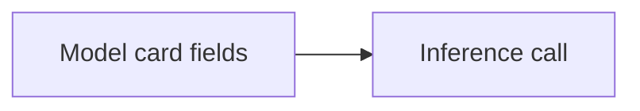

## What you will change

- A model-card line (task, input, output, or size)

## Pass condition

Each line is named with the matching field.

## Sources

- [Machine Learning Glossary](https://developers.google.com/machine-learning/glossary)
````
Create `.run/01-inference.run.xml`:

````xml
<component name="ProjectRunConfigurationManager">
  <configuration default="false" name="01 Inference and a model card" type="AndroidRunConfigurationType" factoryName="Android App">
    <module name="Ai_Lab.app" />
    <option name="ANDROID_RUN_CONFIGURATION_SCHEMA_VERSION" value="1" />
    <option name="DEPLOY" value="true" />
    <option name="MODE" value="specific_activity" />
    <option name="ACTIVITY" value="com.mabrouk.ailab.inference.InferenceLabActivity" />
    <option name="ACTIVITY_CLASS" value="com.mabrouk.ailab.inference.InferenceLabActivity" />
    <method v="2">
      <option name="Android.Gradle.BeforeRunTask" enabled="true" />
    </method>
  </configuration>
</component>
````
- [ ] **Step 4: Run the test to verify it passes**

Run: `./gradlew :lab-inference:testDebugUnitTest --tests com.mabrouk.ailab.inference.InferenceLabTest`

Expected: PASS

- [ ] **Step 5: Commit**

````bash
GIT_AUTHOR_NAME='mohamed_mabrouk' \
GIT_AUTHOR_EMAIL='mabroukmohamed582@gmail.com' \
GIT_COMMITTER_NAME='mohamed_mabrouk' \
GIT_COMMITTER_EMAIL='mabroukmohamed582@gmail.com' \
git commit -m "Add the Inference and a model card lab module."
````
### Task 4: Tensors, shapes, and preprocessing

**Files:**
- Create: `lab-tensors/build.gradle.kts`
- Create: `lab-tensors/src/main/AndroidManifest.xml`
- Create: `lab-tensors/src/main/java/com/mabrouk/ailab/tensors/TensorsLab.kt`
- Create: `lab-tensors/src/main/java/com/mabrouk/ailab/tensors/TensorsLabActivity.kt`
- Create: `lab-tensors/src/main/java/com/mabrouk/ailab/tensors/TensorsLabInitializer.kt`
- Create: `lab-tensors/src/test/java/com/mabrouk/ailab/tensors/TensorsLabTest.kt`
- Create: `lab-tensors/README.md`
- Create: `.run/02-tensors.run.xml`
- Modify: `settings.gradle.kts`
- Modify: `app/build.gradle.kts`

**Interfaces:**
- Consumes: `Lab`, `Track`, `LabRegistry.register`, `LabScreen`, `AiLabTheme`
- Produces: `TensorsLab.lab` with id `tensors` and order `2`

- [ ] **Step 1: Write the failing test**

Create `lab-tensors/src/test/java/com/mabrouk/ailab/tensors/TensorsLabTest.kt`:

````kotlin
package com.mabrouk.ailab.tensors

import org.junit.Assert.assertEquals
import org.junit.Assert.assertTrue
import org.junit.Test

class TensorsLabTest {
    @Test
    fun lab_matchesTheCatalogContract() {
        val lab = TensorsLab.lab
        assertEquals("tensors", lab.id)
        assertEquals(2, lab.order)
        assertTrue(lab.idea.isNotBlank())
        assertTrue(lab.runInputs.isNotEmpty())
        assertTrue(lab.passCondition.isNotBlank())
        assertTrue(lab.sources.all { it.startsWith("https://") })
        assertEquals("com.mabrouk.ailab.tensors.TensorsLabActivity", lab.activityClassName)
    }
}
````
- [ ] **Step 2: Run the test to verify it fails**

Run: `./gradlew :lab-tensors:testDebugUnitTest --tests com.mabrouk.ailab.tensors.TensorsLabTest`

Expected: FAIL because the module or `TensorsLab` does not exist yet.

- [ ] **Step 3: Add the module**

Add `include(":lab-tensors")` to `settings.gradle.kts`.

Add `implementation(project(":lab-tensors"))` to `app/build.gradle.kts`.

Create `lab-tensors/build.gradle.kts`:

````kotlin
plugins {
    alias(libs.plugins.android.library)
    alias(libs.plugins.kotlin.compose)
}

android {
    namespace = "com.mabrouk.ailab.tensors"
    compileSdk {
        version = release(37)
    }
    defaultConfig {
        minSdk = 26
    }
    compileOptions {
        sourceCompatibility = JavaVersion.VERSION_11
        targetCompatibility = JavaVersion.VERSION_11
    }
    buildFeatures {
        compose = true
    }
}

dependencies {
    implementation(project(":lab-api"))
    implementation(platform(libs.androidx.compose.bom))
    implementation(libs.androidx.activity.compose)
    implementation(libs.androidx.compose.material3)
    implementation(libs.androidx.compose.ui)
    implementation(libs.androidx.startup.runtime)
    testImplementation(libs.junit)
}
````
Create `lab-tensors/src/main/AndroidManifest.xml`:

````xml
<?xml version="1.0" encoding="utf-8"?>
<manifest xmlns:android="http://schemas.android.com/apk/res/android"
    xmlns:tools="http://schemas.android.com/tools">
    <application>
        <activity
            android:name=".TensorsLabActivity"
            android:exported="false" />
        <provider
            android:name="androidx.startup.InitializationProvider"
            android:authorities="${applicationId}.androidx-startup"
            android:exported="false"
            tools:node="merge">
            <meta-data
                android:name="com.mabrouk.ailab.tensors.TensorsLabInitializer"
                android:value="androidx.startup" />
        </provider>
    </application>
</manifest>
````
Create `lab-tensors/src/main/java/com/mabrouk/ailab/tensors/TensorsLab.kt`:

````kotlin
package com.mabrouk.ailab.tensors

import com.mabrouk.ailab.lab.Lab
import com.mabrouk.ailab.lab.Track

object TensorsLab {
    val lab = Lab(
        id = "tensors",
        title = "Tensors, shapes, and preprocessing",
        track = Track.Literacy,
        order = 2,
        summary = "Shape and dtype decide whether an input fits a model.",
        idea = "A tensor is an array with a shape and a dtype. A vision model also needs a known scale and channel order before the first inference.",
        prerequisites = listOf("inference"),
        runInputs = listOf(
        "A shape such as 1x224x224x3",
        "A dtype name",
        ),
        passCondition = "The shape's rank and element count match the text.",
        sources = listOf(
        "https://developers.google.com/machine-learning/glossary",
        "https://ai.google.dev/edge/litert/android",
        ),
        activityClassName = "com.mabrouk.ailab.tensors.TensorsLabActivity",
    )
}
````
Create `lab-tensors/src/main/java/com/mabrouk/ailab/tensors/TensorsLabActivity.kt`:

````kotlin
package com.mabrouk.ailab.tensors

import android.os.Bundle
import androidx.activity.ComponentActivity
import androidx.activity.compose.setContent
import androidx.activity.enableEdgeToEdge
import com.mabrouk.ailab.lab.theme.AiLabTheme
import com.mabrouk.ailab.lab.ui.LabScreen

class TensorsLabActivity : ComponentActivity() {
    override fun onCreate(savedInstanceState: Bundle?) {
        super.onCreate(savedInstanceState)
        enableEdgeToEdge()
        setContent {
            AiLabTheme {
                LabScreen(TensorsLab.lab)
            }
        }
    }
}
````
Create `lab-tensors/src/main/java/com/mabrouk/ailab/tensors/TensorsLabInitializer.kt`:

````kotlin
package com.mabrouk.ailab.tensors

import android.content.Context
import androidx.startup.Initializer
import com.mabrouk.ailab.lab.LabRegistry

class TensorsLabInitializer : Initializer<Unit> {
    override fun create(context: Context) {
        LabRegistry.register(TensorsLab.lab)
    }

    override fun dependencies(): List<Class<out Initializer<*>>> = emptyList()
}
````
Create `lab-tensors/README.md`:

````markdown
# Tensors, shapes, and preprocessing

## What this topic is

A tensor is an array with a shape and a dtype. A vision model also needs a known scale and channel order before the first inference.

## Why an Android AI engineer needs it

A wrong shape is the usual reason a first on-device inference fails.

## Diagram

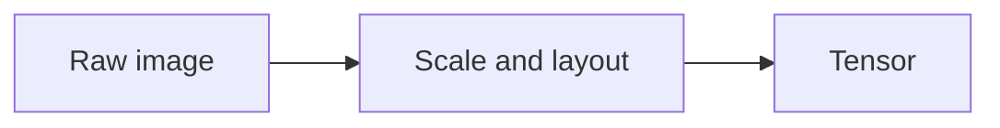

## What you will change

- A shape such as 1x224x224x3
- A dtype name

## Pass condition

The shape's rank and element count match the text.

## Sources

- [Machine Learning Glossary](https://developers.google.com/machine-learning/glossary)
- [LiteRT on Android](https://ai.google.dev/edge/litert/android)
````
Create `.run/02-tensors.run.xml`:

````xml
<component name="ProjectRunConfigurationManager">
  <configuration default="false" name="02 Tensors, shapes, and preprocessing" type="AndroidRunConfigurationType" factoryName="Android App">
    <module name="Ai_Lab.app" />
    <option name="ANDROID_RUN_CONFIGURATION_SCHEMA_VERSION" value="1" />
    <option name="DEPLOY" value="true" />
    <option name="MODE" value="specific_activity" />
    <option name="ACTIVITY" value="com.mabrouk.ailab.tensors.TensorsLabActivity" />
    <option name="ACTIVITY_CLASS" value="com.mabrouk.ailab.tensors.TensorsLabActivity" />
    <method v="2">
      <option name="Android.Gradle.BeforeRunTask" enabled="true" />
    </method>
  </configuration>
</component>
````
- [ ] **Step 4: Run the test to verify it passes**

Run: `./gradlew :lab-tensors:testDebugUnitTest --tests com.mabrouk.ailab.tensors.TensorsLabTest`

Expected: PASS

- [ ] **Step 5: Commit**

````bash
GIT_AUTHOR_NAME='mohamed_mabrouk' \
GIT_AUTHOR_EMAIL='mabroukmohamed582@gmail.com' \
GIT_COMMITTER_NAME='mohamed_mabrouk' \
GIT_COMMITTER_EMAIL='mabroukmohamed582@gmail.com' \
git commit -m "Add the Tensors, shapes, and preprocessing lab module."
````
### Task 5: Tokens

**Files:**
- Create: `lab-tokens/build.gradle.kts`
- Create: `lab-tokens/src/main/AndroidManifest.xml`
- Create: `lab-tokens/src/main/java/com/mabrouk/ailab/tokens/TokensLab.kt`
- Create: `lab-tokens/src/main/java/com/mabrouk/ailab/tokens/TokensLabActivity.kt`
- Create: `lab-tokens/src/main/java/com/mabrouk/ailab/tokens/TokensLabInitializer.kt`
- Create: `lab-tokens/src/test/java/com/mabrouk/ailab/tokens/TokensLabTest.kt`
- Create: `lab-tokens/README.md`
- Create: `.run/03-tokens.run.xml`
- Modify: `settings.gradle.kts`
- Modify: `app/build.gradle.kts`

**Interfaces:**
- Consumes: `Lab`, `Track`, `LabRegistry.register`, `LabScreen`, `AiLabTheme`
- Produces: `TokensLab.lab` with id `tokens` and order `3`

- [ ] **Step 1: Write the failing test**

Create `lab-tokens/src/test/java/com/mabrouk/ailab/tokens/TokensLabTest.kt`:

````kotlin
package com.mabrouk.ailab.tokens

import org.junit.Assert.assertEquals
import org.junit.Assert.assertTrue
import org.junit.Test

class TokensLabTest {
    @Test
    fun lab_matchesTheCatalogContract() {
        val lab = TokensLab.lab
        assertEquals("tokens", lab.id)
        assertEquals(3, lab.order)
        assertTrue(lab.idea.isNotBlank())
        assertTrue(lab.runInputs.isNotEmpty())
        assertTrue(lab.passCondition.isNotBlank())
        assertTrue(lab.sources.all { it.startsWith("https://") })
        assertEquals("com.mabrouk.ailab.tokens.TokensLabActivity", lab.activityClassName)
    }
}
````
- [ ] **Step 2: Run the test to verify it fails**

Run: `./gradlew :lab-tokens:testDebugUnitTest --tests com.mabrouk.ailab.tokens.TokensLabTest`

Expected: FAIL because the module or `TokensLab` does not exist yet.

- [ ] **Step 3: Add the module**

Add `include(":lab-tokens")` to `settings.gradle.kts`.

Add `implementation(project(":lab-tokens"))` to `app/build.gradle.kts`.

Create `lab-tokens/build.gradle.kts`:

````kotlin
plugins {
    alias(libs.plugins.android.library)
    alias(libs.plugins.kotlin.compose)
}

android {
    namespace = "com.mabrouk.ailab.tokens"
    compileSdk {
        version = release(37)
    }
    defaultConfig {
        minSdk = 26
    }
    compileOptions {
        sourceCompatibility = JavaVersion.VERSION_11
        targetCompatibility = JavaVersion.VERSION_11
    }
    buildFeatures {
        compose = true
    }
}

dependencies {
    implementation(project(":lab-api"))
    implementation(platform(libs.androidx.compose.bom))
    implementation(libs.androidx.activity.compose)
    implementation(libs.androidx.compose.material3)
    implementation(libs.androidx.compose.ui)
    implementation(libs.androidx.startup.runtime)
    testImplementation(libs.junit)
}
````
Create `lab-tokens/src/main/AndroidManifest.xml`:

````xml
<?xml version="1.0" encoding="utf-8"?>
<manifest xmlns:android="http://schemas.android.com/apk/res/android"
    xmlns:tools="http://schemas.android.com/tools">
    <application>
        <activity
            android:name=".TokensLabActivity"
            android:exported="false" />
        <provider
            android:name="androidx.startup.InitializationProvider"
            android:authorities="${applicationId}.androidx-startup"
            android:exported="false"
            tools:node="merge">
            <meta-data
                android:name="com.mabrouk.ailab.tokens.TokensLabInitializer"
                android:value="androidx.startup" />
        </provider>
    </application>
</manifest>
````
Create `lab-tokens/src/main/java/com/mabrouk/ailab/tokens/TokensLab.kt`:

````kotlin
package com.mabrouk.ailab.tokens

import com.mabrouk.ailab.lab.Lab
import com.mabrouk.ailab.lab.Track

object TokensLab {
    val lab = Lab(
        id = "tokens",
        title = "Tokens",
        track = Track.Literacy,
        order = 3,
        summary = "Text becomes token ids before a prompt is sent.",
        idea = "A language model reads token ids, not raw characters. The same sentence can produce a different count under a different tokenizer.",
        prerequisites = listOf("tensors"),
        runInputs = listOf(
        "One sentence",
        ),
        passCondition = "The shown token count equals the splitter used by the lab.",
        sources = listOf(
        "https://developers.google.com/machine-learning/glossary",
        "https://developers.google.com/ml-kit/genai/prompt/android",
        ),
        activityClassName = "com.mabrouk.ailab.tokens.TokensLabActivity",
    )
}
````
Create `lab-tokens/src/main/java/com/mabrouk/ailab/tokens/TokensLabActivity.kt`:

````kotlin
package com.mabrouk.ailab.tokens

import android.os.Bundle
import androidx.activity.ComponentActivity
import androidx.activity.compose.setContent
import androidx.activity.enableEdgeToEdge
import com.mabrouk.ailab.lab.theme.AiLabTheme
import com.mabrouk.ailab.lab.ui.LabScreen

class TokensLabActivity : ComponentActivity() {
    override fun onCreate(savedInstanceState: Bundle?) {
        super.onCreate(savedInstanceState)
        enableEdgeToEdge()
        setContent {
            AiLabTheme {
                LabScreen(TokensLab.lab)
            }
        }
    }
}
````
Create `lab-tokens/src/main/java/com/mabrouk/ailab/tokens/TokensLabInitializer.kt`:

````kotlin
package com.mabrouk.ailab.tokens

import android.content.Context
import androidx.startup.Initializer
import com.mabrouk.ailab.lab.LabRegistry

class TokensLabInitializer : Initializer<Unit> {
    override fun create(context: Context) {
        LabRegistry.register(TokensLab.lab)
    }

    override fun dependencies(): List<Class<out Initializer<*>>> = emptyList()
}
````
Create `lab-tokens/README.md`:

````markdown
# Tokens

## What this topic is

A language model reads token ids, not raw characters. The same sentence can produce a different count under a different tokenizer.

## Why an Android AI engineer needs it

Context limits and Prompt API quotas are counted in tokens.

## Diagram

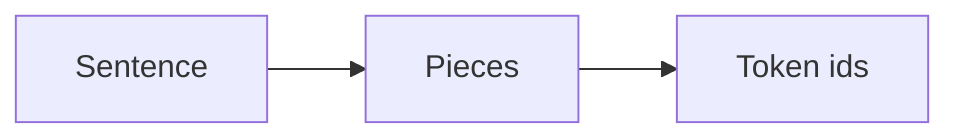

## What you will change

- One sentence

## Pass condition

The shown token count equals the splitter used by the lab.

## Sources

- [Machine Learning Glossary](https://developers.google.com/machine-learning/glossary)
- [Prompt API](https://developers.google.com/ml-kit/genai/prompt/android)
````
Create `.run/03-tokens.run.xml`:

````xml
<component name="ProjectRunConfigurationManager">
  <configuration default="false" name="03 Tokens" type="AndroidRunConfigurationType" factoryName="Android App">
    <module name="Ai_Lab.app" />
    <option name="ANDROID_RUN_CONFIGURATION_SCHEMA_VERSION" value="1" />
    <option name="DEPLOY" value="true" />
    <option name="MODE" value="specific_activity" />
    <option name="ACTIVITY" value="com.mabrouk.ailab.tokens.TokensLabActivity" />
    <option name="ACTIVITY_CLASS" value="com.mabrouk.ailab.tokens.TokensLabActivity" />
    <method v="2">
      <option name="Android.Gradle.BeforeRunTask" enabled="true" />
    </method>
  </configuration>
</component>
````
- [ ] **Step 4: Run the test to verify it passes**

Run: `./gradlew :lab-tokens:testDebugUnitTest --tests com.mabrouk.ailab.tokens.TokensLabTest`

Expected: PASS

- [ ] **Step 5: Commit**

````bash
GIT_AUTHOR_NAME='mohamed_mabrouk' \
GIT_AUTHOR_EMAIL='mabroukmohamed582@gmail.com' \
GIT_COMMITTER_NAME='mohamed_mabrouk' \
GIT_COMMITTER_EMAIL='mabroukmohamed582@gmail.com' \
git commit -m "Add the Tokens lab module."
````
### Task 6: Embeddings and similarity

**Files:**
- Create: `lab-embeddings/build.gradle.kts`
- Create: `lab-embeddings/src/main/AndroidManifest.xml`
- Create: `lab-embeddings/src/main/java/com/mabrouk/ailab/embeddings/EmbeddingsLab.kt`
- Create: `lab-embeddings/src/main/java/com/mabrouk/ailab/embeddings/EmbeddingsLabActivity.kt`
- Create: `lab-embeddings/src/main/java/com/mabrouk/ailab/embeddings/EmbeddingsLabInitializer.kt`
- Create: `lab-embeddings/src/test/java/com/mabrouk/ailab/embeddings/EmbeddingsLabTest.kt`
- Create: `lab-embeddings/README.md`
- Create: `.run/04-embeddings.run.xml`
- Modify: `settings.gradle.kts`
- Modify: `app/build.gradle.kts`

**Interfaces:**
- Consumes: `Lab`, `Track`, `LabRegistry.register`, `LabScreen`, `AiLabTheme`
- Produces: `EmbeddingsLab.lab` with id `embeddings` and order `4`

- [ ] **Step 1: Write the failing test**

Create `lab-embeddings/src/test/java/com/mabrouk/ailab/embeddings/EmbeddingsLabTest.kt`:

````kotlin
package com.mabrouk.ailab.embeddings

import org.junit.Assert.assertEquals
import org.junit.Assert.assertTrue
import org.junit.Test

class EmbeddingsLabTest {
    @Test
    fun lab_matchesTheCatalogContract() {
        val lab = EmbeddingsLab.lab
        assertEquals("embeddings", lab.id)
        assertEquals(4, lab.order)
        assertTrue(lab.idea.isNotBlank())
        assertTrue(lab.runInputs.isNotEmpty())
        assertTrue(lab.passCondition.isNotBlank())
        assertTrue(lab.sources.all { it.startsWith("https://") })
        assertEquals("com.mabrouk.ailab.embeddings.EmbeddingsLabActivity", lab.activityClassName)
    }
}
````
- [ ] **Step 2: Run the test to verify it fails**

Run: `./gradlew :lab-embeddings:testDebugUnitTest --tests com.mabrouk.ailab.embeddings.EmbeddingsLabTest`

Expected: FAIL because the module or `EmbeddingsLab` does not exist yet.

- [ ] **Step 3: Add the module**

Add `include(":lab-embeddings")` to `settings.gradle.kts`.

Add `implementation(project(":lab-embeddings"))` to `app/build.gradle.kts`.

Create `lab-embeddings/build.gradle.kts`:

````kotlin
plugins {
    alias(libs.plugins.android.library)
    alias(libs.plugins.kotlin.compose)
}

android {
    namespace = "com.mabrouk.ailab.embeddings"
    compileSdk {
        version = release(37)
    }
    defaultConfig {
        minSdk = 26
    }
    compileOptions {
        sourceCompatibility = JavaVersion.VERSION_11
        targetCompatibility = JavaVersion.VERSION_11
    }
    buildFeatures {
        compose = true
    }
}

dependencies {
    implementation(project(":lab-api"))
    implementation(platform(libs.androidx.compose.bom))
    implementation(libs.androidx.activity.compose)
    implementation(libs.androidx.compose.material3)
    implementation(libs.androidx.compose.ui)
    implementation(libs.androidx.startup.runtime)
    testImplementation(libs.junit)
}
````
Create `lab-embeddings/src/main/AndroidManifest.xml`:

````xml
<?xml version="1.0" encoding="utf-8"?>
<manifest xmlns:android="http://schemas.android.com/apk/res/android"
    xmlns:tools="http://schemas.android.com/tools">
    <application>
        <activity
            android:name=".EmbeddingsLabActivity"
            android:exported="false" />
        <provider
            android:name="androidx.startup.InitializationProvider"
            android:authorities="${applicationId}.androidx-startup"
            android:exported="false"
            tools:node="merge">
            <meta-data
                android:name="com.mabrouk.ailab.embeddings.EmbeddingsLabInitializer"
                android:value="androidx.startup" />
        </provider>
    </application>
</manifest>
````
Create `lab-embeddings/src/main/java/com/mabrouk/ailab/embeddings/EmbeddingsLab.kt`:

````kotlin
package com.mabrouk.ailab.embeddings

import com.mabrouk.ailab.lab.Lab
import com.mabrouk.ailab.lab.Track

object EmbeddingsLab {
    val lab = Lab(
        id = "embeddings",
        title = "Embeddings and similarity",
        track = Track.Literacy,
        order = 4,
        summary = "Similar items land near each other in vector space.",
        idea = "An embedding is a vector for a piece of text or an image. Cosine similarity ranks which pieces are close.",
        prerequisites = listOf("tokens"),
        runInputs = listOf(
        "First phrase",
        "Second phrase",
        ),
        passCondition = "The higher cosine pair is the pair the lab marks as closer.",
        sources = listOf(
        "https://developers.google.com/machine-learning/crash-course/embeddings/video-lecture",
        ),
        activityClassName = "com.mabrouk.ailab.embeddings.EmbeddingsLabActivity",
    )
}
````
Create `lab-embeddings/src/main/java/com/mabrouk/ailab/embeddings/EmbeddingsLabActivity.kt`:

````kotlin
package com.mabrouk.ailab.embeddings

import android.os.Bundle
import androidx.activity.ComponentActivity
import androidx.activity.compose.setContent
import androidx.activity.enableEdgeToEdge
import com.mabrouk.ailab.lab.theme.AiLabTheme
import com.mabrouk.ailab.lab.ui.LabScreen

class EmbeddingsLabActivity : ComponentActivity() {
    override fun onCreate(savedInstanceState: Bundle?) {
        super.onCreate(savedInstanceState)
        enableEdgeToEdge()
        setContent {
            AiLabTheme {
                LabScreen(EmbeddingsLab.lab)
            }
        }
    }
}
````
Create `lab-embeddings/src/main/java/com/mabrouk/ailab/embeddings/EmbeddingsLabInitializer.kt`:

````kotlin
package com.mabrouk.ailab.embeddings

import android.content.Context
import androidx.startup.Initializer
import com.mabrouk.ailab.lab.LabRegistry

class EmbeddingsLabInitializer : Initializer<Unit> {
    override fun create(context: Context) {
        LabRegistry.register(EmbeddingsLab.lab)
    }

    override fun dependencies(): List<Class<out Initializer<*>>> = emptyList()
}
````
Create `lab-embeddings/README.md`:

````markdown
# Embeddings and similarity

## What this topic is

An embedding is a vector for a piece of text or an image. Cosine similarity ranks which pieces are close.

## Why an Android AI engineer needs it

Retrieval in the RAG labs is a similarity sort over these vectors.

## Diagram

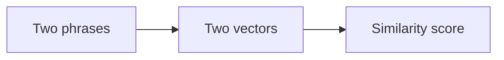

## What you will change

- First phrase
- Second phrase

## Pass condition

The higher cosine pair is the pair the lab marks as closer.

## Sources

- [Embeddings crash course](https://developers.google.com/machine-learning/crash-course/embeddings/video-lecture)
````
Create `.run/04-embeddings.run.xml`:

````xml
<component name="ProjectRunConfigurationManager">
  <configuration default="false" name="04 Embeddings and similarity" type="AndroidRunConfigurationType" factoryName="Android App">
    <module name="Ai_Lab.app" />
    <option name="ANDROID_RUN_CONFIGURATION_SCHEMA_VERSION" value="1" />
    <option name="DEPLOY" value="true" />
    <option name="MODE" value="specific_activity" />
    <option name="ACTIVITY" value="com.mabrouk.ailab.embeddings.EmbeddingsLabActivity" />
    <option name="ACTIVITY_CLASS" value="com.mabrouk.ailab.embeddings.EmbeddingsLabActivity" />
    <method v="2">
      <option name="Android.Gradle.BeforeRunTask" enabled="true" />
    </method>
  </configuration>
</component>
````
- [ ] **Step 4: Run the test to verify it passes**

Run: `./gradlew :lab-embeddings:testDebugUnitTest --tests com.mabrouk.ailab.embeddings.EmbeddingsLabTest`

Expected: PASS

- [ ] **Step 5: Commit**

````bash
GIT_AUTHOR_NAME='mohamed_mabrouk' \
GIT_AUTHOR_EMAIL='mabroukmohamed582@gmail.com' \
GIT_COMMITTER_NAME='mohamed_mabrouk' \
GIT_COMMITTER_EMAIL='mabroukmohamed582@gmail.com' \
git commit -m "Add the Embeddings and similarity lab module."
````
### Task 7: Reading a model output

**Files:**
- Create: `lab-outputs/build.gradle.kts`
- Create: `lab-outputs/src/main/AndroidManifest.xml`
- Create: `lab-outputs/src/main/java/com/mabrouk/ailab/outputs/OutputsLab.kt`
- Create: `lab-outputs/src/main/java/com/mabrouk/ailab/outputs/OutputsLabActivity.kt`
- Create: `lab-outputs/src/main/java/com/mabrouk/ailab/outputs/OutputsLabInitializer.kt`
- Create: `lab-outputs/src/test/java/com/mabrouk/ailab/outputs/OutputsLabTest.kt`
- Create: `lab-outputs/README.md`
- Create: `.run/05-outputs.run.xml`
- Modify: `settings.gradle.kts`
- Modify: `app/build.gradle.kts`

**Interfaces:**
- Consumes: `Lab`, `Track`, `LabRegistry.register`, `LabScreen`, `AiLabTheme`
- Produces: `OutputsLab.lab` with id `outputs` and order `5`

- [ ] **Step 1: Write the failing test**

Create `lab-outputs/src/test/java/com/mabrouk/ailab/outputs/OutputsLabTest.kt`:

````kotlin
package com.mabrouk.ailab.outputs

import org.junit.Assert.assertEquals
import org.junit.Assert.assertTrue
import org.junit.Test

class OutputsLabTest {
    @Test
    fun lab_matchesTheCatalogContract() {
        val lab = OutputsLab.lab
        assertEquals("outputs", lab.id)
        assertEquals(5, lab.order)
        assertTrue(lab.idea.isNotBlank())
        assertTrue(lab.runInputs.isNotEmpty())
        assertTrue(lab.passCondition.isNotBlank())
        assertTrue(lab.sources.all { it.startsWith("https://") })
        assertEquals("com.mabrouk.ailab.outputs.OutputsLabActivity", lab.activityClassName)
    }
}
````
- [ ] **Step 2: Run the test to verify it fails**

Run: `./gradlew :lab-outputs:testDebugUnitTest --tests com.mabrouk.ailab.outputs.OutputsLabTest`

Expected: FAIL because the module or `OutputsLab` does not exist yet.

- [ ] **Step 3: Add the module**

Add `include(":lab-outputs")` to `settings.gradle.kts`.

Add `implementation(project(":lab-outputs"))` to `app/build.gradle.kts`.

Create `lab-outputs/build.gradle.kts`:

````kotlin
plugins {
    alias(libs.plugins.android.library)
    alias(libs.plugins.kotlin.compose)
}

android {
    namespace = "com.mabrouk.ailab.outputs"
    compileSdk {
        version = release(37)
    }
    defaultConfig {
        minSdk = 26
    }
    compileOptions {
        sourceCompatibility = JavaVersion.VERSION_11
        targetCompatibility = JavaVersion.VERSION_11
    }
    buildFeatures {
        compose = true
    }
}

dependencies {
    implementation(project(":lab-api"))
    implementation(platform(libs.androidx.compose.bom))
    implementation(libs.androidx.activity.compose)
    implementation(libs.androidx.compose.material3)
    implementation(libs.androidx.compose.ui)
    implementation(libs.androidx.startup.runtime)
    testImplementation(libs.junit)
}
````
Create `lab-outputs/src/main/AndroidManifest.xml`:

````xml
<?xml version="1.0" encoding="utf-8"?>
<manifest xmlns:android="http://schemas.android.com/apk/res/android"
    xmlns:tools="http://schemas.android.com/tools">
    <application>
        <activity
            android:name=".OutputsLabActivity"
            android:exported="false" />
        <provider
            android:name="androidx.startup.InitializationProvider"
            android:authorities="${applicationId}.androidx-startup"
            android:exported="false"
            tools:node="merge">
            <meta-data
                android:name="com.mabrouk.ailab.outputs.OutputsLabInitializer"
                android:value="androidx.startup" />
        </provider>
    </application>
</manifest>
````
Create `lab-outputs/src/main/java/com/mabrouk/ailab/outputs/OutputsLab.kt`:

````kotlin
package com.mabrouk.ailab.outputs

import com.mabrouk.ailab.lab.Lab
import com.mabrouk.ailab.lab.Track

object OutputsLab {
    val lab = Lab(
        id = "outputs",
        title = "Reading a model output",
        track = Track.Literacy,
        order = 5,
        summary = "Interpret scores and boxes before you show them.",
        idea = "Classifiers return scores, detectors return boxes and labels, and a raw buffer is neither a decision.",
        prerequisites = listOf("embeddings"),
        runInputs = listOf(
        "A score list",
        ),
        passCondition = "The top label is the highest score, and scores below a stated threshold are dropped.",
        sources = listOf(
        "https://developers.google.com/machine-learning/glossary",
        "https://developers.google.com/ml-kit/vision",
        ),
        activityClassName = "com.mabrouk.ailab.outputs.OutputsLabActivity",
    )
}
````
Create `lab-outputs/src/main/java/com/mabrouk/ailab/outputs/OutputsLabActivity.kt`:

````kotlin
package com.mabrouk.ailab.outputs

import android.os.Bundle
import androidx.activity.ComponentActivity
import androidx.activity.compose.setContent
import androidx.activity.enableEdgeToEdge
import com.mabrouk.ailab.lab.theme.AiLabTheme
import com.mabrouk.ailab.lab.ui.LabScreen

class OutputsLabActivity : ComponentActivity() {
    override fun onCreate(savedInstanceState: Bundle?) {
        super.onCreate(savedInstanceState)
        enableEdgeToEdge()
        setContent {
            AiLabTheme {
                LabScreen(OutputsLab.lab)
            }
        }
    }
}
````
Create `lab-outputs/src/main/java/com/mabrouk/ailab/outputs/OutputsLabInitializer.kt`:

````kotlin
package com.mabrouk.ailab.outputs

import android.content.Context
import androidx.startup.Initializer
import com.mabrouk.ailab.lab.LabRegistry

class OutputsLabInitializer : Initializer<Unit> {
    override fun create(context: Context) {
        LabRegistry.register(OutputsLab.lab)
    }

    override fun dependencies(): List<Class<out Initializer<*>>> = emptyList()
}
````
Create `lab-outputs/README.md`:

````markdown
# Reading a model output

## What this topic is

Classifiers return scores, detectors return boxes and labels, and a raw buffer is neither a decision.

## Why an Android AI engineer needs it

The UI should show a decision, and the buffer is not yet a decision.

## Diagram

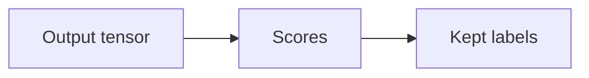

## What you will change

- A score list

## Pass condition

The top label is the highest score, and scores below a stated threshold are dropped.

## Sources

- [Machine Learning Glossary](https://developers.google.com/machine-learning/glossary)
- [ML Kit vision](https://developers.google.com/ml-kit/vision)
````
Create `.run/05-outputs.run.xml`:

````xml
<component name="ProjectRunConfigurationManager">
  <configuration default="false" name="05 Reading a model output" type="AndroidRunConfigurationType" factoryName="Android App">
    <module name="Ai_Lab.app" />
    <option name="ANDROID_RUN_CONFIGURATION_SCHEMA_VERSION" value="1" />
    <option name="DEPLOY" value="true" />
    <option name="MODE" value="specific_activity" />
    <option name="ACTIVITY" value="com.mabrouk.ailab.outputs.OutputsLabActivity" />
    <option name="ACTIVITY_CLASS" value="com.mabrouk.ailab.outputs.OutputsLabActivity" />
    <method v="2">
      <option name="Android.Gradle.BeforeRunTask" enabled="true" />
    </method>
  </configuration>
</component>
````
- [ ] **Step 4: Run the test to verify it passes**

Run: `./gradlew :lab-outputs:testDebugUnitTest --tests com.mabrouk.ailab.outputs.OutputsLabTest`

Expected: PASS

- [ ] **Step 5: Commit**

````bash
GIT_AUTHOR_NAME='mohamed_mabrouk' \
GIT_AUTHOR_EMAIL='mabroukmohamed582@gmail.com' \
GIT_COMMITTER_NAME='mohamed_mabrouk' \
GIT_COMMITTER_EMAIL='mabroukmohamed582@gmail.com' \
git commit -m "Add the Reading a model output lab module."
````
### Task 8: Transformers, intuition

**Files:**
- Create: `lab-transformers/build.gradle.kts`
- Create: `lab-transformers/src/main/AndroidManifest.xml`
- Create: `lab-transformers/src/main/java/com/mabrouk/ailab/transformers/TransformersLab.kt`
- Create: `lab-transformers/src/main/java/com/mabrouk/ailab/transformers/TransformersLabActivity.kt`
- Create: `lab-transformers/src/main/java/com/mabrouk/ailab/transformers/TransformersLabInitializer.kt`
- Create: `lab-transformers/src/test/java/com/mabrouk/ailab/transformers/TransformersLabTest.kt`
- Create: `lab-transformers/README.md`
- Create: `.run/06-transformers.run.xml`
- Modify: `settings.gradle.kts`
- Modify: `app/build.gradle.kts`

**Interfaces:**
- Consumes: `Lab`, `Track`, `LabRegistry.register`, `LabScreen`, `AiLabTheme`
- Produces: `TransformersLab.lab` with id `transformers` and order `6`

- [ ] **Step 1: Write the failing test**

Create `lab-transformers/src/test/java/com/mabrouk/ailab/transformers/TransformersLabTest.kt`:

````kotlin
package com.mabrouk.ailab.transformers

import org.junit.Assert.assertEquals
import org.junit.Assert.assertTrue
import org.junit.Test

class TransformersLabTest {
    @Test
    fun lab_matchesTheCatalogContract() {
        val lab = TransformersLab.lab
        assertEquals("transformers", lab.id)
        assertEquals(6, lab.order)
        assertTrue(lab.idea.isNotBlank())
        assertTrue(lab.runInputs.isNotEmpty())
        assertTrue(lab.passCondition.isNotBlank())
        assertTrue(lab.sources.all { it.startsWith("https://") })
        assertEquals("com.mabrouk.ailab.transformers.TransformersLabActivity", lab.activityClassName)
    }
}
````
- [ ] **Step 2: Run the test to verify it fails**

Run: `./gradlew :lab-transformers:testDebugUnitTest --tests com.mabrouk.ailab.transformers.TransformersLabTest`

Expected: FAIL because the module or `TransformersLab` does not exist yet.

- [ ] **Step 3: Add the module**

Add `include(":lab-transformers")` to `settings.gradle.kts`.

Add `implementation(project(":lab-transformers"))` to `app/build.gradle.kts`.

Create `lab-transformers/build.gradle.kts`:

````kotlin
plugins {
    alias(libs.plugins.android.library)
    alias(libs.plugins.kotlin.compose)
}

android {
    namespace = "com.mabrouk.ailab.transformers"
    compileSdk {
        version = release(37)
    }
    defaultConfig {
        minSdk = 26
    }
    compileOptions {
        sourceCompatibility = JavaVersion.VERSION_11
        targetCompatibility = JavaVersion.VERSION_11
    }
    buildFeatures {
        compose = true
    }
}

dependencies {
    implementation(project(":lab-api"))
    implementation(platform(libs.androidx.compose.bom))
    implementation(libs.androidx.activity.compose)
    implementation(libs.androidx.compose.material3)
    implementation(libs.androidx.compose.ui)
    implementation(libs.androidx.startup.runtime)
    testImplementation(libs.junit)
}
````
Create `lab-transformers/src/main/AndroidManifest.xml`:

````xml
<?xml version="1.0" encoding="utf-8"?>
<manifest xmlns:android="http://schemas.android.com/apk/res/android"
    xmlns:tools="http://schemas.android.com/tools">
    <application>
        <activity
            android:name=".TransformersLabActivity"
            android:exported="false" />
        <provider
            android:name="androidx.startup.InitializationProvider"
            android:authorities="${applicationId}.androidx-startup"
            android:exported="false"
            tools:node="merge">
            <meta-data
                android:name="com.mabrouk.ailab.transformers.TransformersLabInitializer"
                android:value="androidx.startup" />
        </provider>
    </application>
</manifest>
````
Create `lab-transformers/src/main/java/com/mabrouk/ailab/transformers/TransformersLab.kt`:

````kotlin
package com.mabrouk.ailab.transformers

import com.mabrouk.ailab.lab.Lab
import com.mabrouk.ailab.lab.Track

object TransformersLab {
    val lab = Lab(
        id = "transformers",
        title = "Transformers, intuition",
        track = Track.Literacy,
        order = 6,
        summary = "The context window is the text the model can see at once.",
        idea = "Attention lets each token look at the others in the context window. This lab does not train a transformer.",
        prerequisites = listOf("outputs"),
        runInputs = listOf(
        "A short prompt",
        "A window size in tokens",
        ),
        passCondition = "The lab marks the prompt as fitting or overflowing that window.",
        sources = listOf(
        "https://developers.google.com/machine-learning/glossary",
        ),
        activityClassName = "com.mabrouk.ailab.transformers.TransformersLabActivity",
    )
}
````
Create `lab-transformers/src/main/java/com/mabrouk/ailab/transformers/TransformersLabActivity.kt`:

````kotlin
package com.mabrouk.ailab.transformers

import android.os.Bundle
import androidx.activity.ComponentActivity
import androidx.activity.compose.setContent
import androidx.activity.enableEdgeToEdge
import com.mabrouk.ailab.lab.theme.AiLabTheme
import com.mabrouk.ailab.lab.ui.LabScreen

class TransformersLabActivity : ComponentActivity() {
    override fun onCreate(savedInstanceState: Bundle?) {
        super.onCreate(savedInstanceState)
        enableEdgeToEdge()
        setContent {
            AiLabTheme {
                LabScreen(TransformersLab.lab)
            }
        }
    }
}
````
Create `lab-transformers/src/main/java/com/mabrouk/ailab/transformers/TransformersLabInitializer.kt`:

````kotlin
package com.mabrouk.ailab.transformers

import android.content.Context
import androidx.startup.Initializer
import com.mabrouk.ailab.lab.LabRegistry

class TransformersLabInitializer : Initializer<Unit> {
    override fun create(context: Context) {
        LabRegistry.register(TransformersLab.lab)
    }

    override fun dependencies(): List<Class<out Initializer<*>>> = emptyList()
}
````
Create `lab-transformers/README.md`:

````markdown
# Transformers, intuition

## What this topic is

Attention lets each token look at the others in the context window. This lab does not train a transformer.

## Why an Android AI engineer needs it

Gemini Nano and LiteRT LM both refuse a prompt that overflows the window.

## Diagram

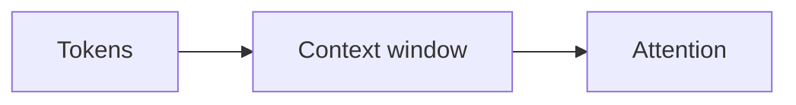

## What you will change

- A short prompt
- A window size in tokens

## Pass condition

The lab marks the prompt as fitting or overflowing that window.

## Sources

- [Machine Learning Glossary](https://developers.google.com/machine-learning/glossary)
````
Create `.run/06-transformers.run.xml`:

````xml
<component name="ProjectRunConfigurationManager">
  <configuration default="false" name="06 Transformers, intuition" type="AndroidRunConfigurationType" factoryName="Android App">
    <module name="Ai_Lab.app" />
    <option name="ANDROID_RUN_CONFIGURATION_SCHEMA_VERSION" value="1" />
    <option name="DEPLOY" value="true" />
    <option name="MODE" value="specific_activity" />
    <option name="ACTIVITY" value="com.mabrouk.ailab.transformers.TransformersLabActivity" />
    <option name="ACTIVITY_CLASS" value="com.mabrouk.ailab.transformers.TransformersLabActivity" />
    <method v="2">
      <option name="Android.Gradle.BeforeRunTask" enabled="true" />
    </method>
  </configuration>
</component>
````
- [ ] **Step 4: Run the test to verify it passes**

Run: `./gradlew :lab-transformers:testDebugUnitTest --tests com.mabrouk.ailab.transformers.TransformersLabTest`

Expected: PASS

- [ ] **Step 5: Commit**

````bash
GIT_AUTHOR_NAME='mohamed_mabrouk' \
GIT_AUTHOR_EMAIL='mabroukmohamed582@gmail.com' \
GIT_COMMITTER_NAME='mohamed_mabrouk' \
GIT_COMMITTER_EMAIL='mabroukmohamed582@gmail.com' \
git commit -m "Add the Transformers, intuition lab module."
````
### Task 9: Prompting and structured output

**Files:**
- Create: `lab-prompting/build.gradle.kts`
- Create: `lab-prompting/src/main/AndroidManifest.xml`
- Create: `lab-prompting/src/main/java/com/mabrouk/ailab/prompting/PromptingLab.kt`
- Create: `lab-prompting/src/main/java/com/mabrouk/ailab/prompting/PromptingLabActivity.kt`
- Create: `lab-prompting/src/main/java/com/mabrouk/ailab/prompting/PromptingLabInitializer.kt`
- Create: `lab-prompting/src/test/java/com/mabrouk/ailab/prompting/PromptingLabTest.kt`
- Create: `lab-prompting/README.md`
- Create: `.run/07-prompting.run.xml`
- Modify: `settings.gradle.kts`
- Modify: `app/build.gradle.kts`

**Interfaces:**
- Consumes: `Lab`, `Track`, `LabRegistry.register`, `LabScreen`, `AiLabTheme`
- Produces: `PromptingLab.lab` with id `prompting` and order `7`

- [ ] **Step 1: Write the failing test**

Create `lab-prompting/src/test/java/com/mabrouk/ailab/prompting/PromptingLabTest.kt`:

````kotlin
package com.mabrouk.ailab.prompting

import org.junit.Assert.assertEquals
import org.junit.Assert.assertTrue
import org.junit.Test

class PromptingLabTest {
    @Test
    fun lab_matchesTheCatalogContract() {
        val lab = PromptingLab.lab
        assertEquals("prompting", lab.id)
        assertEquals(7, lab.order)
        assertTrue(lab.idea.isNotBlank())
        assertTrue(lab.runInputs.isNotEmpty())
        assertTrue(lab.passCondition.isNotBlank())
        assertTrue(lab.sources.all { it.startsWith("https://") })
        assertEquals("com.mabrouk.ailab.prompting.PromptingLabActivity", lab.activityClassName)
    }
}
````
- [ ] **Step 2: Run the test to verify it fails**

Run: `./gradlew :lab-prompting:testDebugUnitTest --tests com.mabrouk.ailab.prompting.PromptingLabTest`

Expected: FAIL because the module or `PromptingLab` does not exist yet.

- [ ] **Step 3: Add the module**

Add `include(":lab-prompting")` to `settings.gradle.kts`.

Add `implementation(project(":lab-prompting"))` to `app/build.gradle.kts`.

Create `lab-prompting/build.gradle.kts`:

````kotlin
plugins {
    alias(libs.plugins.android.library)
    alias(libs.plugins.kotlin.compose)
}

android {
    namespace = "com.mabrouk.ailab.prompting"
    compileSdk {
        version = release(37)
    }
    defaultConfig {
        minSdk = 26
    }
    compileOptions {
        sourceCompatibility = JavaVersion.VERSION_11
        targetCompatibility = JavaVersion.VERSION_11
    }
    buildFeatures {
        compose = true
    }
}

dependencies {
    implementation(project(":lab-api"))
    implementation(platform(libs.androidx.compose.bom))
    implementation(libs.androidx.activity.compose)
    implementation(libs.androidx.compose.material3)
    implementation(libs.androidx.compose.ui)
    implementation(libs.androidx.startup.runtime)
    testImplementation(libs.junit)
}
````
Create `lab-prompting/src/main/AndroidManifest.xml`:

````xml
<?xml version="1.0" encoding="utf-8"?>
<manifest xmlns:android="http://schemas.android.com/apk/res/android"
    xmlns:tools="http://schemas.android.com/tools">
    <application>
        <activity
            android:name=".PromptingLabActivity"
            android:exported="false" />
        <provider
            android:name="androidx.startup.InitializationProvider"
            android:authorities="${applicationId}.androidx-startup"
            android:exported="false"
            tools:node="merge">
            <meta-data
                android:name="com.mabrouk.ailab.prompting.PromptingLabInitializer"
                android:value="androidx.startup" />
        </provider>
    </application>
</manifest>
````
Create `lab-prompting/src/main/java/com/mabrouk/ailab/prompting/PromptingLab.kt`:

````kotlin
package com.mabrouk.ailab.prompting

import com.mabrouk.ailab.lab.Lab
import com.mabrouk.ailab.lab.Track

object PromptingLab {
    val lab = Lab(
        id = "prompting",
        title = "Prompting and structured output",
        track = Track.Literacy,
        order = 7,
        summary = "Ask for a shape, not only a paragraph.",
        idea = "An instruction, a few examples, and a requested shape change the answer. A typed shape is a contract the app can store.",
        prerequisites = listOf("transformers"),
        runInputs = listOf(
        "One instruction",
        "A field name the answer must contain",
        ),
        passCondition = "The drafted prompt contains the instruction and the field name.",
        sources = listOf(
        "https://developers.google.com/ml-kit/genai/prompt/android",
        "https://developers.google.com/ml-kit/genai/prompt/android/structured-output",
        ),
        activityClassName = "com.mabrouk.ailab.prompting.PromptingLabActivity",
    )
}
````
Create `lab-prompting/src/main/java/com/mabrouk/ailab/prompting/PromptingLabActivity.kt`:

````kotlin
package com.mabrouk.ailab.prompting

import android.os.Bundle
import androidx.activity.ComponentActivity
import androidx.activity.compose.setContent
import androidx.activity.enableEdgeToEdge
import com.mabrouk.ailab.lab.theme.AiLabTheme
import com.mabrouk.ailab.lab.ui.LabScreen

class PromptingLabActivity : ComponentActivity() {
    override fun onCreate(savedInstanceState: Bundle?) {
        super.onCreate(savedInstanceState)
        enableEdgeToEdge()
        setContent {
            AiLabTheme {
                LabScreen(PromptingLab.lab)
            }
        }
    }
}
````
Create `lab-prompting/src/main/java/com/mabrouk/ailab/prompting/PromptingLabInitializer.kt`:

````kotlin
package com.mabrouk.ailab.prompting

import android.content.Context
import androidx.startup.Initializer
import com.mabrouk.ailab.lab.LabRegistry

class PromptingLabInitializer : Initializer<Unit> {
    override fun create(context: Context) {
        LabRegistry.register(PromptingLab.lab)
    }

    override fun dependencies(): List<Class<out Initializer<*>>> = emptyList()
}
````
Create `lab-prompting/README.md`:

````markdown
# Prompting and structured output

## What this topic is

An instruction, a few examples, and a requested shape change the answer. A typed shape is a contract the app can store.

## Why an Android AI engineer needs it

An Android app stores fields. A paragraph has to be parsed before it can be stored.

## Diagram

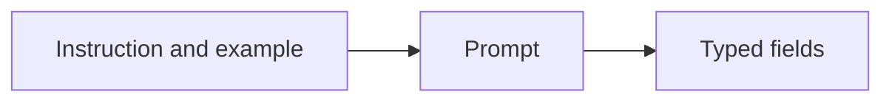

## What you will change

- One instruction
- A field name the answer must contain

## Pass condition

The drafted prompt contains the instruction and the field name.

## Sources

- [Prompt API](https://developers.google.com/ml-kit/genai/prompt/android)
- [Structured output](https://developers.google.com/ml-kit/genai/prompt/android/structured-output)
````
Create `.run/07-prompting.run.xml`:

````xml
<component name="ProjectRunConfigurationManager">
  <configuration default="false" name="07 Prompting and structured output" type="AndroidRunConfigurationType" factoryName="Android App">
    <module name="Ai_Lab.app" />
    <option name="ANDROID_RUN_CONFIGURATION_SCHEMA_VERSION" value="1" />
    <option name="DEPLOY" value="true" />
    <option name="MODE" value="specific_activity" />
    <option name="ACTIVITY" value="com.mabrouk.ailab.prompting.PromptingLabActivity" />
    <option name="ACTIVITY_CLASS" value="com.mabrouk.ailab.prompting.PromptingLabActivity" />
    <method v="2">
      <option name="Android.Gradle.BeforeRunTask" enabled="true" />
    </method>
  </configuration>
</component>
````
- [ ] **Step 4: Run the test to verify it passes**

Run: `./gradlew :lab-prompting:testDebugUnitTest --tests com.mabrouk.ailab.prompting.PromptingLabTest`

Expected: PASS

- [ ] **Step 5: Commit**

````bash
GIT_AUTHOR_NAME='mohamed_mabrouk' \
GIT_AUTHOR_EMAIL='mabroukmohamed582@gmail.com' \
GIT_COMMITTER_NAME='mohamed_mabrouk' \
GIT_COMMITTER_EMAIL='mabroukmohamed582@gmail.com' \
git commit -m "Add the Prompting and structured output lab module."
````
### Task 10: RAG

**Files:**
- Create: `lab-rag/build.gradle.kts`
- Create: `lab-rag/src/main/AndroidManifest.xml`
- Create: `lab-rag/src/main/java/com/mabrouk/ailab/rag/RagLab.kt`
- Create: `lab-rag/src/main/java/com/mabrouk/ailab/rag/RagLabActivity.kt`
- Create: `lab-rag/src/main/java/com/mabrouk/ailab/rag/RagLabInitializer.kt`
- Create: `lab-rag/src/test/java/com/mabrouk/ailab/rag/RagLabTest.kt`
- Create: `lab-rag/README.md`
- Create: `.run/08-rag.run.xml`
- Modify: `settings.gradle.kts`
- Modify: `app/build.gradle.kts`

**Interfaces:**
- Consumes: `Lab`, `Track`, `LabRegistry.register`, `LabScreen`, `AiLabTheme`
- Produces: `RagLab.lab` with id `rag` and order `8`

- [ ] **Step 1: Write the failing test**

Create `lab-rag/src/test/java/com/mabrouk/ailab/rag/RagLabTest.kt`:

````kotlin
package com.mabrouk.ailab.rag

import org.junit.Assert.assertEquals
import org.junit.Assert.assertTrue
import org.junit.Test

class RagLabTest {
    @Test
    fun lab_matchesTheCatalogContract() {
        val lab = RagLab.lab
        assertEquals("rag", lab.id)
        assertEquals(8, lab.order)
        assertTrue(lab.idea.isNotBlank())
        assertTrue(lab.runInputs.isNotEmpty())
        assertTrue(lab.passCondition.isNotBlank())
        assertTrue(lab.sources.all { it.startsWith("https://") })
        assertEquals("com.mabrouk.ailab.rag.RagLabActivity", lab.activityClassName)
    }
}
````
- [ ] **Step 2: Run the test to verify it fails**

Run: `./gradlew :lab-rag:testDebugUnitTest --tests com.mabrouk.ailab.rag.RagLabTest`

Expected: FAIL because the module or `RagLab` does not exist yet.

- [ ] **Step 3: Add the module**

Add `include(":lab-rag")` to `settings.gradle.kts`.

Add `implementation(project(":lab-rag"))` to `app/build.gradle.kts`.

Create `lab-rag/build.gradle.kts`:

````kotlin
plugins {
    alias(libs.plugins.android.library)
    alias(libs.plugins.kotlin.compose)
}

android {
    namespace = "com.mabrouk.ailab.rag"
    compileSdk {
        version = release(37)
    }
    defaultConfig {
        minSdk = 26
    }
    compileOptions {
        sourceCompatibility = JavaVersion.VERSION_11
        targetCompatibility = JavaVersion.VERSION_11
    }
    buildFeatures {
        compose = true
    }
}

dependencies {
    implementation(project(":lab-api"))
    implementation(platform(libs.androidx.compose.bom))
    implementation(libs.androidx.activity.compose)
    implementation(libs.androidx.compose.material3)
    implementation(libs.androidx.compose.ui)
    implementation(libs.androidx.startup.runtime)
    testImplementation(libs.junit)
}
````
Create `lab-rag/src/main/AndroidManifest.xml`:

````xml
<?xml version="1.0" encoding="utf-8"?>
<manifest xmlns:android="http://schemas.android.com/apk/res/android"
    xmlns:tools="http://schemas.android.com/tools">
    <application>
        <activity
            android:name=".RagLabActivity"
            android:exported="false" />
        <provider
            android:name="androidx.startup.InitializationProvider"
            android:authorities="${applicationId}.androidx-startup"
            android:exported="false"
            tools:node="merge">
            <meta-data
                android:name="com.mabrouk.ailab.rag.RagLabInitializer"
                android:value="androidx.startup" />
        </provider>
    </application>
</manifest>
````
Create `lab-rag/src/main/java/com/mabrouk/ailab/rag/RagLab.kt`:

````kotlin
package com.mabrouk.ailab.rag

import com.mabrouk.ailab.lab.Lab
import com.mabrouk.ailab.lab.Track

object RagLab {
    val lab = Lab(
        id = "rag",
        title = "RAG",
        track = Track.Literacy,
        order = 8,
        summary = "The answer has to point at retrieved text.",
        idea = "Split notes into chunks, embed the chunks, retrieve the closest ones, and answer from those chunks.",
        prerequisites = listOf("prompting", "embeddings"),
        runInputs = listOf(
        "Note 1",
        "Note 2",
        "Note 3",
        "Question",
        ),
        passCondition = "The retrieved note is the one that shares the question's terms, and the answer quotes it.",
        sources = listOf(
        "https://cloud.google.com/vertex-ai/generative-ai/docs/rag-overview",
        ),
        activityClassName = "com.mabrouk.ailab.rag.RagLabActivity",
    )
}
````
Create `lab-rag/src/main/java/com/mabrouk/ailab/rag/RagLabActivity.kt`:

````kotlin
package com.mabrouk.ailab.rag

import android.os.Bundle
import androidx.activity.ComponentActivity
import androidx.activity.compose.setContent
import androidx.activity.enableEdgeToEdge
import com.mabrouk.ailab.lab.theme.AiLabTheme
import com.mabrouk.ailab.lab.ui.LabScreen

class RagLabActivity : ComponentActivity() {
    override fun onCreate(savedInstanceState: Bundle?) {
        super.onCreate(savedInstanceState)
        enableEdgeToEdge()
        setContent {
            AiLabTheme {
                LabScreen(RagLab.lab)
            }
        }
    }
}
````
Create `lab-rag/src/main/java/com/mabrouk/ailab/rag/RagLabInitializer.kt`:

````kotlin
package com.mabrouk.ailab.rag

import android.content.Context
import androidx.startup.Initializer
import com.mabrouk.ailab.lab.LabRegistry

class RagLabInitializer : Initializer<Unit> {
    override fun create(context: Context) {
        LabRegistry.register(RagLab.lab)
    }

    override fun dependencies(): List<Class<out Initializer<*>>> = emptyList()
}
````
Create `lab-rag/README.md`:

````markdown
# RAG

## What this topic is

Split notes into chunks, embed the chunks, retrieve the closest ones, and answer from those chunks.

## Why an Android AI engineer needs it

This is the pattern the on-device RAG lab runs on the phone.

## Diagram

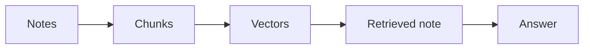

## What you will change

- Note 1
- Note 2
- Note 3
- Question

## Pass condition

The retrieved note is the one that shares the question's terms, and the answer quotes it.

## Sources

- [Retrieval-augmented generation](https://cloud.google.com/vertex-ai/generative-ai/docs/rag-overview)
````
Create `.run/08-rag.run.xml`:

````xml
<component name="ProjectRunConfigurationManager">
  <configuration default="false" name="08 RAG" type="AndroidRunConfigurationType" factoryName="Android App">
    <module name="Ai_Lab.app" />
    <option name="ANDROID_RUN_CONFIGURATION_SCHEMA_VERSION" value="1" />
    <option name="DEPLOY" value="true" />
    <option name="MODE" value="specific_activity" />
    <option name="ACTIVITY" value="com.mabrouk.ailab.rag.RagLabActivity" />
    <option name="ACTIVITY_CLASS" value="com.mabrouk.ailab.rag.RagLabActivity" />
    <method v="2">
      <option name="Android.Gradle.BeforeRunTask" enabled="true" />
    </method>
  </configuration>
</component>
````
- [ ] **Step 4: Run the test to verify it passes**

Run: `./gradlew :lab-rag:testDebugUnitTest --tests com.mabrouk.ailab.rag.RagLabTest`

Expected: PASS

- [ ] **Step 5: Commit**

````bash
GIT_AUTHOR_NAME='mohamed_mabrouk' \
GIT_AUTHOR_EMAIL='mabroukmohamed582@gmail.com' \
GIT_COMMITTER_NAME='mohamed_mabrouk' \
GIT_COMMITTER_EMAIL='mabroukmohamed582@gmail.com' \
git commit -m "Add the RAG lab module."
````
### Task 11: Tools and a small agent loop

**Files:**
- Create: `lab-agents/build.gradle.kts`
- Create: `lab-agents/src/main/AndroidManifest.xml`
- Create: `lab-agents/src/main/java/com/mabrouk/ailab/agents/AgentsLab.kt`
- Create: `lab-agents/src/main/java/com/mabrouk/ailab/agents/AgentsLabActivity.kt`
- Create: `lab-agents/src/main/java/com/mabrouk/ailab/agents/AgentsLabInitializer.kt`
- Create: `lab-agents/src/test/java/com/mabrouk/ailab/agents/AgentsLabTest.kt`
- Create: `lab-agents/README.md`
- Create: `.run/09-agents.run.xml`
- Modify: `settings.gradle.kts`
- Modify: `app/build.gradle.kts`

**Interfaces:**
- Consumes: `Lab`, `Track`, `LabRegistry.register`, `LabScreen`, `AiLabTheme`
- Produces: `AgentsLab.lab` with id `agents` and order `9`

- [ ] **Step 1: Write the failing test**

Create `lab-agents/src/test/java/com/mabrouk/ailab/agents/AgentsLabTest.kt`:

````kotlin
package com.mabrouk.ailab.agents

import org.junit.Assert.assertEquals
import org.junit.Assert.assertTrue
import org.junit.Test

class AgentsLabTest {
    @Test
    fun lab_matchesTheCatalogContract() {
        val lab = AgentsLab.lab
        assertEquals("agents", lab.id)
        assertEquals(9, lab.order)
        assertTrue(lab.idea.isNotBlank())
        assertTrue(lab.runInputs.isNotEmpty())
        assertTrue(lab.passCondition.isNotBlank())
        assertTrue(lab.sources.all { it.startsWith("https://") })
        assertEquals("com.mabrouk.ailab.agents.AgentsLabActivity", lab.activityClassName)
    }
}
````
- [ ] **Step 2: Run the test to verify it fails**

Run: `./gradlew :lab-agents:testDebugUnitTest --tests com.mabrouk.ailab.agents.AgentsLabTest`

Expected: FAIL because the module or `AgentsLab` does not exist yet.

- [ ] **Step 3: Add the module**

Add `include(":lab-agents")` to `settings.gradle.kts`.

Add `implementation(project(":lab-agents"))` to `app/build.gradle.kts`.

Create `lab-agents/build.gradle.kts`:

````kotlin
plugins {
    alias(libs.plugins.android.library)
    alias(libs.plugins.kotlin.compose)
}

android {
    namespace = "com.mabrouk.ailab.agents"
    compileSdk {
        version = release(37)
    }
    defaultConfig {
        minSdk = 26
    }
    compileOptions {
        sourceCompatibility = JavaVersion.VERSION_11
        targetCompatibility = JavaVersion.VERSION_11
    }
    buildFeatures {
        compose = true
    }
}

dependencies {
    implementation(project(":lab-api"))
    implementation(platform(libs.androidx.compose.bom))
    implementation(libs.androidx.activity.compose)
    implementation(libs.androidx.compose.material3)
    implementation(libs.androidx.compose.ui)
    implementation(libs.androidx.startup.runtime)
    testImplementation(libs.junit)
}
````
Create `lab-agents/src/main/AndroidManifest.xml`:

````xml
<?xml version="1.0" encoding="utf-8"?>
<manifest xmlns:android="http://schemas.android.com/apk/res/android"
    xmlns:tools="http://schemas.android.com/tools">
    <application>
        <activity
            android:name=".AgentsLabActivity"
            android:exported="false" />
        <provider
            android:name="androidx.startup.InitializationProvider"
            android:authorities="${applicationId}.androidx-startup"
            android:exported="false"
            tools:node="merge">
            <meta-data
                android:name="com.mabrouk.ailab.agents.AgentsLabInitializer"
                android:value="androidx.startup" />
        </provider>
    </application>
</manifest>
````
Create `lab-agents/src/main/java/com/mabrouk/ailab/agents/AgentsLab.kt`:

````kotlin
package com.mabrouk.ailab.agents

import com.mabrouk.ailab.lab.Lab
import com.mabrouk.ailab.lab.Track

object AgentsLab {
    val lab = Lab(
        id = "agents",
        title = "Tools and a small agent loop",
        track = Track.Literacy,
        order = 9,
        summary = "The app runs the tool. The model only requests it.",
        idea = "The model chooses a tool, the app runs it, and the tool result goes back into the next turn.",
        prerequisites = listOf("rag"),
        runInputs = listOf(
        "A question that needs one arithmetic tool",
        ),
        passCondition = "The loop calls the tool once and the final text contains the tool result.",
        sources = listOf(
        "https://developers.google.com/ml-kit/genai",
        ),
        activityClassName = "com.mabrouk.ailab.agents.AgentsLabActivity",
    )
}
````
Create `lab-agents/src/main/java/com/mabrouk/ailab/agents/AgentsLabActivity.kt`:

````kotlin
package com.mabrouk.ailab.agents

import android.os.Bundle
import androidx.activity.ComponentActivity
import androidx.activity.compose.setContent
import androidx.activity.enableEdgeToEdge
import com.mabrouk.ailab.lab.theme.AiLabTheme
import com.mabrouk.ailab.lab.ui.LabScreen

class AgentsLabActivity : ComponentActivity() {
    override fun onCreate(savedInstanceState: Bundle?) {
        super.onCreate(savedInstanceState)
        enableEdgeToEdge()
        setContent {
            AiLabTheme {
                LabScreen(AgentsLab.lab)
            }
        }
    }
}
````
Create `lab-agents/src/main/java/com/mabrouk/ailab/agents/AgentsLabInitializer.kt`:

````kotlin
package com.mabrouk.ailab.agents

import android.content.Context
import androidx.startup.Initializer
import com.mabrouk.ailab.lab.LabRegistry

class AgentsLabInitializer : Initializer<Unit> {
    override fun create(context: Context) {
        LabRegistry.register(AgentsLab.lab)
    }

    override fun dependencies(): List<Class<out Initializer<*>>> = emptyList()
}
````
Create `lab-agents/README.md`:

````markdown
# Tools and a small agent loop

## What this topic is

The model chooses a tool, the app runs it, and the tool result goes back into the next turn.

## Why an Android AI engineer needs it

AppFunctions is this loop, with the phone as the tool runner.

## Diagram

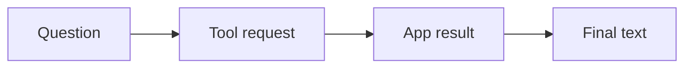

## What you will change

- A question that needs one arithmetic tool

## Pass condition

The loop calls the tool once and the final text contains the tool result.

## Sources

- [ML Kit GenAI overview](https://developers.google.com/ml-kit/genai)
````
Create `.run/09-agents.run.xml`:

````xml
<component name="ProjectRunConfigurationManager">
  <configuration default="false" name="09 Tools and a small agent loop" type="AndroidRunConfigurationType" factoryName="Android App">
    <module name="Ai_Lab.app" />
    <option name="ANDROID_RUN_CONFIGURATION_SCHEMA_VERSION" value="1" />
    <option name="DEPLOY" value="true" />
    <option name="MODE" value="specific_activity" />
    <option name="ACTIVITY" value="com.mabrouk.ailab.agents.AgentsLabActivity" />
    <option name="ACTIVITY_CLASS" value="com.mabrouk.ailab.agents.AgentsLabActivity" />
    <method v="2">
      <option name="Android.Gradle.BeforeRunTask" enabled="true" />
    </method>
  </configuration>
</component>
````
- [ ] **Step 4: Run the test to verify it passes**

Run: `./gradlew :lab-agents:testDebugUnitTest --tests com.mabrouk.ailab.agents.AgentsLabTest`

Expected: PASS

- [ ] **Step 5: Commit**

````bash
GIT_AUTHOR_NAME='mohamed_mabrouk' \
GIT_AUTHOR_EMAIL='mabroukmohamed582@gmail.com' \
GIT_COMMITTER_NAME='mohamed_mabrouk' \
GIT_COMMITTER_EMAIL='mabroukmohamed582@gmail.com' \
git commit -m "Add the Tools and a small agent loop lab module."
````
### Task 12: Evaluation

**Files:**
- Create: `lab-evaluation/build.gradle.kts`
- Create: `lab-evaluation/src/main/AndroidManifest.xml`
- Create: `lab-evaluation/src/main/java/com/mabrouk/ailab/evaluation/EvaluationLab.kt`
- Create: `lab-evaluation/src/main/java/com/mabrouk/ailab/evaluation/EvaluationLabActivity.kt`
- Create: `lab-evaluation/src/main/java/com/mabrouk/ailab/evaluation/EvaluationLabInitializer.kt`
- Create: `lab-evaluation/src/test/java/com/mabrouk/ailab/evaluation/EvaluationLabTest.kt`
- Create: `lab-evaluation/README.md`
- Create: `.run/10-evaluation.run.xml`
- Modify: `settings.gradle.kts`
- Modify: `app/build.gradle.kts`

**Interfaces:**
- Consumes: `Lab`, `Track`, `LabRegistry.register`, `LabScreen`, `AiLabTheme`
- Produces: `EvaluationLab.lab` with id `evaluation` and order `10`

- [ ] **Step 1: Write the failing test**

Create `lab-evaluation/src/test/java/com/mabrouk/ailab/evaluation/EvaluationLabTest.kt`:

````kotlin
package com.mabrouk.ailab.evaluation

import org.junit.Assert.assertEquals
import org.junit.Assert.assertTrue
import org.junit.Test

class EvaluationLabTest {
    @Test
    fun lab_matchesTheCatalogContract() {
        val lab = EvaluationLab.lab
        assertEquals("evaluation", lab.id)
        assertEquals(10, lab.order)
        assertTrue(lab.idea.isNotBlank())
        assertTrue(lab.runInputs.isNotEmpty())
        assertTrue(lab.passCondition.isNotBlank())
        assertTrue(lab.sources.all { it.startsWith("https://") })
        assertEquals("com.mabrouk.ailab.evaluation.EvaluationLabActivity", lab.activityClassName)
    }
}
````
- [ ] **Step 2: Run the test to verify it fails**

Run: `./gradlew :lab-evaluation:testDebugUnitTest --tests com.mabrouk.ailab.evaluation.EvaluationLabTest`

Expected: FAIL because the module or `EvaluationLab` does not exist yet.

- [ ] **Step 3: Add the module**

Add `include(":lab-evaluation")` to `settings.gradle.kts`.

Add `implementation(project(":lab-evaluation"))` to `app/build.gradle.kts`.

Create `lab-evaluation/build.gradle.kts`:

````kotlin
plugins {
    alias(libs.plugins.android.library)
    alias(libs.plugins.kotlin.compose)
}

android {
    namespace = "com.mabrouk.ailab.evaluation"
    compileSdk {
        version = release(37)
    }
    defaultConfig {
        minSdk = 26
    }
    compileOptions {
        sourceCompatibility = JavaVersion.VERSION_11
        targetCompatibility = JavaVersion.VERSION_11
    }
    buildFeatures {
        compose = true
    }
}

dependencies {
    implementation(project(":lab-api"))
    implementation(platform(libs.androidx.compose.bom))
    implementation(libs.androidx.activity.compose)
    implementation(libs.androidx.compose.material3)
    implementation(libs.androidx.compose.ui)
    implementation(libs.androidx.startup.runtime)
    testImplementation(libs.junit)
}
````
Create `lab-evaluation/src/main/AndroidManifest.xml`:

````xml
<?xml version="1.0" encoding="utf-8"?>
<manifest xmlns:android="http://schemas.android.com/apk/res/android"
    xmlns:tools="http://schemas.android.com/tools">
    <application>
        <activity
            android:name=".EvaluationLabActivity"
            android:exported="false" />
        <provider
            android:name="androidx.startup.InitializationProvider"
            android:authorities="${applicationId}.androidx-startup"
            android:exported="false"
            tools:node="merge">
            <meta-data
                android:name="com.mabrouk.ailab.evaluation.EvaluationLabInitializer"
                android:value="androidx.startup" />
        </provider>
    </application>
</manifest>
````
Create `lab-evaluation/src/main/java/com/mabrouk/ailab/evaluation/EvaluationLab.kt`:

````kotlin
package com.mabrouk.ailab.evaluation

import com.mabrouk.ailab.lab.Lab
import com.mabrouk.ailab.lab.Track

object EvaluationLab {
    val lab = Lab(
        id = "evaluation",
        title = "Evaluation",
        track = Track.Literacy,
        order = 10,
        summary = "Keep a golden set before you trust a prompt.",
        idea = "A golden set of questions with known answers shows whether a change helped. Track retrieval hits and wrong answers separately.",
        prerequisites = listOf("agents"),
        runInputs = listOf(
        "Expected answer 1",
        "Expected answer 2",
        "Expected answer 3",
        "Actual answer 1",
        "Actual answer 2",
        "Actual answer 3",
        ),
        passCondition = "The score equals the number of exact matches.",
        sources = listOf(
        "https://developers.google.com/ml-kit/genai",
        ),
        activityClassName = "com.mabrouk.ailab.evaluation.EvaluationLabActivity",
    )
}
````
Create `lab-evaluation/src/main/java/com/mabrouk/ailab/evaluation/EvaluationLabActivity.kt`:

````kotlin
package com.mabrouk.ailab.evaluation

import android.os.Bundle
import androidx.activity.ComponentActivity
import androidx.activity.compose.setContent
import androidx.activity.enableEdgeToEdge
import com.mabrouk.ailab.lab.theme.AiLabTheme
import com.mabrouk.ailab.lab.ui.LabScreen

class EvaluationLabActivity : ComponentActivity() {
    override fun onCreate(savedInstanceState: Bundle?) {
        super.onCreate(savedInstanceState)
        enableEdgeToEdge()
        setContent {
            AiLabTheme {
                LabScreen(EvaluationLab.lab)
            }
        }
    }
}
````
Create `lab-evaluation/src/main/java/com/mabrouk/ailab/evaluation/EvaluationLabInitializer.kt`:

````kotlin
package com.mabrouk.ailab.evaluation

import android.content.Context
import androidx.startup.Initializer
import com.mabrouk.ailab.lab.LabRegistry

class EvaluationLabInitializer : Initializer<Unit> {
    override fun create(context: Context) {
        LabRegistry.register(EvaluationLab.lab)
    }

    override fun dependencies(): List<Class<out Initializer<*>>> = emptyList()
}
````
Create `lab-evaluation/README.md`:

````markdown
# Evaluation

## What this topic is

A golden set of questions with known answers shows whether a change helped. Track retrieval hits and wrong answers separately.

## Why an Android AI engineer needs it

A prompt change on Gemini Nano can look better and still miss the golden answers.

## Diagram


## What you will change

- Expected answer 1
- Expected answer 2
- Expected answer 3
- Actual answer 1
- Actual answer 2
- Actual answer 3

## Pass condition

The score equals the number of exact matches.

## Sources

- [ML Kit GenAI overview](https://developers.google.com/ml-kit/genai)
````
Create `.run/10-evaluation.run.xml`:

````xml
<component name="ProjectRunConfigurationManager">
  <configuration default="false" name="10 Evaluation" type="AndroidRunConfigurationType" factoryName="Android App">
    <module name="Ai_Lab.app" />
    <option name="ANDROID_RUN_CONFIGURATION_SCHEMA_VERSION" value="1" />
    <option name="DEPLOY" value="true" />
    <option name="MODE" value="specific_activity" />
    <option name="ACTIVITY" value="com.mabrouk.ailab.evaluation.EvaluationLabActivity" />
    <option name="ACTIVITY_CLASS" value="com.mabrouk.ailab.evaluation.EvaluationLabActivity" />
    <method v="2">
      <option name="Android.Gradle.BeforeRunTask" enabled="true" />
    </method>
  </configuration>
</component>
````
- [ ] **Step 4: Run the test to verify it passes**

Run: `./gradlew :lab-evaluation:testDebugUnitTest --tests com.mabrouk.ailab.evaluation.EvaluationLabTest`

Expected: PASS

- [ ] **Step 5: Commit**

````bash
GIT_AUTHOR_NAME='mohamed_mabrouk' \
GIT_AUTHOR_EMAIL='mabroukmohamed582@gmail.com' \
GIT_COMMITTER_NAME='mohamed_mabrouk' \
GIT_COMMITTER_EMAIL='mabroukmohamed582@gmail.com' \
git commit -m "Add the Evaluation lab module."
````
### Task 13: Quantization, latency, memory, and battery

**Files:**
- Create: `lab-quantization/build.gradle.kts`
- Create: `lab-quantization/src/main/AndroidManifest.xml`
- Create: `lab-quantization/src/main/java/com/mabrouk/ailab/quantization/QuantizationLab.kt`
- Create: `lab-quantization/src/main/java/com/mabrouk/ailab/quantization/QuantizationLabActivity.kt`
- Create: `lab-quantization/src/main/java/com/mabrouk/ailab/quantization/QuantizationLabInitializer.kt`
- Create: `lab-quantization/src/test/java/com/mabrouk/ailab/quantization/QuantizationLabTest.kt`
- Create: `lab-quantization/README.md`
- Create: `.run/11-quantization.run.xml`
- Modify: `settings.gradle.kts`
- Modify: `app/build.gradle.kts`

**Interfaces:**
- Consumes: `Lab`, `Track`, `LabRegistry.register`, `LabScreen`, `AiLabTheme`
- Produces: `QuantizationLab.lab` with id `quantization` and order `11`

- [ ] **Step 1: Write the failing test**

Create `lab-quantization/src/test/java/com/mabrouk/ailab/quantization/QuantizationLabTest.kt`:

````kotlin
package com.mabrouk.ailab.quantization

import org.junit.Assert.assertEquals
import org.junit.Assert.assertTrue
import org.junit.Test

class QuantizationLabTest {
    @Test
    fun lab_matchesTheCatalogContract() {
        val lab = QuantizationLab.lab
        assertEquals("quantization", lab.id)
        assertEquals(11, lab.order)
        assertTrue(lab.idea.isNotBlank())
        assertTrue(lab.runInputs.isNotEmpty())
        assertTrue(lab.passCondition.isNotBlank())
        assertTrue(lab.sources.all { it.startsWith("https://") })
        assertEquals("com.mabrouk.ailab.quantization.QuantizationLabActivity", lab.activityClassName)
    }
}
````
- [ ] **Step 2: Run the test to verify it fails**

Run: `./gradlew :lab-quantization:testDebugUnitTest --tests com.mabrouk.ailab.quantization.QuantizationLabTest`

Expected: FAIL because the module or `QuantizationLab` does not exist yet.

- [ ] **Step 3: Add the module**

Add `include(":lab-quantization")` to `settings.gradle.kts`.

Add `implementation(project(":lab-quantization"))` to `app/build.gradle.kts`.

Create `lab-quantization/build.gradle.kts`:

````kotlin
plugins {
    alias(libs.plugins.android.library)
    alias(libs.plugins.kotlin.compose)
}

android {
    namespace = "com.mabrouk.ailab.quantization"
    compileSdk {
        version = release(37)
    }
    defaultConfig {
        minSdk = 26
    }
    compileOptions {
        sourceCompatibility = JavaVersion.VERSION_11
        targetCompatibility = JavaVersion.VERSION_11
    }
    buildFeatures {
        compose = true
    }
}

dependencies {
    implementation(project(":lab-api"))
    implementation(platform(libs.androidx.compose.bom))
    implementation(libs.androidx.activity.compose)
    implementation(libs.androidx.compose.material3)
    implementation(libs.androidx.compose.ui)
    implementation(libs.androidx.startup.runtime)
    testImplementation(libs.junit)
}
````
Create `lab-quantization/src/main/AndroidManifest.xml`:

````xml
<?xml version="1.0" encoding="utf-8"?>
<manifest xmlns:android="http://schemas.android.com/apk/res/android"
    xmlns:tools="http://schemas.android.com/tools">
    <application>
        <activity
            android:name=".QuantizationLabActivity"
            android:exported="false" />
        <provider
            android:name="androidx.startup.InitializationProvider"
            android:authorities="${applicationId}.androidx-startup"
            android:exported="false"
            tools:node="merge">
            <meta-data
                android:name="com.mabrouk.ailab.quantization.QuantizationLabInitializer"
                android:value="androidx.startup" />
        </provider>
    </application>
</manifest>
````
Create `lab-quantization/src/main/java/com/mabrouk/ailab/quantization/QuantizationLab.kt`:

````kotlin
package com.mabrouk.ailab.quantization

import com.mabrouk.ailab.lab.Lab
import com.mabrouk.ailab.lab.Track

object QuantizationLab {
    val lab = Lab(
        id = "quantization",
        title = "Quantization, latency, memory, and battery",
        track = Track.Literacy,
        order = 11,
        summary = "Size, latency, and answer quality move together.",
        idea = "Lower precision makes a model smaller and usually faster, and it can change answers.",
        prerequisites = listOf("evaluation"),
        runInputs = listOf(
        "A size in megabytes",
        "A bit width (32, 8, or 4)",
        ),
        passCondition = "The estimated smaller size follows the bit-width ratio the screen states.",
        sources = listOf(
        "https://ai.google.dev/edge/litert/android",
        ),
        activityClassName = "com.mabrouk.ailab.quantization.QuantizationLabActivity",
    )
}
````
Create `lab-quantization/src/main/java/com/mabrouk/ailab/quantization/QuantizationLabActivity.kt`:

````kotlin
package com.mabrouk.ailab.quantization

import android.os.Bundle
import androidx.activity.ComponentActivity
import androidx.activity.compose.setContent
import androidx.activity.enableEdgeToEdge
import com.mabrouk.ailab.lab.theme.AiLabTheme
import com.mabrouk.ailab.lab.ui.LabScreen

class QuantizationLabActivity : ComponentActivity() {
    override fun onCreate(savedInstanceState: Bundle?) {
        super.onCreate(savedInstanceState)
        enableEdgeToEdge()
        setContent {
            AiLabTheme {
                LabScreen(QuantizationLab.lab)
            }
        }
    }
}
````
Create `lab-quantization/src/main/java/com/mabrouk/ailab/quantization/QuantizationLabInitializer.kt`:

````kotlin
package com.mabrouk.ailab.quantization

import android.content.Context
import androidx.startup.Initializer
import com.mabrouk.ailab.lab.LabRegistry

class QuantizationLabInitializer : Initializer<Unit> {
    override fun create(context: Context) {
        LabRegistry.register(QuantizationLab.lab)
    }

    override fun dependencies(): List<Class<out Initializer<*>>> = emptyList()
}
````
Create `lab-quantization/README.md`:

````markdown
# Quantization, latency, memory, and battery

## What this topic is

Lower precision makes a model smaller and usually faster, and it can change answers.

## Why an Android AI engineer needs it

Phones ship int8 or int4 models because a float model often does not fit.

## Diagram

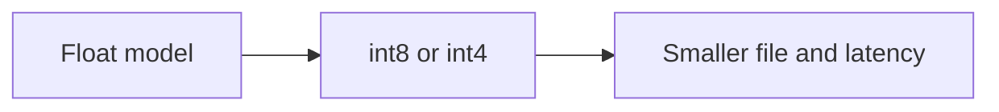

## What you will change

- A size in megabytes
- A bit width (32, 8, or 4)

## Pass condition

The estimated smaller size follows the bit-width ratio the screen states.

## Sources

- [LiteRT on Android](https://ai.google.dev/edge/litert/android)
````
Create `.run/11-quantization.run.xml`:

````xml
<component name="ProjectRunConfigurationManager">
  <configuration default="false" name="11 Quantization, latency, memory, and battery" type="AndroidRunConfigurationType" factoryName="Android App">
    <module name="Ai_Lab.app" />
    <option name="ANDROID_RUN_CONFIGURATION_SCHEMA_VERSION" value="1" />
    <option name="DEPLOY" value="true" />
    <option name="MODE" value="specific_activity" />
    <option name="ACTIVITY" value="com.mabrouk.ailab.quantization.QuantizationLabActivity" />
    <option name="ACTIVITY_CLASS" value="com.mabrouk.ailab.quantization.QuantizationLabActivity" />
    <method v="2">
      <option name="Android.Gradle.BeforeRunTask" enabled="true" />
    </method>
  </configuration>
</component>
````
- [ ] **Step 4: Run the test to verify it passes**

Run: `./gradlew :lab-quantization:testDebugUnitTest --tests com.mabrouk.ailab.quantization.QuantizationLabTest`

Expected: PASS

- [ ] **Step 5: Commit**

````bash
GIT_AUTHOR_NAME='mohamed_mabrouk' \
GIT_AUTHOR_EMAIL='mabroukmohamed582@gmail.com' \
GIT_COMMITTER_NAME='mohamed_mabrouk' \
GIT_COMMITTER_EMAIL='mabroukmohamed582@gmail.com' \
git commit -m "Add the Quantization, latency, memory, and battery lab module."
````
### Task 14: Privacy, safety, on-device and cloud

**Files:**
- Create: `lab-privacy/build.gradle.kts`
- Create: `lab-privacy/src/main/AndroidManifest.xml`
- Create: `lab-privacy/src/main/java/com/mabrouk/ailab/privacy/PrivacyLab.kt`
- Create: `lab-privacy/src/main/java/com/mabrouk/ailab/privacy/PrivacyLabActivity.kt`
- Create: `lab-privacy/src/main/java/com/mabrouk/ailab/privacy/PrivacyLabInitializer.kt`
- Create: `lab-privacy/src/test/java/com/mabrouk/ailab/privacy/PrivacyLabTest.kt`
- Create: `lab-privacy/README.md`
- Create: `.run/12-privacy.run.xml`
- Modify: `settings.gradle.kts`
- Modify: `app/build.gradle.kts`

**Interfaces:**
- Consumes: `Lab`, `Track`, `LabRegistry.register`, `LabScreen`, `AiLabTheme`
- Produces: `PrivacyLab.lab` with id `privacy` and order `12`

- [ ] **Step 1: Write the failing test**

Create `lab-privacy/src/test/java/com/mabrouk/ailab/privacy/PrivacyLabTest.kt`:

````kotlin
package com.mabrouk.ailab.privacy

import org.junit.Assert.assertEquals
import org.junit.Assert.assertTrue
import org.junit.Test

class PrivacyLabTest {
    @Test
    fun lab_matchesTheCatalogContract() {
        val lab = PrivacyLab.lab
        assertEquals("privacy", lab.id)
        assertEquals(12, lab.order)
        assertTrue(lab.idea.isNotBlank())
        assertTrue(lab.runInputs.isNotEmpty())
        assertTrue(lab.passCondition.isNotBlank())
        assertTrue(lab.sources.all { it.startsWith("https://") })
        assertEquals("com.mabrouk.ailab.privacy.PrivacyLabActivity", lab.activityClassName)
    }
}
````
- [ ] **Step 2: Run the test to verify it fails**

Run: `./gradlew :lab-privacy:testDebugUnitTest --tests com.mabrouk.ailab.privacy.PrivacyLabTest`

Expected: FAIL because the module or `PrivacyLab` does not exist yet.

- [ ] **Step 3: Add the module**

Add `include(":lab-privacy")` to `settings.gradle.kts`.

Add `implementation(project(":lab-privacy"))` to `app/build.gradle.kts`.

Create `lab-privacy/build.gradle.kts`:

````kotlin
plugins {
    alias(libs.plugins.android.library)
    alias(libs.plugins.kotlin.compose)
}

android {
    namespace = "com.mabrouk.ailab.privacy"
    compileSdk {
        version = release(37)
    }
    defaultConfig {
        minSdk = 26
    }
    compileOptions {
        sourceCompatibility = JavaVersion.VERSION_11
        targetCompatibility = JavaVersion.VERSION_11
    }
    buildFeatures {
        compose = true
    }
}

dependencies {
    implementation(project(":lab-api"))
    implementation(platform(libs.androidx.compose.bom))
    implementation(libs.androidx.activity.compose)
    implementation(libs.androidx.compose.material3)
    implementation(libs.androidx.compose.ui)
    implementation(libs.androidx.startup.runtime)
    testImplementation(libs.junit)
}
````
Create `lab-privacy/src/main/AndroidManifest.xml`:

````xml
<?xml version="1.0" encoding="utf-8"?>
<manifest xmlns:android="http://schemas.android.com/apk/res/android"
    xmlns:tools="http://schemas.android.com/tools">
    <application>
        <activity
            android:name=".PrivacyLabActivity"
            android:exported="false" />
        <provider
            android:name="androidx.startup.InitializationProvider"
            android:authorities="${applicationId}.androidx-startup"
            android:exported="false"
            tools:node="merge">
            <meta-data
                android:name="com.mabrouk.ailab.privacy.PrivacyLabInitializer"
                android:value="androidx.startup" />
        </provider>
    </application>
</manifest>
````
Create `lab-privacy/src/main/java/com/mabrouk/ailab/privacy/PrivacyLab.kt`:

````kotlin
package com.mabrouk.ailab.privacy

import com.mabrouk.ailab.lab.Lab
import com.mabrouk.ailab.lab.Track

object PrivacyLab {
    val lab = Lab(
        id = "privacy",
        title = "Privacy, safety, on-device and cloud",
        track = Track.Literacy,
        order = 12,
        summary = "Pick where the bytes go before you pick a model.",
        idea = "On-device keeps the input on the phone. Cloud sends it away. A hybrid path sends only what the on-device model cannot do.",
        prerequisites = listOf("quantization"),
        runInputs = listOf(
        "A feature description",
        ),
        passCondition = "The lab's label is on-device, cloud, or hybrid and matches the rule on screen.",
        sources = listOf(
        "https://developers.google.com/ml-kit/genai",
        "https://developer.android.com/ai/appfunctions",
        ),
        activityClassName = "com.mabrouk.ailab.privacy.PrivacyLabActivity",
    )
}
````
Create `lab-privacy/src/main/java/com/mabrouk/ailab/privacy/PrivacyLabActivity.kt`:

````kotlin
package com.mabrouk.ailab.privacy

import android.os.Bundle
import androidx.activity.ComponentActivity
import androidx.activity.compose.setContent
import androidx.activity.enableEdgeToEdge
import com.mabrouk.ailab.lab.theme.AiLabTheme
import com.mabrouk.ailab.lab.ui.LabScreen

class PrivacyLabActivity : ComponentActivity() {
    override fun onCreate(savedInstanceState: Bundle?) {
        super.onCreate(savedInstanceState)
        enableEdgeToEdge()
        setContent {
            AiLabTheme {
                LabScreen(PrivacyLab.lab)
            }
        }
    }
}
````
Create `lab-privacy/src/main/java/com/mabrouk/ailab/privacy/PrivacyLabInitializer.kt`:

````kotlin
package com.mabrouk.ailab.privacy

import android.content.Context
import androidx.startup.Initializer
import com.mabrouk.ailab.lab.LabRegistry

class PrivacyLabInitializer : Initializer<Unit> {
    override fun create(context: Context) {
        LabRegistry.register(PrivacyLab.lab)
    }

    override fun dependencies(): List<Class<out Initializer<*>>> = emptyList()
}
````
Create `lab-privacy/README.md`:

````markdown
# Privacy, safety, on-device and cloud

## What this topic is

On-device keeps the input on the phone. Cloud sends it away. A hybrid path sends only what the on-device model cannot do.

## Why an Android AI engineer needs it

The Android labs choose Gemini Nano, LiteRT, or a cloud call from this rule.

## Diagram

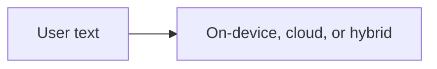

## What you will change

- A feature description

## Pass condition

The lab's label is on-device, cloud, or hybrid and matches the rule on screen.

## Sources

- [ML Kit GenAI overview](https://developers.google.com/ml-kit/genai)
- [AppFunctions overview](https://developer.android.com/ai/appfunctions)
````
Create `.run/12-privacy.run.xml`:

````xml
<component name="ProjectRunConfigurationManager">
  <configuration default="false" name="12 Privacy, safety, on-device and cloud" type="AndroidRunConfigurationType" factoryName="Android App">
    <module name="Ai_Lab.app" />
    <option name="ANDROID_RUN_CONFIGURATION_SCHEMA_VERSION" value="1" />
    <option name="DEPLOY" value="true" />
    <option name="MODE" value="specific_activity" />
    <option name="ACTIVITY" value="com.mabrouk.ailab.privacy.PrivacyLabActivity" />
    <option name="ACTIVITY_CLASS" value="com.mabrouk.ailab.privacy.PrivacyLabActivity" />
    <method v="2">
      <option name="Android.Gradle.BeforeRunTask" enabled="true" />
    </method>
  </configuration>
</component>
````
- [ ] **Step 4: Run the test to verify it passes**

Run: `./gradlew :lab-privacy:testDebugUnitTest --tests com.mabrouk.ailab.privacy.PrivacyLabTest`

Expected: PASS

- [ ] **Step 5: Commit**

````bash
GIT_AUTHOR_NAME='mohamed_mabrouk' \
GIT_AUTHOR_EMAIL='mabroukmohamed582@gmail.com' \
GIT_COMMITTER_NAME='mohamed_mabrouk' \
GIT_COMMITTER_EMAIL='mabroukmohamed582@gmail.com' \
git commit -m "Add the Privacy, safety, on-device and cloud lab module."
````
### Task 15: ML Kit task APIs

**Files:**
- Create: `lab-mlkit-tasks/build.gradle.kts`
- Create: `lab-mlkit-tasks/src/main/AndroidManifest.xml`
- Create: `lab-mlkit-tasks/src/main/java/com/mabrouk/ailab/mlkittasks/MlkitTasksLab.kt`
- Create: `lab-mlkit-tasks/src/main/java/com/mabrouk/ailab/mlkittasks/MlkitTasksLabActivity.kt`
- Create: `lab-mlkit-tasks/src/main/java/com/mabrouk/ailab/mlkittasks/MlkitTasksLabInitializer.kt`
- Create: `lab-mlkit-tasks/src/test/java/com/mabrouk/ailab/mlkittasks/MlkitTasksLabTest.kt`
- Create: `lab-mlkit-tasks/README.md`
- Create: `.run/13-mlkit-tasks.run.xml`
- Modify: `settings.gradle.kts`
- Modify: `app/build.gradle.kts`

**Interfaces:**
- Consumes: `Lab`, `Track`, `LabRegistry.register`, `LabScreen`, `AiLabTheme`
- Produces: `MlkitTasksLab.lab` with id `mlkit-tasks` and order `13`

- [ ] **Step 1: Write the failing test**

Create `lab-mlkit-tasks/src/test/java/com/mabrouk/ailab/mlkittasks/MlkitTasksLabTest.kt`:

````kotlin
package com.mabrouk.ailab.mlkittasks

import org.junit.Assert.assertEquals
import org.junit.Assert.assertTrue
import org.junit.Test

class MlkitTasksLabTest {
    @Test
    fun lab_matchesTheCatalogContract() {
        val lab = MlkitTasksLab.lab
        assertEquals("mlkit-tasks", lab.id)
        assertEquals(13, lab.order)
        assertTrue(lab.idea.isNotBlank())
        assertTrue(lab.runInputs.isNotEmpty())
        assertTrue(lab.passCondition.isNotBlank())
        assertTrue(lab.sources.all { it.startsWith("https://") })
        assertEquals("com.mabrouk.ailab.mlkittasks.MlkitTasksLabActivity", lab.activityClassName)
    }
}
````
- [ ] **Step 2: Run the test to verify it fails**

Run: `./gradlew :lab-mlkit-tasks:testDebugUnitTest --tests com.mabrouk.ailab.mlkittasks.MlkitTasksLabTest`

Expected: FAIL because the module or `MlkitTasksLab` does not exist yet.

- [ ] **Step 3: Add the module**

Add `include(":lab-mlkit-tasks")` to `settings.gradle.kts`.

Add `implementation(project(":lab-mlkit-tasks"))` to `app/build.gradle.kts`.

Create `lab-mlkit-tasks/build.gradle.kts`:

````kotlin
plugins {
    alias(libs.plugins.android.library)
    alias(libs.plugins.kotlin.compose)
}

android {
    namespace = "com.mabrouk.ailab.mlkittasks"
    compileSdk {
        version = release(37)
    }
    defaultConfig {
        minSdk = 26
    }
    compileOptions {
        sourceCompatibility = JavaVersion.VERSION_11
        targetCompatibility = JavaVersion.VERSION_11
    }
    buildFeatures {
        compose = true
    }
}

dependencies {
    implementation(project(":lab-api"))
    implementation(platform(libs.androidx.compose.bom))
    implementation(libs.androidx.activity.compose)
    implementation(libs.androidx.compose.material3)
    implementation(libs.androidx.compose.ui)
    implementation(libs.androidx.startup.runtime)
    testImplementation(libs.junit)
}
````
Create `lab-mlkit-tasks/src/main/AndroidManifest.xml`:

````xml
<?xml version="1.0" encoding="utf-8"?>
<manifest xmlns:android="http://schemas.android.com/apk/res/android"
    xmlns:tools="http://schemas.android.com/tools">
    <application>
        <activity
            android:name=".MlkitTasksLabActivity"
            android:exported="false" />
        <provider
            android:name="androidx.startup.InitializationProvider"
            android:authorities="${applicationId}.androidx-startup"
            android:exported="false"
            tools:node="merge">
            <meta-data
                android:name="com.mabrouk.ailab.mlkittasks.MlkitTasksLabInitializer"
                android:value="androidx.startup" />
        </provider>
    </application>
</manifest>
````
Create `lab-mlkit-tasks/src/main/java/com/mabrouk/ailab/mlkittasks/MlkitTasksLab.kt`:

````kotlin
package com.mabrouk.ailab.mlkittasks

import com.mabrouk.ailab.lab.Lab
import com.mabrouk.ailab.lab.Track

object MlkitTasksLab {
    val lab = Lab(
        id = "mlkit-tasks",
        title = "ML Kit task APIs",
        track = Track.Android,
        order = 13,
        summary = "Call a task API before you ship a custom model.",
        idea = "Text recognition, barcode, face, and pose are ready-made models with a task API.",
        prerequisites = listOf("privacy"),
        runInputs = listOf(
        "A task name",
        ),
        passCondition = "The screen lists what that task returns (text, a code, faces, or landmarks).",
        sources = listOf(
        "https://developers.google.com/ml-kit/vision",
        ),
        activityClassName = "com.mabrouk.ailab.mlkittasks.MlkitTasksLabActivity",
    )
}
````
Create `lab-mlkit-tasks/src/main/java/com/mabrouk/ailab/mlkittasks/MlkitTasksLabActivity.kt`:

````kotlin
package com.mabrouk.ailab.mlkittasks

import android.os.Bundle
import androidx.activity.ComponentActivity
import androidx.activity.compose.setContent
import androidx.activity.enableEdgeToEdge
import com.mabrouk.ailab.lab.theme.AiLabTheme
import com.mabrouk.ailab.lab.ui.LabScreen

class MlkitTasksLabActivity : ComponentActivity() {
    override fun onCreate(savedInstanceState: Bundle?) {
        super.onCreate(savedInstanceState)
        enableEdgeToEdge()
        setContent {
            AiLabTheme {
                LabScreen(MlkitTasksLab.lab)
            }
        }
    }
}
````
Create `lab-mlkit-tasks/src/main/java/com/mabrouk/ailab/mlkittasks/MlkitTasksLabInitializer.kt`:

````kotlin
package com.mabrouk.ailab.mlkittasks

import android.content.Context
import androidx.startup.Initializer
import com.mabrouk.ailab.lab.LabRegistry

class MlkitTasksLabInitializer : Initializer<Unit> {
    override fun create(context: Context) {
        LabRegistry.register(MlkitTasksLab.lab)
    }

    override fun dependencies(): List<Class<out Initializer<*>>> = emptyList()
}
````
Create `lab-mlkit-tasks/README.md`:

````markdown
# ML Kit task APIs

## What this topic is

Text recognition, barcode, face, and pose are ready-made models with a task API.

## Why an Android AI engineer needs it

Most camera features do not need a model you convert yourself.

## Diagram

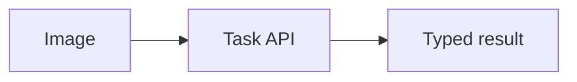

## What you will change

- A task name

## Pass condition

The screen lists what that task returns (text, a code, faces, or landmarks).

## Sources

- [ML Kit vision](https://developers.google.com/ml-kit/vision)
````
Create `.run/13-mlkit-tasks.run.xml`:

````xml
<component name="ProjectRunConfigurationManager">
  <configuration default="false" name="13 ML Kit task APIs" type="AndroidRunConfigurationType" factoryName="Android App">
    <module name="Ai_Lab.app" />
    <option name="ANDROID_RUN_CONFIGURATION_SCHEMA_VERSION" value="1" />
    <option name="DEPLOY" value="true" />
    <option name="MODE" value="specific_activity" />
    <option name="ACTIVITY" value="com.mabrouk.ailab.mlkittasks.MlkitTasksLabActivity" />
    <option name="ACTIVITY_CLASS" value="com.mabrouk.ailab.mlkittasks.MlkitTasksLabActivity" />
    <method v="2">
      <option name="Android.Gradle.BeforeRunTask" enabled="true" />
    </method>
  </configuration>
</component>
````
- [ ] **Step 4: Run the test to verify it passes**

Run: `./gradlew :lab-mlkit-tasks:testDebugUnitTest --tests com.mabrouk.ailab.mlkittasks.MlkitTasksLabTest`

Expected: PASS

- [ ] **Step 5: Commit**

````bash
GIT_AUTHOR_NAME='mohamed_mabrouk' \
GIT_AUTHOR_EMAIL='mabroukmohamed582@gmail.com' \
GIT_COMMITTER_NAME='mohamed_mabrouk' \
GIT_COMMITTER_EMAIL='mabroukmohamed582@gmail.com' \
git commit -m "Add the ML Kit task APIs lab module."
````
### Task 16: Gemini Nano Prompt API

**Files:**
- Create: `lab-prompt-api/build.gradle.kts`
- Create: `lab-prompt-api/src/main/AndroidManifest.xml`
- Create: `lab-prompt-api/src/main/java/com/mabrouk/ailab/promptapi/PromptApiLab.kt`
- Create: `lab-prompt-api/src/main/java/com/mabrouk/ailab/promptapi/PromptApiLabActivity.kt`
- Create: `lab-prompt-api/src/main/java/com/mabrouk/ailab/promptapi/PromptApiLabInitializer.kt`
- Create: `lab-prompt-api/src/test/java/com/mabrouk/ailab/promptapi/PromptApiLabTest.kt`
- Create: `lab-prompt-api/README.md`
- Create: `.run/14-prompt-api.run.xml`
- Modify: `settings.gradle.kts`
- Modify: `app/build.gradle.kts`

**Interfaces:**
- Consumes: `Lab`, `Track`, `LabRegistry.register`, `LabScreen`, `AiLabTheme`
- Produces: `PromptApiLab.lab` with id `prompt-api` and order `14`

- [ ] **Step 1: Write the failing test**

Create `lab-prompt-api/src/test/java/com/mabrouk/ailab/promptapi/PromptApiLabTest.kt`:

````kotlin
package com.mabrouk.ailab.promptapi

import org.junit.Assert.assertEquals
import org.junit.Assert.assertTrue
import org.junit.Test

class PromptApiLabTest {
    @Test
    fun lab_matchesTheCatalogContract() {
        val lab = PromptApiLab.lab
        assertEquals("prompt-api", lab.id)
        assertEquals(14, lab.order)
        assertTrue(lab.idea.isNotBlank())
        assertTrue(lab.runInputs.isNotEmpty())
        assertTrue(lab.passCondition.isNotBlank())
        assertTrue(lab.sources.all { it.startsWith("https://") })
        assertEquals("com.mabrouk.ailab.promptapi.PromptApiLabActivity", lab.activityClassName)
    }
}
````
- [ ] **Step 2: Run the test to verify it fails**

Run: `./gradlew :lab-prompt-api:testDebugUnitTest --tests com.mabrouk.ailab.promptapi.PromptApiLabTest`

Expected: FAIL because the module or `PromptApiLab` does not exist yet.

- [ ] **Step 3: Add the module**

Add `include(":lab-prompt-api")` to `settings.gradle.kts`.

Add `implementation(project(":lab-prompt-api"))` to `app/build.gradle.kts`.

Create `lab-prompt-api/build.gradle.kts`:

````kotlin
plugins {
    alias(libs.plugins.android.library)
    alias(libs.plugins.kotlin.compose)
}

android {
    namespace = "com.mabrouk.ailab.promptapi"
    compileSdk {
        version = release(37)
    }
    defaultConfig {
        minSdk = 26
    }
    compileOptions {
        sourceCompatibility = JavaVersion.VERSION_11
        targetCompatibility = JavaVersion.VERSION_11
    }
    buildFeatures {
        compose = true
    }
}

dependencies {
    implementation(project(":lab-api"))
    implementation(platform(libs.androidx.compose.bom))
    implementation(libs.androidx.activity.compose)
    implementation(libs.androidx.compose.material3)
    implementation(libs.androidx.compose.ui)
    implementation(libs.androidx.startup.runtime)
    testImplementation(libs.junit)
}
````
Create `lab-prompt-api/src/main/AndroidManifest.xml`:

````xml
<?xml version="1.0" encoding="utf-8"?>
<manifest xmlns:android="http://schemas.android.com/apk/res/android"
    xmlns:tools="http://schemas.android.com/tools">
    <application>
        <activity
            android:name=".PromptApiLabActivity"
            android:exported="false" />
        <provider
            android:name="androidx.startup.InitializationProvider"
            android:authorities="${applicationId}.androidx-startup"
            android:exported="false"
            tools:node="merge">
            <meta-data
                android:name="com.mabrouk.ailab.promptapi.PromptApiLabInitializer"
                android:value="androidx.startup" />
        </provider>
    </application>
</manifest>
````
Create `lab-prompt-api/src/main/java/com/mabrouk/ailab/promptapi/PromptApiLab.kt`:

````kotlin
package com.mabrouk.ailab.promptapi

import com.mabrouk.ailab.lab.Lab
import com.mabrouk.ailab.lab.Track

object PromptApiLab {
    val lab = Lab(
        id = "prompt-api",
        title = "Gemini Nano Prompt API",
        track = Track.Android,
        order = 14,
        summary = "Ask Gemini Nano only after the feature is available.",
        idea = "Check FeatureStatus, download when the model is downloadable, stream or wait, and close() the client. The model is unavailable on some phones, including unlocked bootloaders.",
        prerequisites = listOf("mlkit-tasks"),
        runInputs = listOf(
        "One prompt",
        ),
        passCondition = "The status is shown, and a missing model stays on an explanation screen without a passed check.",
        sources = listOf(
        "https://developers.google.com/ml-kit/genai/prompt/android/get-started",
        "https://developers.google.com/ml-kit/genai/prompt/android",
        ),
        activityClassName = "com.mabrouk.ailab.promptapi.PromptApiLabActivity",
    )
}
````
Create `lab-prompt-api/src/main/java/com/mabrouk/ailab/promptapi/PromptApiLabActivity.kt`:

````kotlin
package com.mabrouk.ailab.promptapi

import android.os.Bundle
import androidx.activity.ComponentActivity
import androidx.activity.compose.setContent
import androidx.activity.enableEdgeToEdge
import com.mabrouk.ailab.lab.theme.AiLabTheme
import com.mabrouk.ailab.lab.ui.LabScreen

class PromptApiLabActivity : ComponentActivity() {
    override fun onCreate(savedInstanceState: Bundle?) {
        super.onCreate(savedInstanceState)
        enableEdgeToEdge()
        setContent {
            AiLabTheme {
                LabScreen(PromptApiLab.lab)
            }
        }
    }
}
````
Create `lab-prompt-api/src/main/java/com/mabrouk/ailab/promptapi/PromptApiLabInitializer.kt`:

````kotlin
package com.mabrouk.ailab.promptapi

import android.content.Context
import androidx.startup.Initializer
import com.mabrouk.ailab.lab.LabRegistry

class PromptApiLabInitializer : Initializer<Unit> {
    override fun create(context: Context) {
        LabRegistry.register(PromptApiLab.lab)
    }

    override fun dependencies(): List<Class<out Initializer<*>>> = emptyList()
}
````
Create `lab-prompt-api/README.md`:

````markdown
# Gemini Nano Prompt API

## What this topic is

Check FeatureStatus, download when the model is downloadable, stream or wait, and close() the client. The model is unavailable on some phones, including unlocked bootloaders.

## Why an Android AI engineer needs it

This is the on-device Gemini path, and it is absent on many devices.

## Diagram

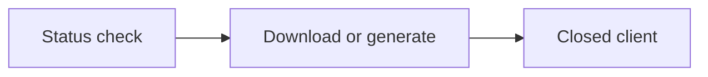

## What you will change

- One prompt

## Pass condition

The status is shown, and a missing model stays on an explanation screen without a passed check.

## Sources

- [Get started with the Prompt API](https://developers.google.com/ml-kit/genai/prompt/android/get-started)
- [Prompt API overview](https://developers.google.com/ml-kit/genai/prompt/android)
````
Create `.run/14-prompt-api.run.xml`:

````xml
<component name="ProjectRunConfigurationManager">
  <configuration default="false" name="14 Gemini Nano Prompt API" type="AndroidRunConfigurationType" factoryName="Android App">
    <module name="Ai_Lab.app" />
    <option name="ANDROID_RUN_CONFIGURATION_SCHEMA_VERSION" value="1" />
    <option name="DEPLOY" value="true" />
    <option name="MODE" value="specific_activity" />
    <option name="ACTIVITY" value="com.mabrouk.ailab.promptapi.PromptApiLabActivity" />
    <option name="ACTIVITY_CLASS" value="com.mabrouk.ailab.promptapi.PromptApiLabActivity" />
    <method v="2">
      <option name="Android.Gradle.BeforeRunTask" enabled="true" />
    </method>
  </configuration>
</component>
````
- [ ] **Step 4: Run the test to verify it passes**

Run: `./gradlew :lab-prompt-api:testDebugUnitTest --tests com.mabrouk.ailab.promptapi.PromptApiLabTest`

Expected: PASS

- [ ] **Step 5: Commit**

````bash
GIT_AUTHOR_NAME='mohamed_mabrouk' \
GIT_AUTHOR_EMAIL='mabroukmohamed582@gmail.com' \
GIT_COMMITTER_NAME='mohamed_mabrouk' \
GIT_COMMITTER_EMAIL='mabroukmohamed582@gmail.com' \
git commit -m "Add the Gemini Nano Prompt API lab module."
````
### Task 17: Structured output and prefix caching

**Files:**
- Create: `lab-structured-output/build.gradle.kts`
- Create: `lab-structured-output/src/main/AndroidManifest.xml`
- Create: `lab-structured-output/src/main/java/com/mabrouk/ailab/structuredoutput/StructuredOutputLab.kt`
- Create: `lab-structured-output/src/main/java/com/mabrouk/ailab/structuredoutput/StructuredOutputLabActivity.kt`
- Create: `lab-structured-output/src/main/java/com/mabrouk/ailab/structuredoutput/StructuredOutputLabInitializer.kt`
- Create: `lab-structured-output/src/test/java/com/mabrouk/ailab/structuredoutput/StructuredOutputLabTest.kt`
- Create: `lab-structured-output/README.md`
- Create: `.run/15-structured-output.run.xml`
- Modify: `settings.gradle.kts`
- Modify: `app/build.gradle.kts`

**Interfaces:**
- Consumes: `Lab`, `Track`, `LabRegistry.register`, `LabScreen`, `AiLabTheme`
- Produces: `StructuredOutputLab.lab` with id `structured-output` and order `15`

- [ ] **Step 1: Write the failing test**

Create `lab-structured-output/src/test/java/com/mabrouk/ailab/structuredoutput/StructuredOutputLabTest.kt`:

````kotlin
package com.mabrouk.ailab.structuredoutput

import org.junit.Assert.assertEquals
import org.junit.Assert.assertTrue
import org.junit.Test

class StructuredOutputLabTest {
    @Test
    fun lab_matchesTheCatalogContract() {
        val lab = StructuredOutputLab.lab
        assertEquals("structured-output", lab.id)
        assertEquals(15, lab.order)
        assertTrue(lab.idea.isNotBlank())
        assertTrue(lab.runInputs.isNotEmpty())
        assertTrue(lab.passCondition.isNotBlank())
        assertTrue(lab.sources.all { it.startsWith("https://") })
        assertEquals("com.mabrouk.ailab.structuredoutput.StructuredOutputLabActivity", lab.activityClassName)
    }
}
````
- [ ] **Step 2: Run the test to verify it fails**

Run: `./gradlew :lab-structured-output:testDebugUnitTest --tests com.mabrouk.ailab.structuredoutput.StructuredOutputLabTest`

Expected: FAIL because the module or `StructuredOutputLab` does not exist yet.

- [ ] **Step 3: Add the module**

Add `include(":lab-structured-output")` to `settings.gradle.kts`.

Add `implementation(project(":lab-structured-output"))` to `app/build.gradle.kts`.

Create `lab-structured-output/build.gradle.kts`:

````kotlin
plugins {
    alias(libs.plugins.android.library)
    alias(libs.plugins.kotlin.compose)
}

android {
    namespace = "com.mabrouk.ailab.structuredoutput"
    compileSdk {
        version = release(37)
    }
    defaultConfig {
        minSdk = 26
    }
    compileOptions {
        sourceCompatibility = JavaVersion.VERSION_11
        targetCompatibility = JavaVersion.VERSION_11
    }
    buildFeatures {
        compose = true
    }
}

dependencies {
    implementation(project(":lab-api"))
    implementation(platform(libs.androidx.compose.bom))
    implementation(libs.androidx.activity.compose)
    implementation(libs.androidx.compose.material3)
    implementation(libs.androidx.compose.ui)
    implementation(libs.androidx.startup.runtime)
    testImplementation(libs.junit)
}
````
Create `lab-structured-output/src/main/AndroidManifest.xml`:

````xml
<?xml version="1.0" encoding="utf-8"?>
<manifest xmlns:android="http://schemas.android.com/apk/res/android"
    xmlns:tools="http://schemas.android.com/tools">
    <application>
        <activity
            android:name=".StructuredOutputLabActivity"
            android:exported="false" />
        <provider
            android:name="androidx.startup.InitializationProvider"
            android:authorities="${applicationId}.androidx-startup"
            android:exported="false"
            tools:node="merge">
            <meta-data
                android:name="com.mabrouk.ailab.structuredoutput.StructuredOutputLabInitializer"
                android:value="androidx.startup" />
        </provider>
    </application>
</manifest>
````
Create `lab-structured-output/src/main/java/com/mabrouk/ailab/structuredoutput/StructuredOutputLab.kt`:

````kotlin
package com.mabrouk.ailab.structuredoutput

import com.mabrouk.ailab.lab.Lab
import com.mabrouk.ailab.lab.Track

object StructuredOutputLab {
    val lab = Lab(
        id = "structured-output",
        title = "Structured output and prefix caching",
        track = Track.Android,
        order = 15,
        summary = "Parse a typed object, and cache the stable prefix.",
        idea = "A Kotlin type is the response contract. A repeated prefix can be cached apart from the changing suffix.",
        prerequisites = listOf("prompt-api"),
        runInputs = listOf(
        "A prefix",
        "A suffix",
        ),
        passCondition = "The screen shows a typed object, and the prefix is marked as the cached part.",
        sources = listOf(
        "https://developers.google.com/ml-kit/genai/prompt/android/structured-output",
        "https://developer.android.com/agents/skills/device-ai/ml-kit-genai-prompt-api/references/prefix-caching",
        ),
        activityClassName = "com.mabrouk.ailab.structuredoutput.StructuredOutputLabActivity",
    )
}
````
Create `lab-structured-output/src/main/java/com/mabrouk/ailab/structuredoutput/StructuredOutputLabActivity.kt`:

````kotlin
package com.mabrouk.ailab.structuredoutput

import android.os.Bundle
import androidx.activity.ComponentActivity
import androidx.activity.compose.setContent
import androidx.activity.enableEdgeToEdge
import com.mabrouk.ailab.lab.theme.AiLabTheme
import com.mabrouk.ailab.lab.ui.LabScreen

class StructuredOutputLabActivity : ComponentActivity() {
    override fun onCreate(savedInstanceState: Bundle?) {
        super.onCreate(savedInstanceState)
        enableEdgeToEdge()
        setContent {
            AiLabTheme {
                LabScreen(StructuredOutputLab.lab)
            }
        }
    }
}
````
Create `lab-structured-output/src/main/java/com/mabrouk/ailab/structuredoutput/StructuredOutputLabInitializer.kt`:

````kotlin
package com.mabrouk.ailab.structuredoutput

import android.content.Context
import androidx.startup.Initializer
import com.mabrouk.ailab.lab.LabRegistry

class StructuredOutputLabInitializer : Initializer<Unit> {
    override fun create(context: Context) {
        LabRegistry.register(StructuredOutputLab.lab)
    }

    override fun dependencies(): List<Class<out Initializer<*>>> = emptyList()
}
````
Create `lab-structured-output/README.md`:

````markdown
# Structured output and prefix caching

## What this topic is

A Kotlin type is the response contract. A repeated prefix can be cached apart from the changing suffix.

## Why an Android AI engineer needs it

Typed output is what you can save, and a cached prefix cuts the repeated cost.

## Diagram

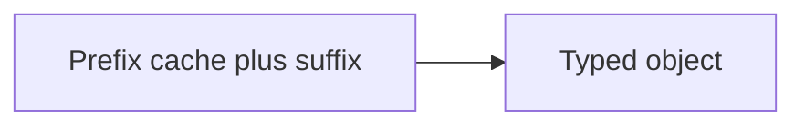

## What you will change

- A prefix
- A suffix

## Pass condition

The screen shows a typed object, and the prefix is marked as the cached part.

## Sources

- [Structured output](https://developers.google.com/ml-kit/genai/prompt/android/structured-output)
- [Prefix caching](https://developer.android.com/agents/skills/device-ai/ml-kit-genai-prompt-api/references/prefix-caching)
````
Create `.run/15-structured-output.run.xml`:

````xml
<component name="ProjectRunConfigurationManager">
  <configuration default="false" name="15 Structured output and prefix caching" type="AndroidRunConfigurationType" factoryName="Android App">
    <module name="Ai_Lab.app" />
    <option name="ANDROID_RUN_CONFIGURATION_SCHEMA_VERSION" value="1" />
    <option name="DEPLOY" value="true" />
    <option name="MODE" value="specific_activity" />
    <option name="ACTIVITY" value="com.mabrouk.ailab.structuredoutput.StructuredOutputLabActivity" />
    <option name="ACTIVITY_CLASS" value="com.mabrouk.ailab.structuredoutput.StructuredOutputLabActivity" />
    <method v="2">
      <option name="Android.Gradle.BeforeRunTask" enabled="true" />
    </method>
  </configuration>
</component>
````
- [ ] **Step 4: Run the test to verify it passes**

Run: `./gradlew :lab-structured-output:testDebugUnitTest --tests com.mabrouk.ailab.structuredoutput.StructuredOutputLabTest`

Expected: PASS

- [ ] **Step 5: Commit**

````bash
GIT_AUTHOR_NAME='mohamed_mabrouk' \
GIT_AUTHOR_EMAIL='mabroukmohamed582@gmail.com' \
GIT_COMMITTER_NAME='mohamed_mabrouk' \
GIT_COMMITTER_EMAIL='mabroukmohamed582@gmail.com' \
git commit -m "Add the Structured output and prefix caching lab module."
````
### Task 18: Summarize, rewrite, proofread, and describe an image

**Files:**
- Create: `lab-genai-tasks/build.gradle.kts`
- Create: `lab-genai-tasks/src/main/AndroidManifest.xml`
- Create: `lab-genai-tasks/src/main/java/com/mabrouk/ailab/genaitasks/GenaiTasksLab.kt`
- Create: `lab-genai-tasks/src/main/java/com/mabrouk/ailab/genaitasks/GenaiTasksLabActivity.kt`
- Create: `lab-genai-tasks/src/main/java/com/mabrouk/ailab/genaitasks/GenaiTasksLabInitializer.kt`
- Create: `lab-genai-tasks/src/test/java/com/mabrouk/ailab/genaitasks/GenaiTasksLabTest.kt`
- Create: `lab-genai-tasks/README.md`
- Create: `.run/16-genai-tasks.run.xml`
- Modify: `settings.gradle.kts`
- Modify: `app/build.gradle.kts`

**Interfaces:**
- Consumes: `Lab`, `Track`, `LabRegistry.register`, `LabScreen`, `AiLabTheme`
- Produces: `GenaiTasksLab.lab` with id `genai-tasks` and order `16`

- [ ] **Step 1: Write the failing test**

Create `lab-genai-tasks/src/test/java/com/mabrouk/ailab/genaitasks/GenaiTasksLabTest.kt`:

````kotlin
package com.mabrouk.ailab.genaitasks

import org.junit.Assert.assertEquals
import org.junit.Assert.assertTrue
import org.junit.Test

class GenaiTasksLabTest {
    @Test
    fun lab_matchesTheCatalogContract() {
        val lab = GenaiTasksLab.lab
        assertEquals("genai-tasks", lab.id)
        assertEquals(16, lab.order)
        assertTrue(lab.idea.isNotBlank())
        assertTrue(lab.runInputs.isNotEmpty())
        assertTrue(lab.passCondition.isNotBlank())
        assertTrue(lab.sources.all { it.startsWith("https://") })
        assertEquals("com.mabrouk.ailab.genaitasks.GenaiTasksLabActivity", lab.activityClassName)
    }
}
````
- [ ] **Step 2: Run the test to verify it fails**

Run: `./gradlew :lab-genai-tasks:testDebugUnitTest --tests com.mabrouk.ailab.genaitasks.GenaiTasksLabTest`

Expected: FAIL because the module or `GenaiTasksLab` does not exist yet.

- [ ] **Step 3: Add the module**

Add `include(":lab-genai-tasks")` to `settings.gradle.kts`.

Add `implementation(project(":lab-genai-tasks"))` to `app/build.gradle.kts`.

Create `lab-genai-tasks/build.gradle.kts`:

````kotlin
plugins {
    alias(libs.plugins.android.library)
    alias(libs.plugins.kotlin.compose)
}

android {
    namespace = "com.mabrouk.ailab.genaitasks"
    compileSdk {
        version = release(37)
    }
    defaultConfig {
        minSdk = 26
    }
    compileOptions {
        sourceCompatibility = JavaVersion.VERSION_11
        targetCompatibility = JavaVersion.VERSION_11
    }
    buildFeatures {
        compose = true
    }
}

dependencies {
    implementation(project(":lab-api"))
    implementation(platform(libs.androidx.compose.bom))
    implementation(libs.androidx.activity.compose)
    implementation(libs.androidx.compose.material3)
    implementation(libs.androidx.compose.ui)
    implementation(libs.androidx.startup.runtime)
    testImplementation(libs.junit)
}
````
Create `lab-genai-tasks/src/main/AndroidManifest.xml`:

````xml
<?xml version="1.0" encoding="utf-8"?>
<manifest xmlns:android="http://schemas.android.com/apk/res/android"
    xmlns:tools="http://schemas.android.com/tools">
    <application>
        <activity
            android:name=".GenaiTasksLabActivity"
            android:exported="false" />
        <provider
            android:name="androidx.startup.InitializationProvider"
            android:authorities="${applicationId}.androidx-startup"
            android:exported="false"
            tools:node="merge">
            <meta-data
                android:name="com.mabrouk.ailab.genaitasks.GenaiTasksLabInitializer"
                android:value="androidx.startup" />
        </provider>
    </application>
</manifest>
````
Create `lab-genai-tasks/src/main/java/com/mabrouk/ailab/genaitasks/GenaiTasksLab.kt`:

````kotlin
package com.mabrouk.ailab.genaitasks

import com.mabrouk.ailab.lab.Lab
import com.mabrouk.ailab.lab.Track

object GenaiTasksLab {
    val lab = Lab(
        id = "genai-tasks",
        title = "Summarize, rewrite, proofread, and describe an image",
        track = Track.Android,
        order = 16,
        summary = "Use a task API when the job already has a name.",
        idea = "These GenAI tasks are fixed jobs on Gemini Nano, separate from a free-form prompt.",
        prerequisites = listOf("structured-output"),
        runInputs = listOf(
        "A task name",
        "A paragraph or image description",
        ),
        passCondition = "The named task is the one that runs, and the result is text.",
        sources = listOf(
        "https://developers.google.com/ml-kit/genai",
        ),
        activityClassName = "com.mabrouk.ailab.genaitasks.GenaiTasksLabActivity",
    )
}
````
Create `lab-genai-tasks/src/main/java/com/mabrouk/ailab/genaitasks/GenaiTasksLabActivity.kt`:

````kotlin
package com.mabrouk.ailab.genaitasks

import android.os.Bundle
import androidx.activity.ComponentActivity
import androidx.activity.compose.setContent
import androidx.activity.enableEdgeToEdge
import com.mabrouk.ailab.lab.theme.AiLabTheme
import com.mabrouk.ailab.lab.ui.LabScreen

class GenaiTasksLabActivity : ComponentActivity() {
    override fun onCreate(savedInstanceState: Bundle?) {
        super.onCreate(savedInstanceState)
        enableEdgeToEdge()
        setContent {
            AiLabTheme {
                LabScreen(GenaiTasksLab.lab)
            }
        }
    }
}
````
Create `lab-genai-tasks/src/main/java/com/mabrouk/ailab/genaitasks/GenaiTasksLabInitializer.kt`:

````kotlin
package com.mabrouk.ailab.genaitasks

import android.content.Context
import androidx.startup.Initializer
import com.mabrouk.ailab.lab.LabRegistry

class GenaiTasksLabInitializer : Initializer<Unit> {
    override fun create(context: Context) {
        LabRegistry.register(GenaiTasksLab.lab)
    }

    override fun dependencies(): List<Class<out Initializer<*>>> = emptyList()
}
````
Create `lab-genai-tasks/README.md`:

````markdown
# Summarize, rewrite, proofread, and describe an image

## What this topic is

These GenAI tasks are fixed jobs on Gemini Nano, separate from a free-form prompt.

## Why an Android AI engineer needs it

Summarize, rewrite, proofread, and image description already have clients. A custom prompt is the wrong tool for those jobs.

## Diagram

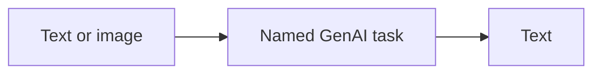

## What you will change

- A task name
- A paragraph or image description

## Pass condition

The named task is the one that runs, and the result is text.

## Sources

- [ML Kit GenAI overview](https://developers.google.com/ml-kit/genai)
````
Create `.run/16-genai-tasks.run.xml`:

````xml
<component name="ProjectRunConfigurationManager">
  <configuration default="false" name="16 Summarize, rewrite, proofread, and describe an image" type="AndroidRunConfigurationType" factoryName="Android App">
    <module name="Ai_Lab.app" />
    <option name="ANDROID_RUN_CONFIGURATION_SCHEMA_VERSION" value="1" />
    <option name="DEPLOY" value="true" />
    <option name="MODE" value="specific_activity" />
    <option name="ACTIVITY" value="com.mabrouk.ailab.genaitasks.GenaiTasksLabActivity" />
    <option name="ACTIVITY_CLASS" value="com.mabrouk.ailab.genaitasks.GenaiTasksLabActivity" />
    <method v="2">
      <option name="Android.Gradle.BeforeRunTask" enabled="true" />
    </method>
  </configuration>
</component>
````
- [ ] **Step 4: Run the test to verify it passes**

Run: `./gradlew :lab-genai-tasks:testDebugUnitTest --tests com.mabrouk.ailab.genaitasks.GenaiTasksLabTest`

Expected: PASS

- [ ] **Step 5: Commit**

````bash
GIT_AUTHOR_NAME='mohamed_mabrouk' \
GIT_AUTHOR_EMAIL='mabroukmohamed582@gmail.com' \
GIT_COMMITTER_NAME='mohamed_mabrouk' \
GIT_COMMITTER_EMAIL='mabroukmohamed582@gmail.com' \
git commit -m "Add the Summarize, rewrite, proofread, and describe an image lab module."
````
### Task 19: LiteRT on CPU

**Files:**
- Create: `lab-litert-cpu/build.gradle.kts`
- Create: `lab-litert-cpu/src/main/AndroidManifest.xml`
- Create: `lab-litert-cpu/src/main/java/com/mabrouk/ailab/litertcpu/LitertCpuLab.kt`
- Create: `lab-litert-cpu/src/main/java/com/mabrouk/ailab/litertcpu/LitertCpuLabActivity.kt`
- Create: `lab-litert-cpu/src/main/java/com/mabrouk/ailab/litertcpu/LitertCpuLabInitializer.kt`
- Create: `lab-litert-cpu/src/test/java/com/mabrouk/ailab/litertcpu/LitertCpuLabTest.kt`
- Create: `lab-litert-cpu/README.md`
- Create: `.run/17-litert-cpu.run.xml`
- Modify: `settings.gradle.kts`
- Modify: `app/build.gradle.kts`

**Interfaces:**
- Consumes: `Lab`, `Track`, `LabRegistry.register`, `LabScreen`, `AiLabTheme`
- Produces: `LitertCpuLab.lab` with id `litert-cpu` and order `17`

- [ ] **Step 1: Write the failing test**

Create `lab-litert-cpu/src/test/java/com/mabrouk/ailab/litertcpu/LitertCpuLabTest.kt`:

````kotlin
package com.mabrouk.ailab.litertcpu

import org.junit.Assert.assertEquals
import org.junit.Assert.assertTrue
import org.junit.Test

class LitertCpuLabTest {
    @Test
    fun lab_matchesTheCatalogContract() {
        val lab = LitertCpuLab.lab
        assertEquals("litert-cpu", lab.id)
        assertEquals(17, lab.order)
        assertTrue(lab.idea.isNotBlank())
        assertTrue(lab.runInputs.isNotEmpty())
        assertTrue(lab.passCondition.isNotBlank())
        assertTrue(lab.sources.all { it.startsWith("https://") })
        assertEquals("com.mabrouk.ailab.litertcpu.LitertCpuLabActivity", lab.activityClassName)
    }
}
````
- [ ] **Step 2: Run the test to verify it fails**

Run: `./gradlew :lab-litert-cpu:testDebugUnitTest --tests com.mabrouk.ailab.litertcpu.LitertCpuLabTest`

Expected: FAIL because the module or `LitertCpuLab` does not exist yet.

- [ ] **Step 3: Add the module**

Add `include(":lab-litert-cpu")` to `settings.gradle.kts`.

Add `implementation(project(":lab-litert-cpu"))` to `app/build.gradle.kts`.

Create `lab-litert-cpu/build.gradle.kts`:

````kotlin
plugins {
    alias(libs.plugins.android.library)
    alias(libs.plugins.kotlin.compose)
}

android {
    namespace = "com.mabrouk.ailab.litertcpu"
    compileSdk {
        version = release(37)
    }
    defaultConfig {
        minSdk = 26
    }
    compileOptions {
        sourceCompatibility = JavaVersion.VERSION_11
        targetCompatibility = JavaVersion.VERSION_11
    }
    buildFeatures {
        compose = true
    }
}

dependencies {
    implementation(project(":lab-api"))
    implementation(platform(libs.androidx.compose.bom))
    implementation(libs.androidx.activity.compose)
    implementation(libs.androidx.compose.material3)
    implementation(libs.androidx.compose.ui)
    implementation(libs.androidx.startup.runtime)
    testImplementation(libs.junit)
}
````
Create `lab-litert-cpu/src/main/AndroidManifest.xml`:

````xml
<?xml version="1.0" encoding="utf-8"?>
<manifest xmlns:android="http://schemas.android.com/apk/res/android"
    xmlns:tools="http://schemas.android.com/tools">
    <application>
        <activity
            android:name=".LitertCpuLabActivity"
            android:exported="false" />
        <provider
            android:name="androidx.startup.InitializationProvider"
            android:authorities="${applicationId}.androidx-startup"
            android:exported="false"
            tools:node="merge">
            <meta-data
                android:name="com.mabrouk.ailab.litertcpu.LitertCpuLabInitializer"
                android:value="androidx.startup" />
        </provider>
    </application>
</manifest>
````
Create `lab-litert-cpu/src/main/java/com/mabrouk/ailab/litertcpu/LitertCpuLab.kt`:

````kotlin
package com.mabrouk.ailab.litertcpu

import com.mabrouk.ailab.lab.Lab
import com.mabrouk.ailab.lab.Track

object LitertCpuLab {
    val lab = Lab(
        id = "litert-cpu",
        title = "LiteRT on CPU",
        track = Track.Android,
        order = 17,
        summary = "Run your own model on the CPU.",
        idea = "CompiledModel runs a .tflite file. Input and output TensorBuffers are allocated once and reused. The deprecated Interpreter API is not used.",
        prerequisites = listOf("genai-tasks"),
        runInputs = listOf(
        "A model file name",
        "An input shape",
        ),
        passCondition = "One inference returns a buffer whose length matches the output shape.",
        sources = listOf(
        "https://ai.google.dev/edge/litert/android",
        "https://developers.google.com/edge/litert/android/compiled_model_java",
        ),
        activityClassName = "com.mabrouk.ailab.litertcpu.LitertCpuLabActivity",
    )
}
````
Create `lab-litert-cpu/src/main/java/com/mabrouk/ailab/litertcpu/LitertCpuLabActivity.kt`:

````kotlin
package com.mabrouk.ailab.litertcpu

import android.os.Bundle
import androidx.activity.ComponentActivity
import androidx.activity.compose.setContent
import androidx.activity.enableEdgeToEdge
import com.mabrouk.ailab.lab.theme.AiLabTheme
import com.mabrouk.ailab.lab.ui.LabScreen

class LitertCpuLabActivity : ComponentActivity() {
    override fun onCreate(savedInstanceState: Bundle?) {
        super.onCreate(savedInstanceState)
        enableEdgeToEdge()
        setContent {
            AiLabTheme {
                LabScreen(LitertCpuLab.lab)
            }
        }
    }
}
````
Create `lab-litert-cpu/src/main/java/com/mabrouk/ailab/litertcpu/LitertCpuLabInitializer.kt`:

````kotlin
package com.mabrouk.ailab.litertcpu

import android.content.Context
import androidx.startup.Initializer
import com.mabrouk.ailab.lab.LabRegistry

class LitertCpuLabInitializer : Initializer<Unit> {
    override fun create(context: Context) {
        LabRegistry.register(LitertCpuLab.lab)
    }

    override fun dependencies(): List<Class<out Initializer<*>>> = emptyList()
}
````
Create `lab-litert-cpu/README.md`:

````markdown
# LiteRT on CPU

## What this topic is

CompiledModel runs a .tflite file. Input and output TensorBuffers are allocated once and reused. The deprecated Interpreter API is not used.

## Why an Android AI engineer needs it

Your own model starts here, on one thread, on the CPU.

## Diagram

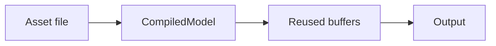

## What you will change

- A model file name
- An input shape

## Pass condition

One inference returns a buffer whose length matches the output shape.

## Sources

- [LiteRT on Android](https://ai.google.dev/edge/litert/android)
- [CompiledModel in Play services](https://developers.google.com/edge/litert/android/compiled_model_java)
````
Create `.run/17-litert-cpu.run.xml`:

````xml
<component name="ProjectRunConfigurationManager">
  <configuration default="false" name="17 LiteRT on CPU" type="AndroidRunConfigurationType" factoryName="Android App">
    <module name="Ai_Lab.app" />
    <option name="ANDROID_RUN_CONFIGURATION_SCHEMA_VERSION" value="1" />
    <option name="DEPLOY" value="true" />
    <option name="MODE" value="specific_activity" />
    <option name="ACTIVITY" value="com.mabrouk.ailab.litertcpu.LitertCpuLabActivity" />
    <option name="ACTIVITY_CLASS" value="com.mabrouk.ailab.litertcpu.LitertCpuLabActivity" />
    <method v="2">
      <option name="Android.Gradle.BeforeRunTask" enabled="true" />
    </method>
  </configuration>
</component>
````
- [ ] **Step 4: Run the test to verify it passes**

Run: `./gradlew :lab-litert-cpu:testDebugUnitTest --tests com.mabrouk.ailab.litertcpu.LitertCpuLabTest`

Expected: PASS

- [ ] **Step 5: Commit**

````bash
GIT_AUTHOR_NAME='mohamed_mabrouk' \
GIT_AUTHOR_EMAIL='mabroukmohamed582@gmail.com' \
GIT_COMMITTER_NAME='mohamed_mabrouk' \
GIT_COMMITTER_EMAIL='mabroukmohamed582@gmail.com' \
git commit -m "Add the LiteRT on CPU lab module."
````
### Task 20: GPU, one thread, warm-up, and latency

**Files:**
- Create: `lab-litert-gpu/build.gradle.kts`
- Create: `lab-litert-gpu/src/main/AndroidManifest.xml`
- Create: `lab-litert-gpu/src/main/java/com/mabrouk/ailab/litertgpu/LitertGpuLab.kt`
- Create: `lab-litert-gpu/src/main/java/com/mabrouk/ailab/litertgpu/LitertGpuLabActivity.kt`
- Create: `lab-litert-gpu/src/main/java/com/mabrouk/ailab/litertgpu/LitertGpuLabInitializer.kt`
- Create: `lab-litert-gpu/src/test/java/com/mabrouk/ailab/litertgpu/LitertGpuLabTest.kt`
- Create: `lab-litert-gpu/README.md`
- Create: `.run/18-litert-gpu.run.xml`
- Modify: `settings.gradle.kts`
- Modify: `app/build.gradle.kts`

**Interfaces:**
- Consumes: `Lab`, `Track`, `LabRegistry.register`, `LabScreen`, `AiLabTheme`
- Produces: `LitertGpuLab.lab` with id `litert-gpu` and order `18`

- [ ] **Step 1: Write the failing test**

Create `lab-litert-gpu/src/test/java/com/mabrouk/ailab/litertgpu/LitertGpuLabTest.kt`:

````kotlin
package com.mabrouk.ailab.litertgpu

import org.junit.Assert.assertEquals
import org.junit.Assert.assertTrue
import org.junit.Test

class LitertGpuLabTest {
    @Test
    fun lab_matchesTheCatalogContract() {
        val lab = LitertGpuLab.lab
        assertEquals("litert-gpu", lab.id)
        assertEquals(18, lab.order)
        assertTrue(lab.idea.isNotBlank())
        assertTrue(lab.runInputs.isNotEmpty())
        assertTrue(lab.passCondition.isNotBlank())
        assertTrue(lab.sources.all { it.startsWith("https://") })
        assertEquals("com.mabrouk.ailab.litertgpu.LitertGpuLabActivity", lab.activityClassName)
    }
}
````
- [ ] **Step 2: Run the test to verify it fails**

Run: `./gradlew :lab-litert-gpu:testDebugUnitTest --tests com.mabrouk.ailab.litertgpu.LitertGpuLabTest`

Expected: FAIL because the module or `LitertGpuLab` does not exist yet.

- [ ] **Step 3: Add the module**

Add `include(":lab-litert-gpu")` to `settings.gradle.kts`.

Add `implementation(project(":lab-litert-gpu"))` to `app/build.gradle.kts`.

Create `lab-litert-gpu/build.gradle.kts`:

````kotlin
plugins {
    alias(libs.plugins.android.library)
    alias(libs.plugins.kotlin.compose)
}

android {
    namespace = "com.mabrouk.ailab.litertgpu"
    compileSdk {
        version = release(37)
    }
    defaultConfig {
        minSdk = 26
    }
    compileOptions {
        sourceCompatibility = JavaVersion.VERSION_11
        targetCompatibility = JavaVersion.VERSION_11
    }
    buildFeatures {
        compose = true
    }
}

dependencies {
    implementation(project(":lab-api"))
    implementation(platform(libs.androidx.compose.bom))
    implementation(libs.androidx.activity.compose)
    implementation(libs.androidx.compose.material3)
    implementation(libs.androidx.compose.ui)
    implementation(libs.androidx.startup.runtime)
    testImplementation(libs.junit)
}
````
Create `lab-litert-gpu/src/main/AndroidManifest.xml`:

````xml
<?xml version="1.0" encoding="utf-8"?>
<manifest xmlns:android="http://schemas.android.com/apk/res/android"
    xmlns:tools="http://schemas.android.com/tools">
    <application>
        <activity
            android:name=".LitertGpuLabActivity"
            android:exported="false" />
        <provider
            android:name="androidx.startup.InitializationProvider"
            android:authorities="${applicationId}.androidx-startup"
            android:exported="false"
            tools:node="merge">
            <meta-data
                android:name="com.mabrouk.ailab.litertgpu.LitertGpuLabInitializer"
                android:value="androidx.startup" />
        </provider>
    </application>
</manifest>
````
Create `lab-litert-gpu/src/main/java/com/mabrouk/ailab/litertgpu/LitertGpuLab.kt`:

````kotlin
package com.mabrouk.ailab.litertgpu

import com.mabrouk.ailab.lab.Lab
import com.mabrouk.ailab.lab.Track

object LitertGpuLab {
    val lab = Lab(
        id = "litert-gpu",
        title = "GPU, one thread, warm-up, and latency",
        track = Track.Android,
        order = 18,
        summary = "Time the steady run, and keep the model on one thread.",
        idea = "One background thread owns the model. GPU options list CPU as the fallback. Measure run together with the output read. Warm up once so the first user tap is not the shader compile.",
        prerequisites = listOf("litert-cpu"),
        runInputs = listOf(
        "A repeat count",
        ),
        passCondition = "The screen shows a warm-up time and a steady-run time.",
        sources = listOf(
        "https://ai.google.dev/edge/litert/android",
        ),
        activityClassName = "com.mabrouk.ailab.litertgpu.LitertGpuLabActivity",
    )
}
````
Create `lab-litert-gpu/src/main/java/com/mabrouk/ailab/litertgpu/LitertGpuLabActivity.kt`:

````kotlin
package com.mabrouk.ailab.litertgpu

import android.os.Bundle
import androidx.activity.ComponentActivity
import androidx.activity.compose.setContent
import androidx.activity.enableEdgeToEdge
import com.mabrouk.ailab.lab.theme.AiLabTheme
import com.mabrouk.ailab.lab.ui.LabScreen

class LitertGpuLabActivity : ComponentActivity() {
    override fun onCreate(savedInstanceState: Bundle?) {
        super.onCreate(savedInstanceState)
        enableEdgeToEdge()
        setContent {
            AiLabTheme {
                LabScreen(LitertGpuLab.lab)
            }
        }
    }
}
````
Create `lab-litert-gpu/src/main/java/com/mabrouk/ailab/litertgpu/LitertGpuLabInitializer.kt`:

````kotlin
package com.mabrouk.ailab.litertgpu

import android.content.Context
import androidx.startup.Initializer
import com.mabrouk.ailab.lab.LabRegistry

class LitertGpuLabInitializer : Initializer<Unit> {
    override fun create(context: Context) {
        LabRegistry.register(LitertGpuLab.lab)
    }

    override fun dependencies(): List<Class<out Initializer<*>>> = emptyList()
}
````
Create `lab-litert-gpu/README.md`:

````markdown
# GPU, one thread, warm-up, and latency

## What this topic is

One background thread owns the model. GPU options list CPU as the fallback. Measure run together with the output read. Warm up once so the first user tap is not the shader compile.

## Why an Android AI engineer needs it

A GPU delegate that is touched from the main thread, or timed without the readback, lies about latency.

## Diagram

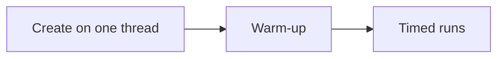

## What you will change

- A repeat count

## Pass condition

The screen shows a warm-up time and a steady-run time.

## Sources

- [LiteRT on Android](https://ai.google.dev/edge/litert/android)
````
Create `.run/18-litert-gpu.run.xml`:

````xml
<component name="ProjectRunConfigurationManager">
  <configuration default="false" name="18 GPU, one thread, warm-up, and latency" type="AndroidRunConfigurationType" factoryName="Android App">
    <module name="Ai_Lab.app" />
    <option name="ANDROID_RUN_CONFIGURATION_SCHEMA_VERSION" value="1" />
    <option name="DEPLOY" value="true" />
    <option name="MODE" value="specific_activity" />
    <option name="ACTIVITY" value="com.mabrouk.ailab.litertgpu.LitertGpuLabActivity" />
    <option name="ACTIVITY_CLASS" value="com.mabrouk.ailab.litertgpu.LitertGpuLabActivity" />
    <method v="2">
      <option name="Android.Gradle.BeforeRunTask" enabled="true" />
    </method>
  </configuration>
</component>
````
- [ ] **Step 4: Run the test to verify it passes**

Run: `./gradlew :lab-litert-gpu:testDebugUnitTest --tests com.mabrouk.ailab.litertgpu.LitertGpuLabTest`

Expected: PASS

- [ ] **Step 5: Commit**

````bash
GIT_AUTHOR_NAME='mohamed_mabrouk' \
GIT_AUTHOR_EMAIL='mabroukmohamed582@gmail.com' \
GIT_COMMITTER_NAME='mohamed_mabrouk' \
GIT_COMMITTER_EMAIL='mabroukmohamed582@gmail.com' \
git commit -m "Add the GPU, one thread, warm-up, and latency lab module."
````
### Task 21: Play services LiteRT and the bundled runtime

**Files:**
- Create: `lab-litert-runtime/build.gradle.kts`
- Create: `lab-litert-runtime/src/main/AndroidManifest.xml`
- Create: `lab-litert-runtime/src/main/java/com/mabrouk/ailab/litertruntime/LitertRuntimeLab.kt`
- Create: `lab-litert-runtime/src/main/java/com/mabrouk/ailab/litertruntime/LitertRuntimeLabActivity.kt`
- Create: `lab-litert-runtime/src/main/java/com/mabrouk/ailab/litertruntime/LitertRuntimeLabInitializer.kt`
- Create: `lab-litert-runtime/src/test/java/com/mabrouk/ailab/litertruntime/LitertRuntimeLabTest.kt`
- Create: `lab-litert-runtime/README.md`
- Create: `.run/19-litert-runtime.run.xml`
- Modify: `settings.gradle.kts`
- Modify: `app/build.gradle.kts`

**Interfaces:**
- Consumes: `Lab`, `Track`, `LabRegistry.register`, `LabScreen`, `AiLabTheme`
- Produces: `LitertRuntimeLab.lab` with id `litert-runtime` and order `19`

- [ ] **Step 1: Write the failing test**

Create `lab-litert-runtime/src/test/java/com/mabrouk/ailab/litertruntime/LitertRuntimeLabTest.kt`:

````kotlin
package com.mabrouk.ailab.litertruntime

import org.junit.Assert.assertEquals
import org.junit.Assert.assertTrue
import org.junit.Test

class LitertRuntimeLabTest {
    @Test
    fun lab_matchesTheCatalogContract() {
        val lab = LitertRuntimeLab.lab
        assertEquals("litert-runtime", lab.id)
        assertEquals(19, lab.order)
        assertTrue(lab.idea.isNotBlank())
        assertTrue(lab.runInputs.isNotEmpty())
        assertTrue(lab.passCondition.isNotBlank())
        assertTrue(lab.sources.all { it.startsWith("https://") })
        assertEquals("com.mabrouk.ailab.litertruntime.LitertRuntimeLabActivity", lab.activityClassName)
    }
}
````
- [ ] **Step 2: Run the test to verify it fails**

Run: `./gradlew :lab-litert-runtime:testDebugUnitTest --tests com.mabrouk.ailab.litertruntime.LitertRuntimeLabTest`

Expected: FAIL because the module or `LitertRuntimeLab` does not exist yet.

- [ ] **Step 3: Add the module**

Add `include(":lab-litert-runtime")` to `settings.gradle.kts`.

Add `implementation(project(":lab-litert-runtime"))` to `app/build.gradle.kts`.

Create `lab-litert-runtime/build.gradle.kts`:

````kotlin
plugins {
    alias(libs.plugins.android.library)
    alias(libs.plugins.kotlin.compose)
}

android {
    namespace = "com.mabrouk.ailab.litertruntime"
    compileSdk {
        version = release(37)
    }
    defaultConfig {
        minSdk = 26
    }
    compileOptions {
        sourceCompatibility = JavaVersion.VERSION_11
        targetCompatibility = JavaVersion.VERSION_11
    }
    buildFeatures {
        compose = true
    }
}

dependencies {
    implementation(project(":lab-api"))
    implementation(platform(libs.androidx.compose.bom))
    implementation(libs.androidx.activity.compose)
    implementation(libs.androidx.compose.material3)
    implementation(libs.androidx.compose.ui)
    implementation(libs.androidx.startup.runtime)
    testImplementation(libs.junit)
}
````
Create `lab-litert-runtime/src/main/AndroidManifest.xml`:

````xml
<?xml version="1.0" encoding="utf-8"?>
<manifest xmlns:android="http://schemas.android.com/apk/res/android"
    xmlns:tools="http://schemas.android.com/tools">
    <application>
        <activity
            android:name=".LitertRuntimeLabActivity"
            android:exported="false" />
        <provider
            android:name="androidx.startup.InitializationProvider"
            android:authorities="${applicationId}.androidx-startup"
            android:exported="false"
            tools:node="merge">
            <meta-data
                android:name="com.mabrouk.ailab.litertruntime.LitertRuntimeLabInitializer"
                android:value="androidx.startup" />
        </provider>
    </application>
</manifest>
````
Create `lab-litert-runtime/src/main/java/com/mabrouk/ailab/litertruntime/LitertRuntimeLab.kt`:

````kotlin
package com.mabrouk.ailab.litertruntime

import com.mabrouk.ailab.lab.Lab
import com.mabrouk.ailab.lab.Track

object LitertRuntimeLab {
    val lab = Lab(
        id = "litert-runtime",
        title = "Play services LiteRT and the bundled runtime",
        track = Track.Android,
        order = 19,
        summary = "Pick one runtime and know why.",
        idea = "Play services keeps the runtime out of the APK. The bundled runtime is for NPU, custom ops, or devices without Play services. One build variant contains one of them.",
        prerequisites = listOf("litert-gpu", "litert-cpu"),
        runInputs = listOf(
        "A runtime name",
        ),
        passCondition = "The screen states which artifact that choice adds and which case forbids mixing them.",
        sources = listOf(
        "https://developers.google.com/edge/litert/android/compiled_model_java",
        "https://ai.google.dev/edge/litert/android",
        ),
        activityClassName = "com.mabrouk.ailab.litertruntime.LitertRuntimeLabActivity",
    )
}
````
Create `lab-litert-runtime/src/main/java/com/mabrouk/ailab/litertruntime/LitertRuntimeLabActivity.kt`:

````kotlin
package com.mabrouk.ailab.litertruntime

import android.os.Bundle
import androidx.activity.ComponentActivity
import androidx.activity.compose.setContent
import androidx.activity.enableEdgeToEdge
import com.mabrouk.ailab.lab.theme.AiLabTheme
import com.mabrouk.ailab.lab.ui.LabScreen

class LitertRuntimeLabActivity : ComponentActivity() {
    override fun onCreate(savedInstanceState: Bundle?) {
        super.onCreate(savedInstanceState)
        enableEdgeToEdge()
        setContent {
            AiLabTheme {
                LabScreen(LitertRuntimeLab.lab)
            }
        }
    }
}
````
Create `lab-litert-runtime/src/main/java/com/mabrouk/ailab/litertruntime/LitertRuntimeLabInitializer.kt`:

````kotlin
package com.mabrouk.ailab.litertruntime

import android.content.Context
import androidx.startup.Initializer
import com.mabrouk.ailab.lab.LabRegistry

class LitertRuntimeLabInitializer : Initializer<Unit> {
    override fun create(context: Context) {
        LabRegistry.register(LitertRuntimeLab.lab)
    }

    override fun dependencies(): List<Class<out Initializer<*>>> = emptyList()
}
````
Create `lab-litert-runtime/README.md`:

````markdown
# Play services LiteRT and the bundled runtime

## What this topic is

Play services keeps the runtime out of the APK. The bundled runtime is for NPU, custom ops, or devices without Play services. One build variant contains one of them.

## Why an Android AI engineer needs it

Shipping both runtimes in one variant is the mistake this lab exists to prevent.

## Diagram

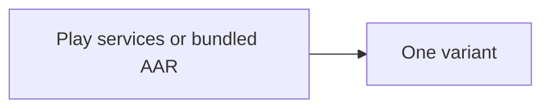

## What you will change

- A runtime name

## Pass condition

The screen states which artifact that choice adds and which case forbids mixing them.

## Sources

- [CompiledModel in Play services](https://developers.google.com/edge/litert/android/compiled_model_java)
- [LiteRT on Android](https://ai.google.dev/edge/litert/android)
````
Create `.run/19-litert-runtime.run.xml`:

````xml
<component name="ProjectRunConfigurationManager">
  <configuration default="false" name="19 Play services LiteRT and the bundled runtime" type="AndroidRunConfigurationType" factoryName="Android App">
    <module name="Ai_Lab.app" />
    <option name="ANDROID_RUN_CONFIGURATION_SCHEMA_VERSION" value="1" />
    <option name="DEPLOY" value="true" />
    <option name="MODE" value="specific_activity" />
    <option name="ACTIVITY" value="com.mabrouk.ailab.litertruntime.LitertRuntimeLabActivity" />
    <option name="ACTIVITY_CLASS" value="com.mabrouk.ailab.litertruntime.LitertRuntimeLabActivity" />
    <method v="2">
      <option name="Android.Gradle.BeforeRunTask" enabled="true" />
    </method>
  </configuration>
</component>
````
- [ ] **Step 4: Run the test to verify it passes**

Run: `./gradlew :lab-litert-runtime:testDebugUnitTest --tests com.mabrouk.ailab.litertruntime.LitertRuntimeLabTest`

Expected: PASS

- [ ] **Step 5: Commit**

````bash
GIT_AUTHOR_NAME='mohamed_mabrouk' \
GIT_AUTHOR_EMAIL='mabroukmohamed582@gmail.com' \
GIT_COMMITTER_NAME='mohamed_mabrouk' \
GIT_COMMITTER_EMAIL='mabroukmohamed582@gmail.com' \
git commit -m "Add the Play services LiteRT and the bundled runtime lab module."
````
### Task 22: Assets, AI packs, and downloads

**Files:**
- Create: `lab-model-delivery/build.gradle.kts`
- Create: `lab-model-delivery/src/main/AndroidManifest.xml`
- Create: `lab-model-delivery/src/main/java/com/mabrouk/ailab/modeldelivery/ModelDeliveryLab.kt`
- Create: `lab-model-delivery/src/main/java/com/mabrouk/ailab/modeldelivery/ModelDeliveryLabActivity.kt`
- Create: `lab-model-delivery/src/main/java/com/mabrouk/ailab/modeldelivery/ModelDeliveryLabInitializer.kt`
- Create: `lab-model-delivery/src/test/java/com/mabrouk/ailab/modeldelivery/ModelDeliveryLabTest.kt`
- Create: `lab-model-delivery/README.md`
- Create: `.run/20-model-delivery.run.xml`
- Modify: `settings.gradle.kts`
- Modify: `app/build.gradle.kts`

**Interfaces:**
- Consumes: `Lab`, `Track`, `LabRegistry.register`, `LabScreen`, `AiLabTheme`
- Produces: `ModelDeliveryLab.lab` with id `model-delivery` and order `20`

- [ ] **Step 1: Write the failing test**

Create `lab-model-delivery/src/test/java/com/mabrouk/ailab/modeldelivery/ModelDeliveryLabTest.kt`:

````kotlin
package com.mabrouk.ailab.modeldelivery

import org.junit.Assert.assertEquals
import org.junit.Assert.assertTrue
import org.junit.Test

class ModelDeliveryLabTest {
    @Test
    fun lab_matchesTheCatalogContract() {
        val lab = ModelDeliveryLab.lab
        assertEquals("model-delivery", lab.id)
        assertEquals(20, lab.order)
        assertTrue(lab.idea.isNotBlank())
        assertTrue(lab.runInputs.isNotEmpty())
        assertTrue(lab.passCondition.isNotBlank())
        assertTrue(lab.sources.all { it.startsWith("https://") })
        assertEquals("com.mabrouk.ailab.modeldelivery.ModelDeliveryLabActivity", lab.activityClassName)
    }
}
````
- [ ] **Step 2: Run the test to verify it fails**

Run: `./gradlew :lab-model-delivery:testDebugUnitTest --tests com.mabrouk.ailab.modeldelivery.ModelDeliveryLabTest`

Expected: FAIL because the module or `ModelDeliveryLab` does not exist yet.

- [ ] **Step 3: Add the module**

Add `include(":lab-model-delivery")` to `settings.gradle.kts`.

Add `implementation(project(":lab-model-delivery"))` to `app/build.gradle.kts`.

Create `lab-model-delivery/build.gradle.kts`:

````kotlin
plugins {
    alias(libs.plugins.android.library)
    alias(libs.plugins.kotlin.compose)
}

android {
    namespace = "com.mabrouk.ailab.modeldelivery"
    compileSdk {
        version = release(37)
    }
    defaultConfig {
        minSdk = 26
    }
    compileOptions {
        sourceCompatibility = JavaVersion.VERSION_11
        targetCompatibility = JavaVersion.VERSION_11
    }
    buildFeatures {
        compose = true
    }
}

dependencies {
    implementation(project(":lab-api"))
    implementation(platform(libs.androidx.compose.bom))
    implementation(libs.androidx.activity.compose)
    implementation(libs.androidx.compose.material3)
    implementation(libs.androidx.compose.ui)
    implementation(libs.androidx.startup.runtime)
    testImplementation(libs.junit)
}
````
Create `lab-model-delivery/src/main/AndroidManifest.xml`:

````xml
<?xml version="1.0" encoding="utf-8"?>
<manifest xmlns:android="http://schemas.android.com/apk/res/android"
    xmlns:tools="http://schemas.android.com/tools">
    <application>
        <activity
            android:name=".ModelDeliveryLabActivity"
            android:exported="false" />
        <provider
            android:name="androidx.startup.InitializationProvider"
            android:authorities="${applicationId}.androidx-startup"
            android:exported="false"
            tools:node="merge">
            <meta-data
                android:name="com.mabrouk.ailab.modeldelivery.ModelDeliveryLabInitializer"
                android:value="androidx.startup" />
        </provider>
    </application>
</manifest>
````
Create `lab-model-delivery/src/main/java/com/mabrouk/ailab/modeldelivery/ModelDeliveryLab.kt`:

````kotlin
package com.mabrouk.ailab.modeldelivery

import com.mabrouk.ailab.lab.Lab
import com.mabrouk.ailab.lab.Track

object ModelDeliveryLab {
    val lab = Lab(
        id = "model-delivery",
        title = "Assets, AI packs, and downloads",
        track = Track.Android,
        order = 20,
        summary = "The model file has an address, and the app has to wait for it.",
        idea = "Small models ship in assets. Larger ones ship as a Play AI pack or a file in app storage. An on-demand pack is null until it has downloaded.",
        prerequisites = listOf("litert-runtime", "litert-cpu"),
        runInputs = listOf(
        "A delivery mode (assets, install-time pack, on-demand pack, or download)",
        ),
        passCondition = "The screen names where CompiledModel.create reads for that mode.",
        sources = listOf(
        "https://developer.android.com/google/play/on-device-ai",
        ),
        activityClassName = "com.mabrouk.ailab.modeldelivery.ModelDeliveryLabActivity",
    )
}
````
Create `lab-model-delivery/src/main/java/com/mabrouk/ailab/modeldelivery/ModelDeliveryLabActivity.kt`:

````kotlin
package com.mabrouk.ailab.modeldelivery

import android.os.Bundle
import androidx.activity.ComponentActivity
import androidx.activity.compose.setContent
import androidx.activity.enableEdgeToEdge
import com.mabrouk.ailab.lab.theme.AiLabTheme
import com.mabrouk.ailab.lab.ui.LabScreen

class ModelDeliveryLabActivity : ComponentActivity() {
    override fun onCreate(savedInstanceState: Bundle?) {
        super.onCreate(savedInstanceState)
        enableEdgeToEdge()
        setContent {
            AiLabTheme {
                LabScreen(ModelDeliveryLab.lab)
            }
        }
    }
}
````
Create `lab-model-delivery/src/main/java/com/mabrouk/ailab/modeldelivery/ModelDeliveryLabInitializer.kt`:

````kotlin
package com.mabrouk.ailab.modeldelivery

import android.content.Context
import androidx.startup.Initializer
import com.mabrouk.ailab.lab.LabRegistry

class ModelDeliveryLabInitializer : Initializer<Unit> {
    override fun create(context: Context) {
        LabRegistry.register(ModelDeliveryLab.lab)
    }

    override fun dependencies(): List<Class<out Initializer<*>>> = emptyList()
}
````
Create `lab-model-delivery/README.md`:

````markdown
# Assets, AI packs, and downloads

## What this topic is

Small models ship in assets. Larger ones ship as a Play AI pack or a file in app storage. An on-demand pack is null until it has downloaded.

## Why an Android AI engineer needs it

CompiledModel.create cannot run until the file has a path.

## Diagram

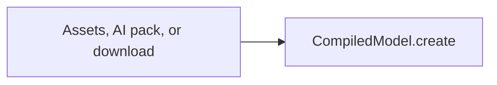

## What you will change

- A delivery mode (assets, install-time pack, on-demand pack, or download)

## Pass condition

The screen names where CompiledModel.create reads for that mode.

## Sources

- [Play for On-device AI](https://developer.android.com/google/play/on-device-ai)
````
Create `.run/20-model-delivery.run.xml`:

````xml
<component name="ProjectRunConfigurationManager">
  <configuration default="false" name="20 Assets, AI packs, and downloads" type="AndroidRunConfigurationType" factoryName="Android App">
    <module name="Ai_Lab.app" />
    <option name="ANDROID_RUN_CONFIGURATION_SCHEMA_VERSION" value="1" />
    <option name="DEPLOY" value="true" />
    <option name="MODE" value="specific_activity" />
    <option name="ACTIVITY" value="com.mabrouk.ailab.modeldelivery.ModelDeliveryLabActivity" />
    <option name="ACTIVITY_CLASS" value="com.mabrouk.ailab.modeldelivery.ModelDeliveryLabActivity" />
    <method v="2">
      <option name="Android.Gradle.BeforeRunTask" enabled="true" />
    </method>
  </configuration>
</component>
````
- [ ] **Step 4: Run the test to verify it passes**

Run: `./gradlew :lab-model-delivery:testDebugUnitTest --tests com.mabrouk.ailab.modeldelivery.ModelDeliveryLabTest`

Expected: PASS

- [ ] **Step 5: Commit**

````bash
GIT_AUTHOR_NAME='mohamed_mabrouk' \
GIT_AUTHOR_EMAIL='mabroukmohamed582@gmail.com' \
GIT_COMMITTER_NAME='mohamed_mabrouk' \
GIT_COMMITTER_EMAIL='mabroukmohamed582@gmail.com' \
git commit -m "Add the Assets, AI packs, and downloads lab module."
````
### Task 23: On-device embeddings and RAG

**Files:**
- Create: `lab-on-device-rag/build.gradle.kts`
- Create: `lab-on-device-rag/src/main/AndroidManifest.xml`
- Create: `lab-on-device-rag/src/main/java/com/mabrouk/ailab/ondevicerag/OnDeviceRagLab.kt`
- Create: `lab-on-device-rag/src/main/java/com/mabrouk/ailab/ondevicerag/OnDeviceRagLabActivity.kt`
- Create: `lab-on-device-rag/src/main/java/com/mabrouk/ailab/ondevicerag/OnDeviceRagLabInitializer.kt`
- Create: `lab-on-device-rag/src/test/java/com/mabrouk/ailab/ondevicerag/OnDeviceRagLabTest.kt`
- Create: `lab-on-device-rag/README.md`
- Create: `.run/21-on-device-rag.run.xml`
- Modify: `settings.gradle.kts`
- Modify: `app/build.gradle.kts`

**Interfaces:**
- Consumes: `Lab`, `Track`, `LabRegistry.register`, `LabScreen`, `AiLabTheme`
- Produces: `OnDeviceRagLab.lab` with id `on-device-rag` and order `21`

- [ ] **Step 1: Write the failing test**

Create `lab-on-device-rag/src/test/java/com/mabrouk/ailab/ondevicerag/OnDeviceRagLabTest.kt`:

````kotlin
package com.mabrouk.ailab.ondevicerag

import org.junit.Assert.assertEquals
import org.junit.Assert.assertTrue
import org.junit.Test

class OnDeviceRagLabTest {
    @Test
    fun lab_matchesTheCatalogContract() {
        val lab = OnDeviceRagLab.lab
        assertEquals("on-device-rag", lab.id)
        assertEquals(21, lab.order)
        assertTrue(lab.idea.isNotBlank())
        assertTrue(lab.runInputs.isNotEmpty())
        assertTrue(lab.passCondition.isNotBlank())
        assertTrue(lab.sources.all { it.startsWith("https://") })
        assertEquals("com.mabrouk.ailab.ondevicerag.OnDeviceRagLabActivity", lab.activityClassName)
    }
}
````
- [ ] **Step 2: Run the test to verify it fails**

Run: `./gradlew :lab-on-device-rag:testDebugUnitTest --tests com.mabrouk.ailab.ondevicerag.OnDeviceRagLabTest`

Expected: FAIL because the module or `OnDeviceRagLab` does not exist yet.

- [ ] **Step 3: Add the module**

Add `include(":lab-on-device-rag")` to `settings.gradle.kts`.

Add `implementation(project(":lab-on-device-rag"))` to `app/build.gradle.kts`.

Create `lab-on-device-rag/build.gradle.kts`:

````kotlin
plugins {
    alias(libs.plugins.android.library)
    alias(libs.plugins.kotlin.compose)
}

android {
    namespace = "com.mabrouk.ailab.ondevicerag"
    compileSdk {
        version = release(37)
    }
    defaultConfig {
        minSdk = 26
    }
    compileOptions {
        sourceCompatibility = JavaVersion.VERSION_11
        targetCompatibility = JavaVersion.VERSION_11
    }
    buildFeatures {
        compose = true
    }
}

dependencies {
    implementation(project(":lab-api"))
    implementation(platform(libs.androidx.compose.bom))
    implementation(libs.androidx.activity.compose)
    implementation(libs.androidx.compose.material3)
    implementation(libs.androidx.compose.ui)
    implementation(libs.androidx.startup.runtime)
    testImplementation(libs.junit)
}
````
Create `lab-on-device-rag/src/main/AndroidManifest.xml`:

````xml
<?xml version="1.0" encoding="utf-8"?>
<manifest xmlns:android="http://schemas.android.com/apk/res/android"
    xmlns:tools="http://schemas.android.com/tools">
    <application>
        <activity
            android:name=".OnDeviceRagLabActivity"
            android:exported="false" />
        <provider
            android:name="androidx.startup.InitializationProvider"
            android:authorities="${applicationId}.androidx-startup"
            android:exported="false"
            tools:node="merge">
            <meta-data
                android:name="com.mabrouk.ailab.ondevicerag.OnDeviceRagLabInitializer"
                android:value="androidx.startup" />
        </provider>
    </application>
</manifest>
````
Create `lab-on-device-rag/src/main/java/com/mabrouk/ailab/ondevicerag/OnDeviceRagLab.kt`:

````kotlin
package com.mabrouk.ailab.ondevicerag

import com.mabrouk.ailab.lab.Lab
import com.mabrouk.ailab.lab.Track

object OnDeviceRagLab {
    val lab = Lab(
        id = "on-device-rag",
        title = "On-device embeddings and RAG",
        track = Track.Android,
        order = 21,
        summary = "RAG from topic 8, with the vectors kept on the device.",
        idea = "Embed notes on the phone, store the vectors in a small index, and answer from the retrieved note.",
        prerequisites = listOf("model-delivery", "embeddings", "rag"),
        runInputs = listOf(
        "Notes typed in the lab",
        "One question",
        ),
        passCondition = "The answer quotes a note that was stored in the index.",
        sources = listOf(
        "https://developers.google.com/machine-learning/crash-course/embeddings/video-lecture",
        "https://cloud.google.com/vertex-ai/generative-ai/docs/rag-overview",
        ),
        activityClassName = "com.mabrouk.ailab.ondevicerag.OnDeviceRagLabActivity",
    )
}
````
Create `lab-on-device-rag/src/main/java/com/mabrouk/ailab/ondevicerag/OnDeviceRagLabActivity.kt`:

````kotlin
package com.mabrouk.ailab.ondevicerag

import android.os.Bundle
import androidx.activity.ComponentActivity
import androidx.activity.compose.setContent
import androidx.activity.enableEdgeToEdge
import com.mabrouk.ailab.lab.theme.AiLabTheme
import com.mabrouk.ailab.lab.ui.LabScreen

class OnDeviceRagLabActivity : ComponentActivity() {
    override fun onCreate(savedInstanceState: Bundle?) {
        super.onCreate(savedInstanceState)
        enableEdgeToEdge()
        setContent {
            AiLabTheme {
                LabScreen(OnDeviceRagLab.lab)
            }
        }
    }
}
````
Create `lab-on-device-rag/src/main/java/com/mabrouk/ailab/ondevicerag/OnDeviceRagLabInitializer.kt`:

````kotlin
package com.mabrouk.ailab.ondevicerag

import android.content.Context
import androidx.startup.Initializer
import com.mabrouk.ailab.lab.LabRegistry

class OnDeviceRagLabInitializer : Initializer<Unit> {
    override fun create(context: Context) {
        LabRegistry.register(OnDeviceRagLab.lab)
    }

    override fun dependencies(): List<Class<out Initializer<*>>> = emptyList()
}
````
Create `lab-on-device-rag/README.md`:

````markdown
# On-device embeddings and RAG

## What this topic is

Embed notes on the phone, store the vectors in a small index, and answer from the retrieved note.

## Why an Android AI engineer needs it

This is the phone version of the literacy RAG lab.

## Diagram

```mermaid
flowchart LR
  n0["Typed notes"] --> n1["On-device vectors"] --> n2["Index"] --> n3["Answer"]
```

## What you will change

- Notes typed in the lab
- One question

## Pass condition

The answer quotes a note that was stored in the index.

## Sources

- [Embeddings crash course](https://developers.google.com/machine-learning/crash-course/embeddings/video-lecture)
- [Retrieval-augmented generation](https://cloud.google.com/vertex-ai/generative-ai/docs/rag-overview)
````
Create `.run/21-on-device-rag.run.xml`:

````xml
<component name="ProjectRunConfigurationManager">
  <configuration default="false" name="21 On-device embeddings and RAG" type="AndroidRunConfigurationType" factoryName="Android App">
    <module name="Ai_Lab.app" />
    <option name="ANDROID_RUN_CONFIGURATION_SCHEMA_VERSION" value="1" />
    <option name="DEPLOY" value="true" />
    <option name="MODE" value="specific_activity" />
    <option name="ACTIVITY" value="com.mabrouk.ailab.ondevicerag.OnDeviceRagLabActivity" />
    <option name="ACTIVITY_CLASS" value="com.mabrouk.ailab.ondevicerag.OnDeviceRagLabActivity" />
    <method v="2">
      <option name="Android.Gradle.BeforeRunTask" enabled="true" />
    </method>
  </configuration>
</component>
````
- [ ] **Step 4: Run the test to verify it passes**

Run: `./gradlew :lab-on-device-rag:testDebugUnitTest --tests com.mabrouk.ailab.ondevicerag.OnDeviceRagLabTest`

Expected: PASS

- [ ] **Step 5: Commit**

````bash
GIT_AUTHOR_NAME='mohamed_mabrouk' \
GIT_AUTHOR_EMAIL='mabroukmohamed582@gmail.com' \
GIT_COMMITTER_NAME='mohamed_mabrouk' \
GIT_COMMITTER_EMAIL='mabroukmohamed582@gmail.com' \
git commit -m "Add the On-device embeddings and RAG lab module."
````
### Task 24: LiteRT LM

**Files:**
- Create: `lab-litert-lm/build.gradle.kts`
- Create: `lab-litert-lm/src/main/AndroidManifest.xml`
- Create: `lab-litert-lm/src/main/java/com/mabrouk/ailab/litertlm/LitertLmLab.kt`
- Create: `lab-litert-lm/src/main/java/com/mabrouk/ailab/litertlm/LitertLmLabActivity.kt`
- Create: `lab-litert-lm/src/main/java/com/mabrouk/ailab/litertlm/LitertLmLabInitializer.kt`
- Create: `lab-litert-lm/src/test/java/com/mabrouk/ailab/litertlm/LitertLmLabTest.kt`
- Create: `lab-litert-lm/README.md`
- Create: `.run/22-litert-lm.run.xml`
- Modify: `settings.gradle.kts`
- Modify: `app/build.gradle.kts`

**Interfaces:**
- Consumes: `Lab`, `Track`, `LabRegistry.register`, `LabScreen`, `AiLabTheme`
- Produces: `LitertLmLab.lab` with id `litert-lm` and order `22`

- [ ] **Step 1: Write the failing test**

Create `lab-litert-lm/src/test/java/com/mabrouk/ailab/litertlm/LitertLmLabTest.kt`:

````kotlin
package com.mabrouk.ailab.litertlm

import org.junit.Assert.assertEquals
import org.junit.Assert.assertTrue
import org.junit.Test

class LitertLmLabTest {
    @Test
    fun lab_matchesTheCatalogContract() {
        val lab = LitertLmLab.lab
        assertEquals("litert-lm", lab.id)
        assertEquals(22, lab.order)
        assertTrue(lab.idea.isNotBlank())
        assertTrue(lab.runInputs.isNotEmpty())
        assertTrue(lab.passCondition.isNotBlank())
        assertTrue(lab.sources.all { it.startsWith("https://") })
        assertEquals("com.mabrouk.ailab.litertlm.LitertLmLabActivity", lab.activityClassName)
    }
}
````
- [ ] **Step 2: Run the test to verify it fails**

Run: `./gradlew :lab-litert-lm:testDebugUnitTest --tests com.mabrouk.ailab.litertlm.LitertLmLabTest`

Expected: FAIL because the module or `LitertLmLab` does not exist yet.

- [ ] **Step 3: Add the module**

Add `include(":lab-litert-lm")` to `settings.gradle.kts`.

Add `implementation(project(":lab-litert-lm"))` to `app/build.gradle.kts`.

Create `lab-litert-lm/build.gradle.kts`:

````kotlin
plugins {
    alias(libs.plugins.android.library)
    alias(libs.plugins.kotlin.compose)
}

android {
    namespace = "com.mabrouk.ailab.litertlm"
    compileSdk {
        version = release(37)
    }
    defaultConfig {
        minSdk = 26
    }
    compileOptions {
        sourceCompatibility = JavaVersion.VERSION_11
        targetCompatibility = JavaVersion.VERSION_11
    }
    buildFeatures {
        compose = true
    }
}

dependencies {
    implementation(project(":lab-api"))
    implementation(platform(libs.androidx.compose.bom))
    implementation(libs.androidx.activity.compose)
    implementation(libs.androidx.compose.material3)
    implementation(libs.androidx.compose.ui)
    implementation(libs.androidx.startup.runtime)
    testImplementation(libs.junit)
}
````
Create `lab-litert-lm/src/main/AndroidManifest.xml`:

````xml
<?xml version="1.0" encoding="utf-8"?>
<manifest xmlns:android="http://schemas.android.com/apk/res/android"
    xmlns:tools="http://schemas.android.com/tools">
    <application>
        <activity
            android:name=".LitertLmLabActivity"
            android:exported="false" />
        <provider
            android:name="androidx.startup.InitializationProvider"
            android:authorities="${applicationId}.androidx-startup"
            android:exported="false"
            tools:node="merge">
            <meta-data
                android:name="com.mabrouk.ailab.litertlm.LitertLmLabInitializer"
                android:value="androidx.startup" />
        </provider>
    </application>
</manifest>
````
Create `lab-litert-lm/src/main/java/com/mabrouk/ailab/litertlm/LitertLmLab.kt`:

````kotlin
package com.mabrouk.ailab.litertlm

import com.mabrouk.ailab.lab.Lab
import com.mabrouk.ailab.lab.Track

object LitertLmLab {
    val lab = Lab(
        id = "litert-lm",
        title = "LiteRT LM",
        track = Track.Android,
        order = 22,
        summary = "Run an open language model you ship yourself.",
        idea = "An open .litertlm model runs through LiteRT-LM, which is a different stack from Gemini Nano.",
        prerequisites = listOf("on-device-rag"),
        runInputs = listOf(
        "A prompt",
        ),
        passCondition = "The screen shows generated text, or an explanation when the model file is absent, and absence does not mark the lab passed.",
        sources = listOf(
        "https://developers.google.com/edge/litert-lm/android",
        ),
        activityClassName = "com.mabrouk.ailab.litertlm.LitertLmLabActivity",
    )
}
````
Create `lab-litert-lm/src/main/java/com/mabrouk/ailab/litertlm/LitertLmLabActivity.kt`:

````kotlin
package com.mabrouk.ailab.litertlm

import android.os.Bundle
import androidx.activity.ComponentActivity
import androidx.activity.compose.setContent
import androidx.activity.enableEdgeToEdge
import com.mabrouk.ailab.lab.theme.AiLabTheme
import com.mabrouk.ailab.lab.ui.LabScreen

class LitertLmLabActivity : ComponentActivity() {
    override fun onCreate(savedInstanceState: Bundle?) {
        super.onCreate(savedInstanceState)
        enableEdgeToEdge()
        setContent {
            AiLabTheme {
                LabScreen(LitertLmLab.lab)
            }
        }
    }
}
````
Create `lab-litert-lm/src/main/java/com/mabrouk/ailab/litertlm/LitertLmLabInitializer.kt`:

````kotlin
package com.mabrouk.ailab.litertlm

import android.content.Context
import androidx.startup.Initializer
import com.mabrouk.ailab.lab.LabRegistry

class LitertLmLabInitializer : Initializer<Unit> {
    override fun create(context: Context) {
        LabRegistry.register(LitertLmLab.lab)
    }

    override fun dependencies(): List<Class<out Initializer<*>>> = emptyList()
}
````
Create `lab-litert-lm/README.md`:

````markdown
# LiteRT LM

## What this topic is

An open .litertlm model runs through LiteRT-LM, which is a different stack from Gemini Nano.

## Why an Android AI engineer needs it

Gemini Nano is a system model. LiteRT LM is a model you package.

## Diagram

```mermaid
flowchart LR
  n0[".litertlm file"] --> n1["LiteRT-LM"] --> n2["Text"]
```

## What you will change

- A prompt

## Pass condition

The screen shows generated text, or an explanation when the model file is absent, and absence does not mark the lab passed.

## Sources

- [LiteRT-LM on Android](https://developers.google.com/edge/litert-lm/android)
````
Create `.run/22-litert-lm.run.xml`:

````xml
<component name="ProjectRunConfigurationManager">
  <configuration default="false" name="22 LiteRT LM" type="AndroidRunConfigurationType" factoryName="Android App">
    <module name="Ai_Lab.app" />
    <option name="ANDROID_RUN_CONFIGURATION_SCHEMA_VERSION" value="1" />
    <option name="DEPLOY" value="true" />
    <option name="MODE" value="specific_activity" />
    <option name="ACTIVITY" value="com.mabrouk.ailab.litertlm.LitertLmLabActivity" />
    <option name="ACTIVITY_CLASS" value="com.mabrouk.ailab.litertlm.LitertLmLabActivity" />
    <method v="2">
      <option name="Android.Gradle.BeforeRunTask" enabled="true" />
    </method>
  </configuration>
</component>
````
- [ ] **Step 4: Run the test to verify it passes**

Run: `./gradlew :lab-litert-lm:testDebugUnitTest --tests com.mabrouk.ailab.litertlm.LitertLmLabTest`

Expected: PASS

- [ ] **Step 5: Commit**

````bash
GIT_AUTHOR_NAME='mohamed_mabrouk' \
GIT_AUTHOR_EMAIL='mabroukmohamed582@gmail.com' \
GIT_COMMITTER_NAME='mohamed_mabrouk' \
GIT_COMMITTER_EMAIL='mabroukmohamed582@gmail.com' \
git commit -m "Add the LiteRT LM lab module."
````
### Task 25: Speech in and speech out

**Files:**
- Create: `lab-speech/build.gradle.kts`
- Create: `lab-speech/src/main/AndroidManifest.xml`
- Create: `lab-speech/src/main/java/com/mabrouk/ailab/speech/SpeechLab.kt`
- Create: `lab-speech/src/main/java/com/mabrouk/ailab/speech/SpeechLabActivity.kt`
- Create: `lab-speech/src/main/java/com/mabrouk/ailab/speech/SpeechLabInitializer.kt`
- Create: `lab-speech/src/test/java/com/mabrouk/ailab/speech/SpeechLabTest.kt`
- Create: `lab-speech/README.md`
- Create: `.run/23-speech.run.xml`
- Modify: `settings.gradle.kts`
- Modify: `app/build.gradle.kts`

**Interfaces:**
- Consumes: `Lab`, `Track`, `LabRegistry.register`, `LabScreen`, `AiLabTheme`
- Produces: `SpeechLab.lab` with id `speech` and order `23`

- [ ] **Step 1: Write the failing test**

Create `lab-speech/src/test/java/com/mabrouk/ailab/speech/SpeechLabTest.kt`:

````kotlin
package com.mabrouk.ailab.speech

import org.junit.Assert.assertEquals
import org.junit.Assert.assertTrue
import org.junit.Test

class SpeechLabTest {
    @Test
    fun lab_matchesTheCatalogContract() {
        val lab = SpeechLab.lab
        assertEquals("speech", lab.id)
        assertEquals(23, lab.order)
        assertTrue(lab.idea.isNotBlank())
        assertTrue(lab.runInputs.isNotEmpty())
        assertTrue(lab.passCondition.isNotBlank())
        assertTrue(lab.sources.all { it.startsWith("https://") })
        assertEquals("com.mabrouk.ailab.speech.SpeechLabActivity", lab.activityClassName)
    }
}
````
- [ ] **Step 2: Run the test to verify it fails**

Run: `./gradlew :lab-speech:testDebugUnitTest --tests com.mabrouk.ailab.speech.SpeechLabTest`

Expected: FAIL because the module or `SpeechLab` does not exist yet.

- [ ] **Step 3: Add the module**

Add `include(":lab-speech")` to `settings.gradle.kts`.

Add `implementation(project(":lab-speech"))` to `app/build.gradle.kts`.

Create `lab-speech/build.gradle.kts`:

````kotlin
plugins {
    alias(libs.plugins.android.library)
    alias(libs.plugins.kotlin.compose)
}

android {
    namespace = "com.mabrouk.ailab.speech"
    compileSdk {
        version = release(37)
    }
    defaultConfig {
        minSdk = 26
    }
    compileOptions {
        sourceCompatibility = JavaVersion.VERSION_11
        targetCompatibility = JavaVersion.VERSION_11
    }
    buildFeatures {
        compose = true
    }
}

dependencies {
    implementation(project(":lab-api"))
    implementation(platform(libs.androidx.compose.bom))
    implementation(libs.androidx.activity.compose)
    implementation(libs.androidx.compose.material3)
    implementation(libs.androidx.compose.ui)
    implementation(libs.androidx.startup.runtime)
    testImplementation(libs.junit)
}
````
Create `lab-speech/src/main/AndroidManifest.xml`:

````xml
<?xml version="1.0" encoding="utf-8"?>
<manifest xmlns:android="http://schemas.android.com/apk/res/android"
    xmlns:tools="http://schemas.android.com/tools">
    <application>
        <activity
            android:name=".SpeechLabActivity"
            android:exported="false" />
        <provider
            android:name="androidx.startup.InitializationProvider"
            android:authorities="${applicationId}.androidx-startup"
            android:exported="false"
            tools:node="merge">
            <meta-data
                android:name="com.mabrouk.ailab.speech.SpeechLabInitializer"
                android:value="androidx.startup" />
        </provider>
    </application>
</manifest>
````
Create `lab-speech/src/main/java/com/mabrouk/ailab/speech/SpeechLab.kt`:

````kotlin
package com.mabrouk.ailab.speech

import com.mabrouk.ailab.lab.Lab
import com.mabrouk.ailab.lab.Track

object SpeechLab {
    val lab = Lab(
        id = "speech",
        title = "Speech in and speech out",
        track = Track.Android,
        order = 23,
        summary = "The prompt can start as speech and the answer can be spoken.",
        idea = "Speech in turns audio into text. Speech out turns text into audio.",
        prerequisites = listOf("litert-lm"),
        runInputs = listOf(
        "A phrase",
        ),
        passCondition = "The recognized text is shown and the same phrase is the one sent to speech output.",
        sources = listOf(
        "https://developer.android.com/reference/android/speech/SpeechRecognizer",
        "https://developer.android.com/reference/android/speech/tts/TextToSpeech",
        "https://developers.google.com/ml-kit/genai",
        ),
        activityClassName = "com.mabrouk.ailab.speech.SpeechLabActivity",
    )
}
````
Create `lab-speech/src/main/java/com/mabrouk/ailab/speech/SpeechLabActivity.kt`:

````kotlin
package com.mabrouk.ailab.speech

import android.os.Bundle
import androidx.activity.ComponentActivity
import androidx.activity.compose.setContent
import androidx.activity.enableEdgeToEdge
import com.mabrouk.ailab.lab.theme.AiLabTheme
import com.mabrouk.ailab.lab.ui.LabScreen

class SpeechLabActivity : ComponentActivity() {
    override fun onCreate(savedInstanceState: Bundle?) {
        super.onCreate(savedInstanceState)
        enableEdgeToEdge()
        setContent {
            AiLabTheme {
                LabScreen(SpeechLab.lab)
            }
        }
    }
}
````
Create `lab-speech/src/main/java/com/mabrouk/ailab/speech/SpeechLabInitializer.kt`:

````kotlin
package com.mabrouk.ailab.speech

import android.content.Context
import androidx.startup.Initializer
import com.mabrouk.ailab.lab.LabRegistry

class SpeechLabInitializer : Initializer<Unit> {
    override fun create(context: Context) {
        LabRegistry.register(SpeechLab.lab)
    }

    override fun dependencies(): List<Class<out Initializer<*>>> = emptyList()
}
````
Create `lab-speech/README.md`:

````markdown
# Speech in and speech out

## What this topic is

Speech in turns audio into text. Speech out turns text into audio.

## Why an Android AI engineer needs it

A lab the learner can talk to still ends as text the model can read.

## Diagram

```mermaid
flowchart LR
  n0["Microphone"] --> n1["Text"] --> n2["Speaker"]
```

## What you will change

- A phrase

## Pass condition

The recognized text is shown and the same phrase is the one sent to speech output.

## Sources

- [SpeechRecognizer](https://developer.android.com/reference/android/speech/SpeechRecognizer)
- [TextToSpeech](https://developer.android.com/reference/android/speech/tts/TextToSpeech)
- [ML Kit GenAI overview](https://developers.google.com/ml-kit/genai)
````
Create `.run/23-speech.run.xml`:

````xml
<component name="ProjectRunConfigurationManager">
  <configuration default="false" name="23 Speech in and speech out" type="AndroidRunConfigurationType" factoryName="Android App">
    <module name="Ai_Lab.app" />
    <option name="ANDROID_RUN_CONFIGURATION_SCHEMA_VERSION" value="1" />
    <option name="DEPLOY" value="true" />
    <option name="MODE" value="specific_activity" />
    <option name="ACTIVITY" value="com.mabrouk.ailab.speech.SpeechLabActivity" />
    <option name="ACTIVITY_CLASS" value="com.mabrouk.ailab.speech.SpeechLabActivity" />
    <method v="2">
      <option name="Android.Gradle.BeforeRunTask" enabled="true" />
    </method>
  </configuration>
</component>
````
- [ ] **Step 4: Run the test to verify it passes**

Run: `./gradlew :lab-speech:testDebugUnitTest --tests com.mabrouk.ailab.speech.SpeechLabTest`

Expected: PASS

- [ ] **Step 5: Commit**

````bash
GIT_AUTHOR_NAME='mohamed_mabrouk' \
GIT_AUTHOR_EMAIL='mabroukmohamed582@gmail.com' \
GIT_COMMITTER_NAME='mohamed_mabrouk' \
GIT_COMMITTER_EMAIL='mabroukmohamed582@gmail.com' \
git commit -m "Add the Speech in and speech out lab module."
````
### Task 26: CameraX into a vision model

**Files:**
- Create: `lab-camerax/build.gradle.kts`
- Create: `lab-camerax/src/main/AndroidManifest.xml`
- Create: `lab-camerax/src/main/java/com/mabrouk/ailab/camerax/CameraxLab.kt`
- Create: `lab-camerax/src/main/java/com/mabrouk/ailab/camerax/CameraxLabActivity.kt`
- Create: `lab-camerax/src/main/java/com/mabrouk/ailab/camerax/CameraxLabInitializer.kt`
- Create: `lab-camerax/src/test/java/com/mabrouk/ailab/camerax/CameraxLabTest.kt`
- Create: `lab-camerax/README.md`
- Create: `.run/24-camerax.run.xml`
- Modify: `settings.gradle.kts`
- Modify: `app/build.gradle.kts`

**Interfaces:**
- Consumes: `Lab`, `Track`, `LabRegistry.register`, `LabScreen`, `AiLabTheme`
- Produces: `CameraxLab.lab` with id `camerax` and order `24`

- [ ] **Step 1: Write the failing test**

Create `lab-camerax/src/test/java/com/mabrouk/ailab/camerax/CameraxLabTest.kt`:

````kotlin
package com.mabrouk.ailab.camerax

import org.junit.Assert.assertEquals
import org.junit.Assert.assertTrue
import org.junit.Test

class CameraxLabTest {
    @Test
    fun lab_matchesTheCatalogContract() {
        val lab = CameraxLab.lab
        assertEquals("camerax", lab.id)
        assertEquals(24, lab.order)
        assertTrue(lab.idea.isNotBlank())
        assertTrue(lab.runInputs.isNotEmpty())
        assertTrue(lab.passCondition.isNotBlank())
        assertTrue(lab.sources.all { it.startsWith("https://") })
        assertEquals("com.mabrouk.ailab.camerax.CameraxLabActivity", lab.activityClassName)
    }
}
````
- [ ] **Step 2: Run the test to verify it fails**

Run: `./gradlew :lab-camerax:testDebugUnitTest --tests com.mabrouk.ailab.camerax.CameraxLabTest`

Expected: FAIL because the module or `CameraxLab` does not exist yet.

- [ ] **Step 3: Add the module**

Add `include(":lab-camerax")` to `settings.gradle.kts`.

Add `implementation(project(":lab-camerax"))` to `app/build.gradle.kts`.

Create `lab-camerax/build.gradle.kts`:

````kotlin
plugins {
    alias(libs.plugins.android.library)
    alias(libs.plugins.kotlin.compose)
}

android {
    namespace = "com.mabrouk.ailab.camerax"
    compileSdk {
        version = release(37)
    }
    defaultConfig {
        minSdk = 26
    }
    compileOptions {
        sourceCompatibility = JavaVersion.VERSION_11
        targetCompatibility = JavaVersion.VERSION_11
    }
    buildFeatures {
        compose = true
    }
}

dependencies {
    implementation(project(":lab-api"))
    implementation(platform(libs.androidx.compose.bom))
    implementation(libs.androidx.activity.compose)
    implementation(libs.androidx.compose.material3)
    implementation(libs.androidx.compose.ui)
    implementation(libs.androidx.startup.runtime)
    testImplementation(libs.junit)
}
````
Create `lab-camerax/src/main/AndroidManifest.xml`:

````xml
<?xml version="1.0" encoding="utf-8"?>
<manifest xmlns:android="http://schemas.android.com/apk/res/android"
    xmlns:tools="http://schemas.android.com/tools">
    <application>
        <activity
            android:name=".CameraxLabActivity"
            android:exported="false" />
        <provider
            android:name="androidx.startup.InitializationProvider"
            android:authorities="${applicationId}.androidx-startup"
            android:exported="false"
            tools:node="merge">
            <meta-data
                android:name="com.mabrouk.ailab.camerax.CameraxLabInitializer"
                android:value="androidx.startup" />
        </provider>
    </application>
</manifest>
````
Create `lab-camerax/src/main/java/com/mabrouk/ailab/camerax/CameraxLab.kt`:

````kotlin
package com.mabrouk.ailab.camerax

import com.mabrouk.ailab.lab.Lab
import com.mabrouk.ailab.lab.Track

object CameraxLab {
    val lab = Lab(
        id = "camerax",
        title = "CameraX into a vision model",
        track = Track.Android,
        order = 24,
        summary = "A live camera is a stream of tensors.",
        idea = "Frames are analyzed on a background executor, converted to the model's tensor layout, and the latest result is what the UI shows.",
        prerequisites = listOf("speech", "tensors", "mlkit-tasks"),
        runInputs = listOf(
        "The camera preview",
        ),
        passCondition = "The screen shows a label for the current frame and drops work when a frame is still running.",
        sources = listOf(
        "https://developer.android.com/media/camera/camerax",
        "https://developers.google.com/ml-kit/vision",
        ),
        activityClassName = "com.mabrouk.ailab.camerax.CameraxLabActivity",
    )
}
````
Create `lab-camerax/src/main/java/com/mabrouk/ailab/camerax/CameraxLabActivity.kt`:

````kotlin
package com.mabrouk.ailab.camerax

import android.os.Bundle
import androidx.activity.ComponentActivity
import androidx.activity.compose.setContent
import androidx.activity.enableEdgeToEdge
import com.mabrouk.ailab.lab.theme.AiLabTheme
import com.mabrouk.ailab.lab.ui.LabScreen

class CameraxLabActivity : ComponentActivity() {
    override fun onCreate(savedInstanceState: Bundle?) {
        super.onCreate(savedInstanceState)
        enableEdgeToEdge()
        setContent {
            AiLabTheme {
                LabScreen(CameraxLab.lab)
            }
        }
    }
}
````
Create `lab-camerax/src/main/java/com/mabrouk/ailab/camerax/CameraxLabInitializer.kt`:

````kotlin
package com.mabrouk.ailab.camerax

import android.content.Context
import androidx.startup.Initializer
import com.mabrouk.ailab.lab.LabRegistry

class CameraxLabInitializer : Initializer<Unit> {
    override fun create(context: Context) {
        LabRegistry.register(CameraxLab.lab)
    }

    override fun dependencies(): List<Class<out Initializer<*>>> = emptyList()
}
````
Create `lab-camerax/README.md`:

````markdown
# CameraX into a vision model

## What this topic is

Frames are analyzed on a background executor, converted to the model's tensor layout, and the latest result is what the UI shows.

## Why an Android AI engineer needs it

The camera lab is where tensors and an ML Kit task meet a live preview.

## Diagram

```mermaid
flowchart LR
  n0["Preview"] --> n1["Analyzer"] --> n2["Tensor"] --> n3["Label"]
```

## What you will change

- The camera preview

## Pass condition

The screen shows a label for the current frame and drops work when a frame is still running.

## Sources

- [CameraX](https://developer.android.com/media/camera/camerax)
- [ML Kit vision](https://developers.google.com/ml-kit/vision)
````
Create `.run/24-camerax.run.xml`:

````xml
<component name="ProjectRunConfigurationManager">
  <configuration default="false" name="24 CameraX into a vision model" type="AndroidRunConfigurationType" factoryName="Android App">
    <module name="Ai_Lab.app" />
    <option name="ANDROID_RUN_CONFIGURATION_SCHEMA_VERSION" value="1" />
    <option name="DEPLOY" value="true" />
    <option name="MODE" value="specific_activity" />
    <option name="ACTIVITY" value="com.mabrouk.ailab.camerax.CameraxLabActivity" />
    <option name="ACTIVITY_CLASS" value="com.mabrouk.ailab.camerax.CameraxLabActivity" />
    <method v="2">
      <option name="Android.Gradle.BeforeRunTask" enabled="true" />
    </method>
  </configuration>
</component>
````
- [ ] **Step 4: Run the test to verify it passes**

Run: `./gradlew :lab-camerax:testDebugUnitTest --tests com.mabrouk.ailab.camerax.CameraxLabTest`

Expected: PASS

- [ ] **Step 5: Commit**

````bash
GIT_AUTHOR_NAME='mohamed_mabrouk' \
GIT_AUTHOR_EMAIL='mabroukmohamed582@gmail.com' \
GIT_COMMITTER_NAME='mohamed_mabrouk' \
GIT_COMMITTER_EMAIL='mabroukmohamed582@gmail.com' \
git commit -m "Add the CameraX into a vision model lab module."
````
### Task 27: First run, heat, and the profiler

**Files:**
- Create: `lab-performance/build.gradle.kts`
- Create: `lab-performance/src/main/AndroidManifest.xml`
- Create: `lab-performance/src/main/java/com/mabrouk/ailab/performance/PerformanceLab.kt`
- Create: `lab-performance/src/main/java/com/mabrouk/ailab/performance/PerformanceLabActivity.kt`
- Create: `lab-performance/src/main/java/com/mabrouk/ailab/performance/PerformanceLabInitializer.kt`
- Create: `lab-performance/src/test/java/com/mabrouk/ailab/performance/PerformanceLabTest.kt`
- Create: `lab-performance/README.md`
- Create: `.run/25-performance.run.xml`
- Modify: `settings.gradle.kts`
- Modify: `app/build.gradle.kts`

**Interfaces:**
- Consumes: `Lab`, `Track`, `LabRegistry.register`, `LabScreen`, `AiLabTheme`
- Produces: `PerformanceLab.lab` with id `performance` and order `25`

- [ ] **Step 1: Write the failing test**

Create `lab-performance/src/test/java/com/mabrouk/ailab/performance/PerformanceLabTest.kt`:

````kotlin
package com.mabrouk.ailab.performance

import org.junit.Assert.assertEquals
import org.junit.Assert.assertTrue
import org.junit.Test

class PerformanceLabTest {
    @Test
    fun lab_matchesTheCatalogContract() {
        val lab = PerformanceLab.lab
        assertEquals("performance", lab.id)
        assertEquals(25, lab.order)
        assertTrue(lab.idea.isNotBlank())
        assertTrue(lab.runInputs.isNotEmpty())
        assertTrue(lab.passCondition.isNotBlank())
        assertTrue(lab.sources.all { it.startsWith("https://") })
        assertEquals("com.mabrouk.ailab.performance.PerformanceLabActivity", lab.activityClassName)
    }
}
````
- [ ] **Step 2: Run the test to verify it fails**

Run: `./gradlew :lab-performance:testDebugUnitTest --tests com.mabrouk.ailab.performance.PerformanceLabTest`

Expected: FAIL because the module or `PerformanceLab` does not exist yet.

- [ ] **Step 3: Add the module**

Add `include(":lab-performance")` to `settings.gradle.kts`.

Add `implementation(project(":lab-performance"))` to `app/build.gradle.kts`.

Create `lab-performance/build.gradle.kts`:

````kotlin
plugins {
    alias(libs.plugins.android.library)
    alias(libs.plugins.kotlin.compose)
}

android {
    namespace = "com.mabrouk.ailab.performance"
    compileSdk {
        version = release(37)
    }
    defaultConfig {
        minSdk = 26
    }
    compileOptions {
        sourceCompatibility = JavaVersion.VERSION_11
        targetCompatibility = JavaVersion.VERSION_11
    }
    buildFeatures {
        compose = true
    }
}

dependencies {
    implementation(project(":lab-api"))
    implementation(platform(libs.androidx.compose.bom))
    implementation(libs.androidx.activity.compose)
    implementation(libs.androidx.compose.material3)
    implementation(libs.androidx.compose.ui)
    implementation(libs.androidx.startup.runtime)
    testImplementation(libs.junit)
}
````
Create `lab-performance/src/main/AndroidManifest.xml`:

````xml
<?xml version="1.0" encoding="utf-8"?>
<manifest xmlns:android="http://schemas.android.com/apk/res/android"
    xmlns:tools="http://schemas.android.com/tools">
    <application>
        <activity
            android:name=".PerformanceLabActivity"
            android:exported="false" />
        <provider
            android:name="androidx.startup.InitializationProvider"
            android:authorities="${applicationId}.androidx-startup"
            android:exported="false"
            tools:node="merge">
            <meta-data
                android:name="com.mabrouk.ailab.performance.PerformanceLabInitializer"
                android:value="androidx.startup" />
        </provider>
    </application>
</manifest>
````
Create `lab-performance/src/main/java/com/mabrouk/ailab/performance/PerformanceLab.kt`:

````kotlin
package com.mabrouk.ailab.performance

import com.mabrouk.ailab.lab.Lab
import com.mabrouk.ailab.lab.Track

object PerformanceLab {
    val lab = Lab(
        id = "performance",
        title = "First run, heat, and the profiler",
        track = Track.Android,
        order = 25,
        summary = "Record first-run and steady-run separately.",
        idea = "The first inference includes compile and load. Later inferences show the steady cost.",
        prerequisites = listOf("camerax", "litert-gpu"),
        runInputs = listOf(
        "A repeat count",
        ),
        passCondition = "The screen shows both times and names the profiler trace to capture.",
        sources = listOf(
        "https://ai.google.dev/edge/litert/android",
        "https://developer.android.com/studio/profile",
        ),
        activityClassName = "com.mabrouk.ailab.performance.PerformanceLabActivity",
    )
}
````
Create `lab-performance/src/main/java/com/mabrouk/ailab/performance/PerformanceLabActivity.kt`:

````kotlin
package com.mabrouk.ailab.performance

import android.os.Bundle
import androidx.activity.ComponentActivity
import androidx.activity.compose.setContent
import androidx.activity.enableEdgeToEdge
import com.mabrouk.ailab.lab.theme.AiLabTheme
import com.mabrouk.ailab.lab.ui.LabScreen

class PerformanceLabActivity : ComponentActivity() {
    override fun onCreate(savedInstanceState: Bundle?) {
        super.onCreate(savedInstanceState)
        enableEdgeToEdge()
        setContent {
            AiLabTheme {
                LabScreen(PerformanceLab.lab)
            }
        }
    }
}
````
Create `lab-performance/src/main/java/com/mabrouk/ailab/performance/PerformanceLabInitializer.kt`:

````kotlin
package com.mabrouk.ailab.performance

import android.content.Context
import androidx.startup.Initializer
import com.mabrouk.ailab.lab.LabRegistry

class PerformanceLabInitializer : Initializer<Unit> {
    override fun create(context: Context) {
        LabRegistry.register(PerformanceLab.lab)
    }

    override fun dependencies(): List<Class<out Initializer<*>>> = emptyList()
}
````
Create `lab-performance/README.md`:

````markdown
# First run, heat, and the profiler

## What this topic is

The first inference includes compile and load. Later inferences show the steady cost.

## Why an Android AI engineer needs it

A demo that quotes the first run as the product latency is wrong.

## Diagram

```mermaid
flowchart LR
  n0["Cold start"] --> n1["Warm-up"] --> n2["Steady samples"]
```

## What you will change

- A repeat count

## Pass condition

The screen shows both times and names the profiler trace to capture.

## Sources

- [LiteRT on Android](https://ai.google.dev/edge/litert/android)
- [Android Studio profiler](https://developer.android.com/studio/profile)
````
Create `.run/25-performance.run.xml`:

````xml
<component name="ProjectRunConfigurationManager">
  <configuration default="false" name="25 First run, heat, and the profiler" type="AndroidRunConfigurationType" factoryName="Android App">
    <module name="Ai_Lab.app" />
    <option name="ANDROID_RUN_CONFIGURATION_SCHEMA_VERSION" value="1" />
    <option name="DEPLOY" value="true" />
    <option name="MODE" value="specific_activity" />
    <option name="ACTIVITY" value="com.mabrouk.ailab.performance.PerformanceLabActivity" />
    <option name="ACTIVITY_CLASS" value="com.mabrouk.ailab.performance.PerformanceLabActivity" />
    <method v="2">
      <option name="Android.Gradle.BeforeRunTask" enabled="true" />
    </method>
  </configuration>
</component>
````
- [ ] **Step 4: Run the test to verify it passes**

Run: `./gradlew :lab-performance:testDebugUnitTest --tests com.mabrouk.ailab.performance.PerformanceLabTest`

Expected: PASS

- [ ] **Step 5: Commit**

````bash
GIT_AUTHOR_NAME='mohamed_mabrouk' \
GIT_AUTHOR_EMAIL='mabroukmohamed582@gmail.com' \
GIT_COMMITTER_NAME='mohamed_mabrouk' \
GIT_COMMITTER_EMAIL='mabroukmohamed582@gmail.com' \
git commit -m "Add the First run, heat, and the profiler lab module."
````
### Task 28: AppFunctions

**Files:**
- Create: `lab-appfunctions/build.gradle.kts`
- Create: `lab-appfunctions/src/main/AndroidManifest.xml`
- Create: `lab-appfunctions/src/main/java/com/mabrouk/ailab/appfunctions/AppfunctionsLab.kt`
- Create: `lab-appfunctions/src/main/java/com/mabrouk/ailab/appfunctions/AppfunctionsLabActivity.kt`
- Create: `lab-appfunctions/src/main/java/com/mabrouk/ailab/appfunctions/AppfunctionsLabInitializer.kt`
- Create: `lab-appfunctions/src/test/java/com/mabrouk/ailab/appfunctions/AppfunctionsLabTest.kt`
- Create: `lab-appfunctions/README.md`
- Create: `.run/26-appfunctions.run.xml`
- Modify: `settings.gradle.kts`
- Modify: `app/build.gradle.kts`

**Interfaces:**
- Consumes: `Lab`, `Track`, `LabRegistry.register`, `LabScreen`, `AiLabTheme`
- Produces: `AppfunctionsLab.lab` with id `appfunctions` and order `26`

- [ ] **Step 1: Write the failing test**

Create `lab-appfunctions/src/test/java/com/mabrouk/ailab/appfunctions/AppfunctionsLabTest.kt`:

````kotlin
package com.mabrouk.ailab.appfunctions

import org.junit.Assert.assertEquals
import org.junit.Assert.assertTrue
import org.junit.Test

class AppfunctionsLabTest {
    @Test
    fun lab_matchesTheCatalogContract() {
        val lab = AppfunctionsLab.lab
        assertEquals("appfunctions", lab.id)
        assertEquals(26, lab.order)
        assertTrue(lab.idea.isNotBlank())
        assertTrue(lab.runInputs.isNotEmpty())
        assertTrue(lab.passCondition.isNotBlank())
        assertTrue(lab.sources.all { it.startsWith("https://") })
        assertEquals("com.mabrouk.ailab.appfunctions.AppfunctionsLabActivity", lab.activityClassName)
    }
}
````
- [ ] **Step 2: Run the test to verify it fails**

Run: `./gradlew :lab-appfunctions:testDebugUnitTest --tests com.mabrouk.ailab.appfunctions.AppfunctionsLabTest`

Expected: FAIL because the module or `AppfunctionsLab` does not exist yet.

- [ ] **Step 3: Add the module**

Add `include(":lab-appfunctions")` to `settings.gradle.kts`.

Add `implementation(project(":lab-appfunctions"))` to `app/build.gradle.kts`.

Create `lab-appfunctions/build.gradle.kts`:

````kotlin
plugins {
    alias(libs.plugins.android.library)
    alias(libs.plugins.kotlin.compose)
}

android {
    namespace = "com.mabrouk.ailab.appfunctions"
    compileSdk {
        version = release(37)
    }
    defaultConfig {
        minSdk = 26
    }
    compileOptions {
        sourceCompatibility = JavaVersion.VERSION_11
        targetCompatibility = JavaVersion.VERSION_11
    }
    buildFeatures {
        compose = true
    }
}

dependencies {
    implementation(project(":lab-api"))
    implementation(platform(libs.androidx.compose.bom))
    implementation(libs.androidx.activity.compose)
    implementation(libs.androidx.compose.material3)
    implementation(libs.androidx.compose.ui)
    implementation(libs.androidx.startup.runtime)
    testImplementation(libs.junit)
}
````
Create `lab-appfunctions/src/main/AndroidManifest.xml`:

````xml
<?xml version="1.0" encoding="utf-8"?>
<manifest xmlns:android="http://schemas.android.com/apk/res/android"
    xmlns:tools="http://schemas.android.com/tools">
    <application>
        <activity
            android:name=".AppfunctionsLabActivity"
            android:exported="false" />
        <provider
            android:name="androidx.startup.InitializationProvider"
            android:authorities="${applicationId}.androidx-startup"
            android:exported="false"
            tools:node="merge">
            <meta-data
                android:name="com.mabrouk.ailab.appfunctions.AppfunctionsLabInitializer"
                android:value="androidx.startup" />
        </provider>
    </application>
</manifest>
````
Create `lab-appfunctions/src/main/java/com/mabrouk/ailab/appfunctions/AppfunctionsLab.kt`:

````kotlin
package com.mabrouk.ailab.appfunctions

import com.mabrouk.ailab.lab.Lab
import com.mabrouk.ailab.lab.Track

object AppfunctionsLab {
    val lab = Lab(
        id = "appfunctions",
        title = "AppFunctions",
        track = Track.Android,
        order = 26,
        summary = "A tool the phone can call has a declaration and a KDoc.",
        idea = "The app publishes a function the system can offer to an agent. The agent calls it without opening the UI.",
        prerequisites = listOf("performance"),
        runInputs = listOf(
        "A function name",
        "One argument",
        ),
        passCondition = "The declared function returns the value for that argument.",
        sources = listOf(
        "https://developer.android.com/ai/appfunctions",
        "https://developer.android.com/ai/appfunctions/add-appfunctions",
        ),
        activityClassName = "com.mabrouk.ailab.appfunctions.AppfunctionsLabActivity",
    )
}
````
Create `lab-appfunctions/src/main/java/com/mabrouk/ailab/appfunctions/AppfunctionsLabActivity.kt`:

````kotlin
package com.mabrouk.ailab.appfunctions

import android.os.Bundle
import androidx.activity.ComponentActivity
import androidx.activity.compose.setContent
import androidx.activity.enableEdgeToEdge
import com.mabrouk.ailab.lab.theme.AiLabTheme
import com.mabrouk.ailab.lab.ui.LabScreen

class AppfunctionsLabActivity : ComponentActivity() {
    override fun onCreate(savedInstanceState: Bundle?) {
        super.onCreate(savedInstanceState)
        enableEdgeToEdge()
        setContent {
            AiLabTheme {
                LabScreen(AppfunctionsLab.lab)
            }
        }
    }
}
````
Create `lab-appfunctions/src/main/java/com/mabrouk/ailab/appfunctions/AppfunctionsLabInitializer.kt`:

````kotlin
package com.mabrouk.ailab.appfunctions

import android.content.Context
import androidx.startup.Initializer
import com.mabrouk.ailab.lab.LabRegistry

class AppfunctionsLabInitializer : Initializer<Unit> {
    override fun create(context: Context) {
        LabRegistry.register(AppfunctionsLab.lab)
    }

    override fun dependencies(): List<Class<out Initializer<*>>> = emptyList()
}
````
Create `lab-appfunctions/README.md`:

````markdown
# AppFunctions

## What this topic is

The app publishes a function the system can offer to an agent. The agent calls it without opening the UI.

## Why an Android AI engineer needs it

This is how an on-device agent runs an action in your app.

## Diagram

```mermaid
flowchart LR
  n0["Declaration"] --> n1["System index"] --> n2["Agent call"] --> n3["Result"]
```

## What you will change

- A function name
- One argument

## Pass condition

The declared function returns the value for that argument.

## Sources

- [AppFunctions overview](https://developer.android.com/ai/appfunctions)
- [Add AppFunctions](https://developer.android.com/ai/appfunctions/add-appfunctions)
````
Create `.run/26-appfunctions.run.xml`:

````xml
<component name="ProjectRunConfigurationManager">
  <configuration default="false" name="26 AppFunctions" type="AndroidRunConfigurationType" factoryName="Android App">
    <module name="Ai_Lab.app" />
    <option name="ANDROID_RUN_CONFIGURATION_SCHEMA_VERSION" value="1" />
    <option name="DEPLOY" value="true" />
    <option name="MODE" value="specific_activity" />
    <option name="ACTIVITY" value="com.mabrouk.ailab.appfunctions.AppfunctionsLabActivity" />
    <option name="ACTIVITY_CLASS" value="com.mabrouk.ailab.appfunctions.AppfunctionsLabActivity" />
    <method v="2">
      <option name="Android.Gradle.BeforeRunTask" enabled="true" />
    </method>
  </configuration>
</component>
````
- [ ] **Step 4: Run the test to verify it passes**

Run: `./gradlew :lab-appfunctions:testDebugUnitTest --tests com.mabrouk.ailab.appfunctions.AppfunctionsLabTest`

Expected: PASS

- [ ] **Step 5: Commit**

````bash
GIT_AUTHOR_NAME='mohamed_mabrouk' \
GIT_AUTHOR_EMAIL='mabroukmohamed582@gmail.com' \
GIT_COMMITTER_NAME='mohamed_mabrouk' \
GIT_COMMITTER_EMAIL='mabroukmohamed582@gmail.com' \
git commit -m "Add the AppFunctions lab module."
````
### Task 29: Testing a missing or known model

**Files:**
- Create: `lab-testing/build.gradle.kts`
- Create: `lab-testing/src/main/AndroidManifest.xml`
- Create: `lab-testing/src/main/java/com/mabrouk/ailab/testing/TestingLab.kt`
- Create: `lab-testing/src/main/java/com/mabrouk/ailab/testing/TestingLabActivity.kt`
- Create: `lab-testing/src/main/java/com/mabrouk/ailab/testing/TestingLabInitializer.kt`
- Create: `lab-testing/src/test/java/com/mabrouk/ailab/testing/TestingLabTest.kt`
- Create: `lab-testing/README.md`
- Create: `.run/27-testing.run.xml`
- Modify: `settings.gradle.kts`
- Modify: `app/build.gradle.kts`

**Interfaces:**
- Consumes: `Lab`, `Track`, `LabRegistry.register`, `LabScreen`, `AiLabTheme`
- Produces: `TestingLab.lab` with id `testing` and order `27`

- [ ] **Step 1: Write the failing test**

Create `lab-testing/src/test/java/com/mabrouk/ailab/testing/TestingLabTest.kt`:

````kotlin
package com.mabrouk.ailab.testing

import org.junit.Assert.assertEquals
import org.junit.Assert.assertTrue
import org.junit.Test

class TestingLabTest {
    @Test
    fun lab_matchesTheCatalogContract() {
        val lab = TestingLab.lab
        assertEquals("testing", lab.id)
        assertEquals(27, lab.order)
        assertTrue(lab.idea.isNotBlank())
        assertTrue(lab.runInputs.isNotEmpty())
        assertTrue(lab.passCondition.isNotBlank())
        assertTrue(lab.sources.all { it.startsWith("https://") })
        assertEquals("com.mabrouk.ailab.testing.TestingLabActivity", lab.activityClassName)
    }
}
````
- [ ] **Step 2: Run the test to verify it fails**

Run: `./gradlew :lab-testing:testDebugUnitTest --tests com.mabrouk.ailab.testing.TestingLabTest`

Expected: FAIL because the module or `TestingLab` does not exist yet.

- [ ] **Step 3: Add the module**

Add `include(":lab-testing")` to `settings.gradle.kts`.

Add `implementation(project(":lab-testing"))` to `app/build.gradle.kts`.

Create `lab-testing/build.gradle.kts`:

````kotlin
plugins {
    alias(libs.plugins.android.library)
    alias(libs.plugins.kotlin.compose)
}

android {
    namespace = "com.mabrouk.ailab.testing"
    compileSdk {
        version = release(37)
    }
    defaultConfig {
        minSdk = 26
    }
    compileOptions {
        sourceCompatibility = JavaVersion.VERSION_11
        targetCompatibility = JavaVersion.VERSION_11
    }
    buildFeatures {
        compose = true
    }
}

dependencies {
    implementation(project(":lab-api"))
    implementation(platform(libs.androidx.compose.bom))
    implementation(libs.androidx.activity.compose)
    implementation(libs.androidx.compose.material3)
    implementation(libs.androidx.compose.ui)
    implementation(libs.androidx.startup.runtime)
    testImplementation(libs.junit)
}
````
Create `lab-testing/src/main/AndroidManifest.xml`:

````xml
<?xml version="1.0" encoding="utf-8"?>
<manifest xmlns:android="http://schemas.android.com/apk/res/android"
    xmlns:tools="http://schemas.android.com/tools">
    <application>
        <activity
            android:name=".TestingLabActivity"
            android:exported="false" />
        <provider
            android:name="androidx.startup.InitializationProvider"
            android:authorities="${applicationId}.androidx-startup"
            android:exported="false"
            tools:node="merge">
            <meta-data
                android:name="com.mabrouk.ailab.testing.TestingLabInitializer"
                android:value="androidx.startup" />
        </provider>
    </application>
</manifest>
````
Create `lab-testing/src/main/java/com/mabrouk/ailab/testing/TestingLab.kt`:

````kotlin
package com.mabrouk.ailab.testing

import com.mabrouk.ailab.lab.Lab
import com.mabrouk.ailab.lab.Track

object TestingLab {
    val lab = Lab(
        id = "testing",
        title = "Testing a missing or known model",
        track = Track.Android,
        order = 27,
        summary = "The lab has a result when the model is missing.",
        idea = "Tests cover feature unavailable, still downloading, and a golden output.",
        prerequisites = listOf("appfunctions", "prompt-api", "litert-cpu"),
        runInputs = listOf(
        "A status (unavailable, downloading, or ready)",
        "A golden output",
        ),
        passCondition = "Unavailable and downloading fail the check with an explanation, and ready passes only when the output matches the golden value.",
        sources = listOf(
        "https://developer.android.com/training/testing",
        ),
        activityClassName = "com.mabrouk.ailab.testing.TestingLabActivity",
    )
}
````
Create `lab-testing/src/main/java/com/mabrouk/ailab/testing/TestingLabActivity.kt`:

````kotlin
package com.mabrouk.ailab.testing

import android.os.Bundle
import androidx.activity.ComponentActivity
import androidx.activity.compose.setContent
import androidx.activity.enableEdgeToEdge
import com.mabrouk.ailab.lab.theme.AiLabTheme
import com.mabrouk.ailab.lab.ui.LabScreen

class TestingLabActivity : ComponentActivity() {
    override fun onCreate(savedInstanceState: Bundle?) {
        super.onCreate(savedInstanceState)
        enableEdgeToEdge()
        setContent {
            AiLabTheme {
                LabScreen(TestingLab.lab)
            }
        }
    }
}
````
Create `lab-testing/src/main/java/com/mabrouk/ailab/testing/TestingLabInitializer.kt`:

````kotlin
package com.mabrouk.ailab.testing

import android.content.Context
import androidx.startup.Initializer
import com.mabrouk.ailab.lab.LabRegistry

class TestingLabInitializer : Initializer<Unit> {
    override fun create(context: Context) {
        LabRegistry.register(TestingLab.lab)
    }

    override fun dependencies(): List<Class<out Initializer<*>>> = emptyList()
}
````
Create `lab-testing/README.md`:

````markdown
# Testing a missing or known model

## What this topic is

Tests cover feature unavailable, still downloading, and a golden output.

## Why an Android AI engineer needs it

Gemini Nano and a bundled model are often absent. The screen still has to explain that.

## Diagram

```mermaid
flowchart LR
  n0["Status"] --> n1["Explanation or golden compare"]
```

## What you will change

- A status (unavailable, downloading, or ready)
- A golden output

## Pass condition

Unavailable and downloading fail the check with an explanation, and ready passes only when the output matches the golden value.

## Sources

- [Android app testing](https://developer.android.com/training/testing)
````
Create `.run/27-testing.run.xml`:

````xml
<component name="ProjectRunConfigurationManager">
  <configuration default="false" name="27 Testing a missing or known model" type="AndroidRunConfigurationType" factoryName="Android App">
    <module name="Ai_Lab.app" />
    <option name="ANDROID_RUN_CONFIGURATION_SCHEMA_VERSION" value="1" />
    <option name="DEPLOY" value="true" />
    <option name="MODE" value="specific_activity" />
    <option name="ACTIVITY" value="com.mabrouk.ailab.testing.TestingLabActivity" />
    <option name="ACTIVITY_CLASS" value="com.mabrouk.ailab.testing.TestingLabActivity" />
    <method v="2">
      <option name="Android.Gradle.BeforeRunTask" enabled="true" />
    </method>
  </configuration>
</component>
````
- [ ] **Step 4: Run the test to verify it passes**

Run: `./gradlew :lab-testing:testDebugUnitTest --tests com.mabrouk.ailab.testing.TestingLabTest`

Expected: PASS

- [ ] **Step 5: Commit**

````bash
GIT_AUTHOR_NAME='mohamed_mabrouk' \
GIT_AUTHOR_EMAIL='mabroukmohamed582@gmail.com' \
GIT_COMMITTER_NAME='mohamed_mabrouk' \
GIT_COMMITTER_EMAIL='mabroukmohamed582@gmail.com' \
git commit -m "Add the Testing a missing or known model lab module."
````
### Task 30: Play policy for AI features

**Files:**
- Create: `lab-play-policy/build.gradle.kts`
- Create: `lab-play-policy/src/main/AndroidManifest.xml`
- Create: `lab-play-policy/src/main/java/com/mabrouk/ailab/playpolicy/PlayPolicyLab.kt`
- Create: `lab-play-policy/src/main/java/com/mabrouk/ailab/playpolicy/PlayPolicyLabActivity.kt`
- Create: `lab-play-policy/src/main/java/com/mabrouk/ailab/playpolicy/PlayPolicyLabInitializer.kt`
- Create: `lab-play-policy/src/test/java/com/mabrouk/ailab/playpolicy/PlayPolicyLabTest.kt`
- Create: `lab-play-policy/README.md`
- Create: `.run/28-play-policy.run.xml`
- Modify: `settings.gradle.kts`
- Modify: `app/build.gradle.kts`

**Interfaces:**
- Consumes: `Lab`, `Track`, `LabRegistry.register`, `LabScreen`, `AiLabTheme`
- Produces: `PlayPolicyLab.lab` with id `play-policy` and order `28`

- [ ] **Step 1: Write the failing test**

Create `lab-play-policy/src/test/java/com/mabrouk/ailab/playpolicy/PlayPolicyLabTest.kt`:

````kotlin
package com.mabrouk.ailab.playpolicy

import org.junit.Assert.assertEquals
import org.junit.Assert.assertTrue
import org.junit.Test

class PlayPolicyLabTest {
    @Test
    fun lab_matchesTheCatalogContract() {
        val lab = PlayPolicyLab.lab
        assertEquals("play-policy", lab.id)
        assertEquals(28, lab.order)
        assertTrue(lab.idea.isNotBlank())
        assertTrue(lab.runInputs.isNotEmpty())
        assertTrue(lab.passCondition.isNotBlank())
        assertTrue(lab.sources.all { it.startsWith("https://") })
        assertEquals("com.mabrouk.ailab.playpolicy.PlayPolicyLabActivity", lab.activityClassName)
    }
}
````
- [ ] **Step 2: Run the test to verify it fails**

Run: `./gradlew :lab-play-policy:testDebugUnitTest --tests com.mabrouk.ailab.playpolicy.PlayPolicyLabTest`

Expected: FAIL because the module or `PlayPolicyLab` does not exist yet.

- [ ] **Step 3: Add the module**

Add `include(":lab-play-policy")` to `settings.gradle.kts`.

Add `implementation(project(":lab-play-policy"))` to `app/build.gradle.kts`.

Create `lab-play-policy/build.gradle.kts`:

````kotlin
plugins {
    alias(libs.plugins.android.library)
    alias(libs.plugins.kotlin.compose)
}

android {
    namespace = "com.mabrouk.ailab.playpolicy"
    compileSdk {
        version = release(37)
    }
    defaultConfig {
        minSdk = 26
    }
    compileOptions {
        sourceCompatibility = JavaVersion.VERSION_11
        targetCompatibility = JavaVersion.VERSION_11
    }
    buildFeatures {
        compose = true
    }
}

dependencies {
    implementation(project(":lab-api"))
    implementation(platform(libs.androidx.compose.bom))
    implementation(libs.androidx.activity.compose)
    implementation(libs.androidx.compose.material3)
    implementation(libs.androidx.compose.ui)
    implementation(libs.androidx.startup.runtime)
    testImplementation(libs.junit)
}
````
Create `lab-play-policy/src/main/AndroidManifest.xml`:

````xml
<?xml version="1.0" encoding="utf-8"?>
<manifest xmlns:android="http://schemas.android.com/apk/res/android"
    xmlns:tools="http://schemas.android.com/tools">
    <application>
        <activity
            android:name=".PlayPolicyLabActivity"
            android:exported="false" />
        <provider
            android:name="androidx.startup.InitializationProvider"
            android:authorities="${applicationId}.androidx-startup"
            android:exported="false"
            tools:node="merge">
            <meta-data
                android:name="com.mabrouk.ailab.playpolicy.PlayPolicyLabInitializer"
                android:value="androidx.startup" />
        </provider>
    </application>
</manifest>
````
Create `lab-play-policy/src/main/java/com/mabrouk/ailab/playpolicy/PlayPolicyLab.kt`:

````kotlin
package com.mabrouk.ailab.playpolicy

import com.mabrouk.ailab.lab.Lab
import com.mabrouk.ailab.lab.Track

object PlayPolicyLab {
    val lab = Lab(
        id = "play-policy",
        title = "Play policy for AI features",
        track = Track.Android,
        order = 28,
        summary = "A generative feature has a policy checklist.",
        idea = "Generative features need a block on restricted content, a way to report output, and testing against hostile prompts.",
        prerequisites = listOf("testing"),
        runInputs = listOf(
        "A feature description",
        ),
        passCondition = "The checklist items the feature still lacks are listed, and an empty list is the pass.",
        sources = listOf(
        "https://support.google.com/googleplay/android-developer/answer/14094294",
        ),
        activityClassName = "com.mabrouk.ailab.playpolicy.PlayPolicyLabActivity",
    )
}
````
Create `lab-play-policy/src/main/java/com/mabrouk/ailab/playpolicy/PlayPolicyLabActivity.kt`:

````kotlin
package com.mabrouk.ailab.playpolicy

import android.os.Bundle
import androidx.activity.ComponentActivity
import androidx.activity.compose.setContent
import androidx.activity.enableEdgeToEdge
import com.mabrouk.ailab.lab.theme.AiLabTheme
import com.mabrouk.ailab.lab.ui.LabScreen

class PlayPolicyLabActivity : ComponentActivity() {
    override fun onCreate(savedInstanceState: Bundle?) {
        super.onCreate(savedInstanceState)
        enableEdgeToEdge()
        setContent {
            AiLabTheme {
                LabScreen(PlayPolicyLab.lab)
            }
        }
    }
}
````
Create `lab-play-policy/src/main/java/com/mabrouk/ailab/playpolicy/PlayPolicyLabInitializer.kt`:

````kotlin
package com.mabrouk.ailab.playpolicy

import android.content.Context
import androidx.startup.Initializer
import com.mabrouk.ailab.lab.LabRegistry

class PlayPolicyLabInitializer : Initializer<Unit> {
    override fun create(context: Context) {
        LabRegistry.register(PlayPolicyLab.lab)
    }

    override fun dependencies(): List<Class<out Initializer<*>>> = emptyList()
}
````
Create `lab-play-policy/README.md`:

````markdown
# Play policy for AI features

## What this topic is

Generative features need a block on restricted content, a way to report output, and testing against hostile prompts.

## Why an Android AI engineer needs it

A lab that generates text still has to meet the Play policy before it ships.

## Diagram

```mermaid
flowchart LR
  n0["Feature"] --> n1["Policy checklist"] --> n2["Pass or missing items"]
```

## What you will change

- A feature description

## Pass condition

The checklist items the feature still lacks are listed, and an empty list is the pass.

## Sources

- [AI-Generated Content policy](https://support.google.com/googleplay/android-developer/answer/14094294)
````
Create `.run/28-play-policy.run.xml`:

````xml
<component name="ProjectRunConfigurationManager">
  <configuration default="false" name="28 Play policy for AI features" type="AndroidRunConfigurationType" factoryName="Android App">
    <module name="Ai_Lab.app" />
    <option name="ANDROID_RUN_CONFIGURATION_SCHEMA_VERSION" value="1" />
    <option name="DEPLOY" value="true" />
    <option name="MODE" value="specific_activity" />
    <option name="ACTIVITY" value="com.mabrouk.ailab.playpolicy.PlayPolicyLabActivity" />
    <option name="ACTIVITY_CLASS" value="com.mabrouk.ailab.playpolicy.PlayPolicyLabActivity" />
    <method v="2">
      <option name="Android.Gradle.BeforeRunTask" enabled="true" />
    </method>
  </configuration>
</component>
````
- [ ] **Step 4: Run the test to verify it passes**

Run: `./gradlew :lab-play-policy:testDebugUnitTest --tests com.mabrouk.ailab.playpolicy.PlayPolicyLabTest`

Expected: PASS

- [ ] **Step 5: Commit**

````bash
GIT_AUTHOR_NAME='mohamed_mabrouk' \
GIT_AUTHOR_EMAIL='mabroukmohamed582@gmail.com' \
GIT_COMMITTER_NAME='mohamed_mabrouk' \
GIT_COMMITTER_EMAIL='mabroukmohamed582@gmail.com' \
git commit -m "Add the Play policy for AI features lab module."
````
### Task 31: Course home, catalog guard, and root README

**Files:**
- Create: `app/src/main/java/com/mabrouk/ailab/AiLabApplication.kt`
- Create: `app/src/main/java/com/mabrouk/ailab/HomeScreen.kt`
- Create: `app/src/test/java/com/mabrouk/ailab/CatalogTest.kt`
- Modify: `app/src/main/java/com/mabrouk/ailab/MainActivity.kt`
- Modify: `app/src/main/AndroidManifest.xml`
- Modify: `app/build.gradle.kts`
- Create: `README.md`

**Interfaces:**
- Consumes: `LabRegistry.labs`, `requireFullCatalog`, `LabProgress.passedIds`, every `<Type>Lab.lab`, `AiLabTheme`
- Produces: the launcher home screen

- [ ] **Step 1: Write the failing catalog test**

Create `app/src/test/java/com/mabrouk/ailab/CatalogTest.kt`:

````kotlin
package com.mabrouk.ailab

import com.mabrouk.ailab.inference.InferenceLab
import com.mabrouk.ailab.tensors.TensorsLab
import com.mabrouk.ailab.tokens.TokensLab
import com.mabrouk.ailab.embeddings.EmbeddingsLab
import com.mabrouk.ailab.outputs.OutputsLab
import com.mabrouk.ailab.transformers.TransformersLab
import com.mabrouk.ailab.prompting.PromptingLab
import com.mabrouk.ailab.rag.RagLab
import com.mabrouk.ailab.agents.AgentsLab
import com.mabrouk.ailab.evaluation.EvaluationLab
import com.mabrouk.ailab.quantization.QuantizationLab
import com.mabrouk.ailab.privacy.PrivacyLab
import com.mabrouk.ailab.mlkittasks.MlkitTasksLab
import com.mabrouk.ailab.promptapi.PromptApiLab
import com.mabrouk.ailab.structuredoutput.StructuredOutputLab
import com.mabrouk.ailab.genaitasks.GenaiTasksLab
import com.mabrouk.ailab.litertcpu.LitertCpuLab
import com.mabrouk.ailab.litertgpu.LitertGpuLab
import com.mabrouk.ailab.litertruntime.LitertRuntimeLab
import com.mabrouk.ailab.modeldelivery.ModelDeliveryLab
import com.mabrouk.ailab.ondevicerag.OnDeviceRagLab
import com.mabrouk.ailab.litertlm.LitertLmLab
import com.mabrouk.ailab.speech.SpeechLab
import com.mabrouk.ailab.camerax.CameraxLab
import com.mabrouk.ailab.performance.PerformanceLab
import com.mabrouk.ailab.appfunctions.AppfunctionsLab
import com.mabrouk.ailab.testing.TestingLab
import com.mabrouk.ailab.playpolicy.PlayPolicyLab
import com.mabrouk.ailab.lab.requireFullCatalog
import org.junit.Assert.assertTrue
import org.junit.Test

class CatalogTest {
    @Test
    fun catalog_hasTwentyEightLabs() {
        val labs = listOf(
        InferenceLab.lab,
        TensorsLab.lab,
        TokensLab.lab,
        EmbeddingsLab.lab,
        OutputsLab.lab,
        TransformersLab.lab,
        PromptingLab.lab,
        RagLab.lab,
        AgentsLab.lab,
        EvaluationLab.lab,
        QuantizationLab.lab,
        PrivacyLab.lab,
        MlkitTasksLab.lab,
        PromptApiLab.lab,
        StructuredOutputLab.lab,
        GenaiTasksLab.lab,
        LitertCpuLab.lab,
        LitertGpuLab.lab,
        LitertRuntimeLab.lab,
        ModelDeliveryLab.lab,
        OnDeviceRagLab.lab,
        LitertLmLab.lab,
        SpeechLab.lab,
        CameraxLab.lab,
        PerformanceLab.lab,
        AppfunctionsLab.lab,
        TestingLab.lab,
        PlayPolicyLab.lab,
        )
        requireFullCatalog(labs)
        labs.forEach { lab ->
            assertTrue(lab.idea.isNotBlank())
            assertTrue(lab.runInputs.isNotEmpty())
            assertTrue(lab.passCondition.isNotBlank())
            assertTrue(lab.sources.all { it.startsWith("https://") })
        }
    }
}
````
- [ ] **Step 2: Run the test**

Run: `./gradlew :app:testDebugUnitTest --tests com.mabrouk.ailab.CatalogTest`

Expected: PASS if Tasks 3 through 30 kept the catalog contract. If it fails, fix the named lab before continuing. Do not weaken the assertions.

- [ ] **Step 3: Raise minSdk and add the application guard**

In `app/build.gradle.kts`, set `minSdk = 26`. `targetSdk` stays 37.

Create `app/src/main/java/com/mabrouk/ailab/AiLabApplication.kt`:

````kotlin
package com.mabrouk.ailab

import android.app.Application
import com.mabrouk.ailab.lab.LabRegistry
import com.mabrouk.ailab.lab.requireFullCatalog

class AiLabApplication : Application() {
    override fun onCreate() {
        super.onCreate()
        requireFullCatalog(LabRegistry.labs())
    }
}
````
In `app/src/main/AndroidManifest.xml`, add `android:name=".AiLabApplication"` on the `<application>` element.

- [ ] **Step 4: Replace the greeting with the course home**

Replace `app/src/main/java/com/mabrouk/ailab/MainActivity.kt` with:

````kotlin
package com.mabrouk.ailab

import android.os.Bundle
import androidx.activity.ComponentActivity
import androidx.activity.compose.setContent
import androidx.activity.enableEdgeToEdge
import com.mabrouk.ailab.lab.theme.AiLabTheme

class MainActivity : ComponentActivity() {
    override fun onCreate(savedInstanceState: Bundle?) {
        super.onCreate(savedInstanceState)
        enableEdgeToEdge()
        setContent {
            AiLabTheme {
                HomeScreen()
            }
        }
    }
}
````
Create `app/src/main/java/com/mabrouk/ailab/HomeScreen.kt`:

````kotlin
package com.mabrouk.ailab

import android.app.Activity
import android.content.Intent
import androidx.compose.foundation.clickable
import androidx.compose.foundation.layout.Column
import androidx.compose.foundation.layout.fillMaxSize
import androidx.compose.foundation.layout.fillMaxWidth
import androidx.compose.foundation.layout.padding
import androidx.compose.foundation.lazy.LazyColumn
import androidx.compose.foundation.lazy.items
import androidx.compose.material3.HorizontalDivider
import androidx.compose.material3.ListItem
import androidx.compose.material3.MaterialTheme
import androidx.compose.material3.Scaffold
import androidx.compose.material3.Text
import androidx.compose.material3.TopAppBar
import androidx.compose.runtime.Composable
import androidx.compose.runtime.getValue
import androidx.compose.runtime.mutableStateOf
import androidx.compose.runtime.remember
import androidx.compose.runtime.setValue
import androidx.compose.ui.Modifier
import androidx.compose.ui.platform.LocalContext
import androidx.compose.ui.unit.dp
import com.mabrouk.ailab.lab.Lab
import com.mabrouk.ailab.lab.LabProgress
import com.mabrouk.ailab.lab.LabRegistry
import com.mabrouk.ailab.lab.Track

@Composable
fun HomeScreen() {
    val context = LocalContext.current
    val labs = LabRegistry.labs()
    val passed = LabProgress(context).passedIds()
    val nextOrder = labs.firstOrNull { it.id !in passed }?.order
    var missingMessage by remember { mutableStateOf("") }
    Scaffold(
        topBar = { TopAppBar(title = { Text("Ai Lab") }) },
    ) { innerPadding ->
        LazyColumn(
            modifier = Modifier
                .fillMaxSize()
                .padding(innerPadding),
        ) {
            if (missingMessage.isNotEmpty()) {
                item {
                    Text(
                        text = missingMessage,
                        modifier = Modifier.padding(16.dp),
                        color = MaterialTheme.colorScheme.error,
                    )
                }
            }
            item { SectionTitle("Track 1. AI literacy") }
            items(labs.filter { it.track == Track.Literacy }, key = { it.id }) { lab ->
                LabRow(lab, passed, nextOrder) { missingMessage = openLab(context, lab) }
            }
            item { SectionTitle("Track 2. Android labs") }
            items(labs.filter { it.track == Track.Android }, key = { it.id }) { lab ->
                LabRow(lab, passed, nextOrder) { missingMessage = openLab(context, lab) }
            }
        }
    }
}

@Composable
private fun SectionTitle(title: String) {
    Text(
        text = title,
        style = MaterialTheme.typography.titleMedium,
        modifier = Modifier.padding(horizontal = 16.dp, vertical = 12.dp),
    )
}

@Composable
private fun LabRow(
    lab: Lab,
    passed: Set<String>,
    nextOrder: Int?,
    onOpen: () -> Unit,
) {
    val badge = when {
        lab.id in passed -> "Done"
        lab.order == nextOrder -> "Next"
        else -> ""
    }
    ListItem(
        headlineContent = { Text("${lab.order}. ${lab.title}") },
        supportingContent = { Text(lab.summary) },
        trailingContent = { if (badge.isNotEmpty()) Text(badge) },
        modifier = Modifier
            .fillMaxWidth()
            .clickable(onClick = onOpen),
    )
    HorizontalDivider()
}

private fun openLab(context: android.content.Context, lab: Lab): String {
    try {
        val type = Class.forName(lab.activityClassName)
        if (!Activity::class.java.isAssignableFrom(type)) {
            return "This lab is not installed."
        }
        context.startActivity(Intent(context, type))
        return ""
    } catch (_: ClassNotFoundException) {
        return "This lab is not installed."
    }
}
````
If `TopAppBar` is experimental, opt in with `@OptIn(ExperimentalMaterial3Api::class)` on `HomeScreen`.

- [ ] **Step 5: Write the root README**

Create `README.md`:

````markdown
# Ai Lab

Ai Lab is the course from Android engineer to Android AI engineer. One app holds one module per topic. Open any topic. When a topic's bench exists, you finish it by passing its check.

Run and Check are on every topic screen and do nothing yet. The interactive benches come next. This slice does not ship a model.

## Run

Open the Ai Lab app for the course map. Android Studio also has one run configuration per topic. That configuration installs this app and opens that topic's screen.

## Topics

| Order | Module | Topic |
| --- | --- | --- |
| 1 | `:lab-inference` | [Inference and a model card](lab-inference/README.md) |
| 2 | `:lab-tensors` | [Tensors, shapes, and preprocessing](lab-tensors/README.md) |
| 3 | `:lab-tokens` | [Tokens](lab-tokens/README.md) |
| 4 | `:lab-embeddings` | [Embeddings and similarity](lab-embeddings/README.md) |
| 5 | `:lab-outputs` | [Reading a model output](lab-outputs/README.md) |
| 6 | `:lab-transformers` | [Transformers, intuition](lab-transformers/README.md) |
| 7 | `:lab-prompting` | [Prompting and structured output](lab-prompting/README.md) |
| 8 | `:lab-rag` | [RAG](lab-rag/README.md) |
| 9 | `:lab-agents` | [Tools and a small agent loop](lab-agents/README.md) |
| 10 | `:lab-evaluation` | [Evaluation](lab-evaluation/README.md) |
| 11 | `:lab-quantization` | [Quantization, latency, memory, and battery](lab-quantization/README.md) |
| 12 | `:lab-privacy` | [Privacy, safety, on-device and cloud](lab-privacy/README.md) |
| 13 | `:lab-mlkit-tasks` | [ML Kit task APIs](lab-mlkit-tasks/README.md) |
| 14 | `:lab-prompt-api` | [Gemini Nano Prompt API](lab-prompt-api/README.md) |
| 15 | `:lab-structured-output` | [Structured output and prefix caching](lab-structured-output/README.md) |
| 16 | `:lab-genai-tasks` | [Summarize, rewrite, proofread, and describe an image](lab-genai-tasks/README.md) |
| 17 | `:lab-litert-cpu` | [LiteRT on CPU](lab-litert-cpu/README.md) |
| 18 | `:lab-litert-gpu` | [GPU, one thread, warm-up, and latency](lab-litert-gpu/README.md) |
| 19 | `:lab-litert-runtime` | [Play services LiteRT and the bundled runtime](lab-litert-runtime/README.md) |
| 20 | `:lab-model-delivery` | [Assets, AI packs, and downloads](lab-model-delivery/README.md) |
| 21 | `:lab-on-device-rag` | [On-device embeddings and RAG](lab-on-device-rag/README.md) |
| 22 | `:lab-litert-lm` | [LiteRT LM](lab-litert-lm/README.md) |
| 23 | `:lab-speech` | [Speech in and speech out](lab-speech/README.md) |
| 24 | `:lab-camerax` | [CameraX into a vision model](lab-camerax/README.md) |
| 25 | `:lab-performance` | [First run, heat, and the profiler](lab-performance/README.md) |
| 26 | `:lab-appfunctions` | [AppFunctions](lab-appfunctions/README.md) |
| 27 | `:lab-testing` | [Testing a missing or known model](lab-testing/README.md) |
| 28 | `:lab-play-policy` | [Play policy for AI features](lab-play-policy/README.md) |
````
- [ ] **Step 6: Compile and run the unit tests**

Run: `./gradlew :app:testDebugUnitTest :app:assembleDebug`

Expected: BUILD SUCCESSFUL. `CatalogTest` passes. This slice has no instrumented test and no device requirement.

- [ ] **Step 7: Commit**

````bash
GIT_AUTHOR_NAME='mohamed_mabrouk' \
GIT_AUTHOR_EMAIL='mabroukmohamed582@gmail.com' \
GIT_COMMITTER_NAME='mohamed_mabrouk' \
GIT_COMMITTER_EMAIL='mabroukmohamed582@gmail.com' \
git commit -m "Show every lab on the course home."
````
### Task 32: Publish the scaffold to GitHub

**Files:**
- Modify: git remotes only. Do not change git config.

**Interfaces:**
- Consumes: the local `main` branch and `https://github.com/mohamedmabrouk582/Android-Ai-Lab`, which already contains `LICENSE` on `main`
- Produces: `origin/main` containing `LICENSE` and the scaffold

- [ ] **Step 1: Add the remote if it is missing**

Run: `git remote get-url origin`

If that fails, run: `git remote add origin https://github.com/mohamedmabrouk582/Android-Ai-Lab.git`

- [ ] **Step 2: Bring LICENSE onto this branch**

Run:

````bash
git fetch origin
git merge origin/main --allow-unrelated-histories -m "Merge LICENSE from Android-Ai-Lab"
````

Set the same author and committer used by every other commit in this plan for that merge if git opens an editor. Do not force-push. Do not add `local.properties`.

- [ ] **Step 3: Push**

Run: `git push -u origin main`

Expected: `main` on `https://github.com/mohamedmabrouk582/Android-Ai-Lab` contains the scaffold and `LICENSE`.

- [ ] **Step 4: Confirm the remote**

Run: `git status -sb`

Expected: `## main...origin/main` with a clean tracked tree. Untracked `.idea/` and `.gradle/` may remain. Leave them untracked.
