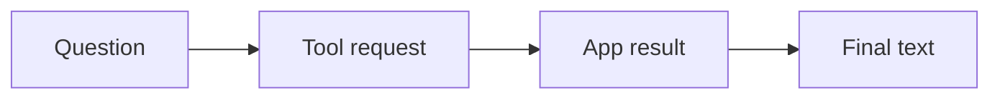

# Tools and a small agent loop

## What this topic is

The model chooses a tool, the app runs it, and the tool result goes back into the next turn.

## Why an Android AI engineer needs it

AppFunctions is this loop, with the phone as the tool runner.

## Diagram

## What you will change

- A question that needs one arithmetic tool

## Pass condition

The loop calls the tool once and the final text contains the tool result.

## Sources

- [ML Kit GenAI overview](https://developers.google.com/ml-kit/genai)
