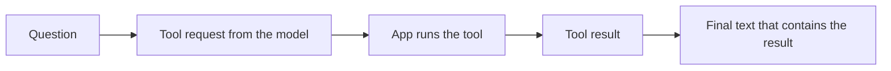

# Tools and a small agent loop

A chat reply can only talk. A tool lets the app do something: add two numbers, read a calendar row, search the notes you already indexed. The model chooses the tool and the arguments. The app runs the tool. The tool’s result goes back into the next turn, and the model writes the final text from that result. The loop is those four beats. This lab uses one arithmetic tool and expects a single call.

Suggested after [RAG](../lab-rag/README.md).

## The four beats

**Question.** You ask something the model cannot answer from the prompt alone, because the truth lives in a function. "What is 17 times 24?" is enough. The product is a fact the tool can compute exactly.

**Tool request.** The model returns a structured request: the tool name and the arguments. For this lab that is one arithmetic call, with 17 and 24, or whatever pair your question needs. The request is data. It is not the product, and it is not permission for the model to invent the product.

**App result.** Your code sees the request, checks the name, runs the function, and gets a number. That run is ordinary Kotlin. It can be a unit test. The model does not receive your source code. It receives the value you send back.

**Final text.** You append the tool result to the conversation and ask the model to answer. The pass requires the final text to contain that result. If the loop called the tool once and the sentence says a different number, the model ignored the tool. If the loop never called the tool and the sentence is right anyway, the model guessed. Both fail this lab. One call, and the result visible in the final text.

## Why the app owns the call

Tools touch real state: files, network, purchases, messages. The model will request a call that is wrong, repeated, or out of policy. Your code is the place that allows the name, checks the argument types, and refuses everything else. A small loop with one arithmetic tool teaches the shape before a later lab publishes a real function to the system through AppFunctions.

Keep the loop short on a phone. Each extra turn is another model run, another wait, and another chance to drift. This lab’s contract is one call. If the question needs a second tool, the question is larger than the exercise.

## Question, tool, result, sentence

## What you will change

- A question that needs one arithmetic tool

## Pass condition

The loop calls the tool once and the final text contains the tool result.

## Sources

- [ML Kit GenAI overview](https://developers.google.com/ml-kit/genai)
