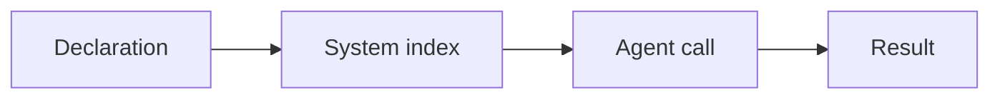

# AppFunctions

## What this topic is

The app publishes a function the system can offer to an agent. The agent calls it without opening the UI.

## Why an Android AI engineer needs it

This is how an on-device agent runs an action in your app.

## Diagram

## What you will change

- A function name
- One argument

## Pass condition

The declared function returns the value for that argument.

## Sources

- [AppFunctions overview](https://developer.android.com/ai/appfunctions)
- [Add AppFunctions](https://developer.android.com/ai/appfunctions/add-appfunctions)
