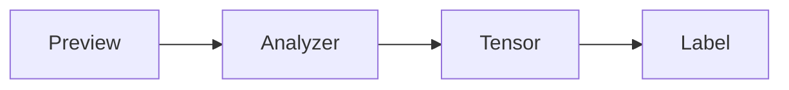

# CameraX into a vision model

## What this topic is

Frames are analyzed on a background executor, converted to the model's tensor layout, and the latest result is what the UI shows.

## Why an Android AI engineer needs it

The camera lab is where tensors and an ML Kit task meet a live preview.

## Diagram

## What you will change

- The camera preview

## Pass condition

The screen shows a label for the current frame and drops work when a frame is still running.

## Sources

- [CameraX](https://developer.android.com/media/camera/camerax)
- [ML Kit vision](https://developers.google.com/ml-kit/vision)
