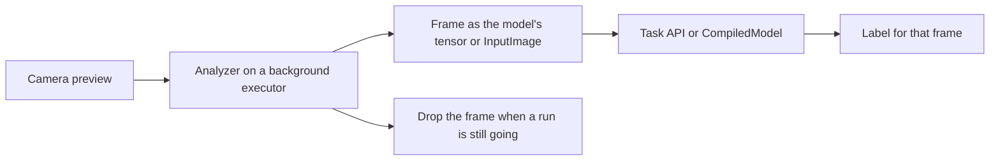

# CameraX into a vision model

A live camera is a stream of frames. Each frame is a future tensor. CameraX gives you the preview and an analyzer. The analyzer runs on a background executor, converts the frame into the layout the model expects, and publishes a label. If a frame arrives while the previous one is still running, you drop it. The UI shows the latest label that finished, for the frame that was current when that work started.

Suggested after [Speech in and speech out](../lab-speech/README.md), [Tensors, shapes, and preprocessing](../lab-tensors/README.md), and [ML Kit task APIs](../lab-mlkit-tasks/README.md).

## The analyzer contract

Bind a `Preview` so the user sees the camera, and an `ImageAnalysis` use case for the frames you will run. Set the analyzer’s executor to a background thread. The GPU lab’s rule applies if the model is a `CompiledModel` on the GPU: that thread is the one thread that owns the model. An ML Kit task client has its own threading rules, and you still must not block the camera callback.

Inside `analyze`:

1. Read the image. Note the rotation. A sideways buffer labeled as upright is a silent accuracy bug.
2. Convert to the tensor layout from the tensors lab: size, channel order, scale, dtype, shape. An ML Kit task that accepts an `InputImage` does this conversion inside the task. A custom `.tflite` model does not.
3. Run the task or the compiled model.
4. Decode the output. A task API returns text, a code, faces, or landmarks. A custom classifier returns scores you turn into one label, with the threshold from the outputs lab.
5. Close the image. A frame you forget to close stalls the camera.

## Drop work that is still running

Analysis can be slower than the frame rate. If you start a new run on every frame, the queue grows, latency climbs, and the label describes a moment several hundred milliseconds ago. Keep a flag or a strategy that means "busy." When a frame arrives and a run is in progress, drop the new frame and close it. When the run finishes, clear the flag and take the next frame that arrives. The screen’s label is the result of the last run that finished, and the pass requires that drop behavior as well as the label.

The preview the lab takes as input is this stream. You do not upload every frame anywhere unless the privacy label for the feature is cloud, and a live camera almost never should be.

## Preview, tensor, label

## What you will change

- The camera preview

## Pass condition

The screen shows a label for the current frame and drops work when a frame is still running.

## Sources

- [CameraX](https://developer.android.com/media/camera/camerax)
- [ML Kit vision](https://developers.google.com/ml-kit/vision)
