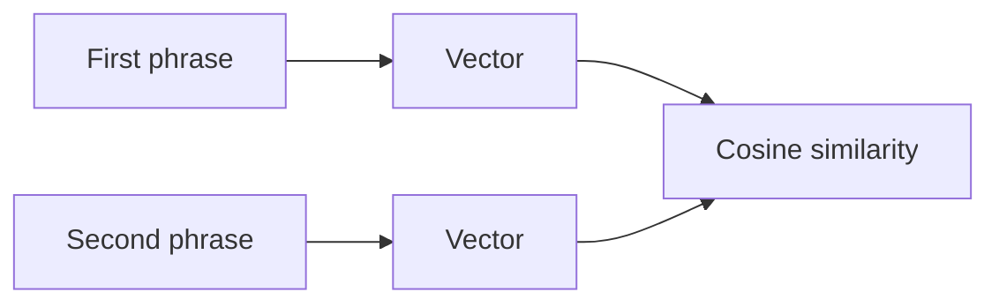

# Embeddings and similarity

An embedding is a list of numbers that stands for a piece of text, an image, or another object. The training of the embedding model places similar meanings near each other. Search, clustering, and retrieval-augmented generation all start from that geometry: turn items into vectors, then ask which vectors point the same way.

Suggested after [Tokens](../lab-tokens/README.md).

## A vector, and one score

Suppose an embedding model returns a vector of a few hundred floats for a phrase. You do not read the floats one by one. You compare two vectors.

Cosine similarity uses the angle between them, ignoring length:

cosine(a, b) = (a · b) / (|a| |b|)

The dot product `a · b` adds up `a[i] * b[i]`. The vertical bars are the length of each vector, the square root of the sum of squares. The score sits between −1 and 1 for ordinary embeddings.

- Near 1: the vectors point the same way. The phrases are the close pair.
- Near 0: they are unrelated in this space.
- Near −1: they point in opposite directions.

A worked comparison makes the lab’s check obvious. Embed "a small red bike" and "a little crimson bicycle." Those should score higher than "a small red bike" and "quarterly tax filing." The lab marks one pair as closer. Your higher cosine has to be that pair. If you rank by the raw dot product and the vectors were not normalized, a long vector can beat a truly closer short one. Cosine, or vectors that are already unit length, is the comparison this topic uses.

## What gets embedded

You embed the things you will later search.

- A note the user typed, so a question can find it.
- A product title, so a query can find the product.
- An image, when the model embeds images and text into one space and you can search photos with a sentence.

The vector is not a summary you show in the UI. It is an index key. You store it beside the original note. The note is what you show and, in the RAG lab, what the answer has to quote.

Distance has cousins. Dot product matches cosine when every vector has length 1. Euclidean distance is another ranking. Pick one and use it both when you build the index and when you query it. Mixing them reorders your results.

## From two phrases to a score

## What you will change

- First phrase
- Second phrase

## Pass condition

The higher cosine pair is the pair the lab marks as closer.

## Sources

- [Embeddings crash course](https://developers.google.com/machine-learning/crash-course/embeddings/video-lecture)
