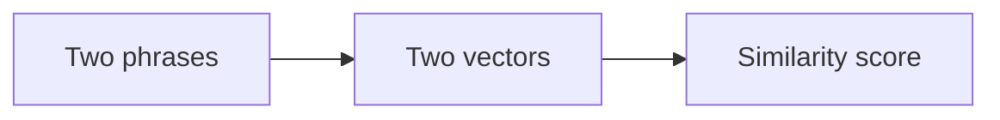

# Embeddings and similarity

## What this topic is

An embedding is a vector for a piece of text or an image. Cosine similarity ranks which pieces are close.

## Why an Android AI engineer needs it

Retrieval in the RAG labs is a similarity sort over these vectors.

## Diagram

## What you will change

- First phrase
- Second phrase

## Pass condition

The higher cosine pair is the pair the lab marks as closer.

## Sources

- [Embeddings crash course](https://developers.google.com/machine-learning/crash-course/embeddings/video-lecture)
