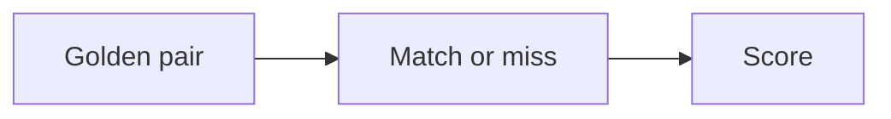

# Evaluation

## What this topic is

A golden set of questions with known answers shows whether a change helped. Track retrieval hits and wrong answers separately.

## Why an Android AI engineer needs it

A prompt change on Gemini Nano can look better and still miss the golden answers.

## Diagram

## What you will change

- Expected answer 1
- Expected answer 2
- Expected answer 3
- Actual answer 1
- Actual answer 2
- Actual answer 3

## Pass condition

The score equals the number of exact matches.

## Sources

- [ML Kit GenAI overview](https://developers.google.com/ml-kit/genai)
