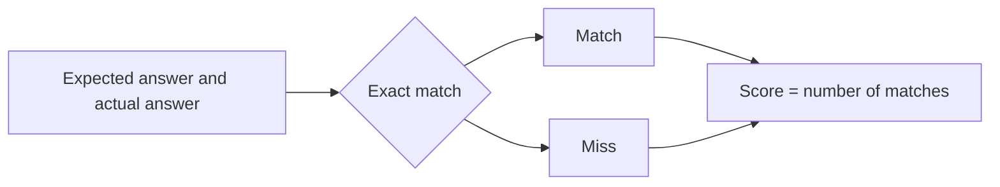

# Evaluation

A prompt that impressed you once is an anecdote. A golden set is a list of questions whose right answers you wrote down before you changed anything. After the change, you score the new answers against that list. The score tells you whether the change helped. This lab’s score is the number of exact matches out of three pairs.

Suggested after [Tools and a small agent loop](../lab-agents/README.md).

## A golden pair

Each case has an expected answer and an actual answer.

- Expected: `40 MB`. Actual: `40 MB`. Match.
- Expected: `hall B`. Actual: `Hall B`. Exact match fails if the lab compares strings as they are written. Decide the comparison before you trust the score. This lab uses exact match, so case and spacing count.
- Expected: `9`. Actual: `doors open at nine`. Miss. The meaning might be close. The score does not award partial credit.

The score equals the number of matches. Three matches score 3. One match scores 1. You type three expected answers and three actual answers, in pairs. Pair them in order: expected 1 with actual 1, and so on. Swapping two actuals changes the score even when the same strings are on screen.

## Two failures that look like one

When the system is RAG, a wrong final sentence has two different causes.

**Retrieval miss.** The note that holds the answer was not in the chunks you passed to the model. Changing the prompt will not insert a note the retriever skipped. Fix the chunking, the embedding, or the number of chunks you keep.

**Answer miss.** The right note was in the prompt and the model still said something else. That is a prompting or model problem. A stricter instruction, a typed field, or a quote requirement belongs here.

Track those counts separately. A single "accuracy" number hides which stage broke. This lab’s check is the exact-match score on the three pairs you enter. The habit you take out of it is the split: a golden question, a known answer, and a record of whether retrieval or the final text failed.

## How many cases

Three pairs are enough to see the arithmetic. A feature you ship needs more, covering the phrases users actually type, the empty input, and the hostile input you will meet again in the Play policy lab. Add a case when you fix a bug, or the bug returns under a new prompt and you will not notice.

Run the same set every time you change the instruction, the examples, the chunk size, or the model. A golden set you do not re-run is a document.

## Pairs to a score

## What you will change

- Expected answer 1
- Expected answer 2
- Expected answer 3
- Actual answer 1
- Actual answer 2
- Actual answer 3

## Pass condition

The score equals the number of exact matches.

## Sources

- [ML Kit GenAI overview](https://developers.google.com/ml-kit/genai)
