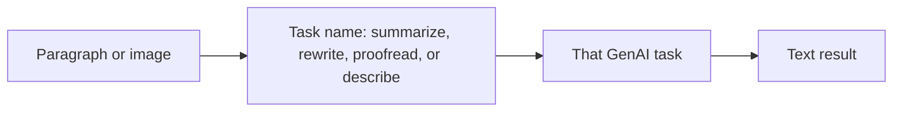

# Summarize, rewrite, proofread, and describe an image

Gemini Nano can take a free-form prompt, and it can also run a named task. Summarize, rewrite, proofread, and image description are named tasks. The job already has a contract: text in, or an image, and text out. Use the task API when the job has one of those names. Use the Prompt API when the job is your own instruction.

Suggested after [Structured output and prefix caching](../lab-structured-output/README.md).

## Four jobs

**Summarize** takes a longer text and returns a shorter text. You still decide what "shorter" means for the screen, but you do not invent the task from a prompt that says "please summarize."

**Rewrite** takes text and returns text in another form: shorter, friendlier, a different tone. The result is still prose, and it is supposed to preserve the meaning you handed in.

**Proofread** takes text and returns text with corrections. The user is asking for their own wording, repaired. A rewrite that changes the request is a different task, and the lab should run the name you chose.

**Describe an image** takes an image and returns text: a caption. The input is visual, the output is still text. That is the bridge from the vision tasks, which return boxes and codes, to a sentence about the picture.

The lab’s inputs are the task name and a paragraph or an image description. The pass is both halves: the task that runs is the one you named, and the result is text. A summarize call that returns a face box has jumped APIs. A proofread call that actually runs summarize has ignored the name.

## Why a named task beats a clever prompt

A prompt can ask for a summary and receive a summary plus advice plus a question back. A task API is built for that one job, with its own client, its own options, and a text result your UI can place in one field. You still check `FeatureStatus`, you still download when the model is downloadable, and you still `close()` the client. Those rules from the Prompt API lab apply to these clients too. A missing model explains itself and does not pass the check.

When the job grows a schema — "summary plus three keywords as fields" — you are back in structured output and a prompt you own. The named task was the right tool while the job’s name was enough.

## Text or image, one named task, text back

## What you will change

- A task name
- A paragraph or image description

## Pass condition

The named task is the one that runs, and the result is text.

## Sources

- [ML Kit GenAI overview](https://developers.google.com/ml-kit/genai)
