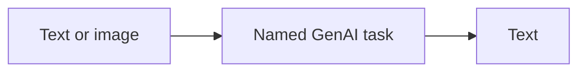

# Summarize, rewrite, proofread, and describe an image

## What this topic is

These GenAI tasks are fixed jobs on Gemini Nano, separate from a free-form prompt.

## Why an Android AI engineer needs it

Summarize, rewrite, proofread, and image description already have clients. A custom prompt is the wrong tool for those jobs.

## Diagram

## What you will change

- A task name
- A paragraph or image description

## Pass condition

The named task is the one that runs, and the result is text.

## Sources

- [ML Kit GenAI overview](https://developers.google.com/ml-kit/genai)
