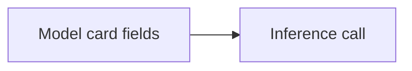

# Inference and a model card

## What this topic is

A model card states the task, the input, the output, and the size. Inference uses the finished weights.

## Why an Android AI engineer needs it

You need the card so you know what a phone is allowed to run before you add a dependency.

## Diagram

## What you will change

- A model-card line (task, input, output, or size)

## Pass condition

Each line is named with the matching field.

## Sources

- [Machine Learning Glossary](https://developers.google.com/machine-learning/glossary)
