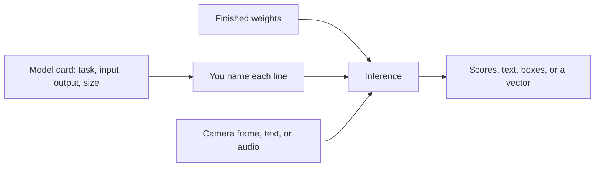

# Inference and a model card

You are about to put a model on a phone. Before you look at an API, read the card that ships with the weights. That card is the contract: what job the model does, what it accepts, what it returns, and how big the file is. Inference is the run that uses those finished weights to produce an output. The weights stay as they are.

A model that classifies food photos is a different object from a model that writes a paragraph. Both can be a single file. The file name will not tell you which one you have. The model card will.

## What you are looking at

A useful card answers four questions in plain language.

**Task.** The job, in one line. "Classify an image into one of 1000 labels." "Embed a sentence." "Detect barcodes." If the card says classification and your screen needs a paragraph, you have the wrong file.

**Input.** The shape, the number type, and the meaning of each axis. A vision model might want a 224 by 224 RGB image scaled to the range 0–1. A language model wants token ids, which is a later topic. The card is where that requirement is written down.

**Output.** What the numbers mean when the run finishes. A list of class scores is not a sentence. A box with a label is not a probability until you read the score that came with it. The card names the fields so your code can name them too.

**Size.** The file size, and often the memory the run needs. A 30 MB file and a 1.2 GB file are both "a model." Only one of them belongs in the first version of an app that must install on a modest phone.

Inference is the forward run: input in, output out, weights unchanged. Training would change the weights. This course runs models. It does not train them.

## A card you can check by hand

Imagine a card with these four lines:

- Task: image classification
- Input: 1×224×224×3 float image, pixels scaled to 0–1, channels in RGB order
- Output: 1000 scores, one per label
- Size: 14 MB

Hand the line "1000 scores, one per label" to the lab. The matching field is **output**. Hand it "14 MB" and the matching field is **size**. The check is that naming, not a guess from the file name.

## Why the phone cares

On a server you can swap models behind an endpoint and fix a mistake in an afternoon. On a phone the file is in the APK, an asset pack, or a download the user already waited for. A wrong input scale still runs. It returns confident, useless scores, and the bug looks like a product problem. Reading the card is how you catch that before the first call.

Size also decides delivery. A small file can live in assets. A large file needs a pack or a download, which is its own lab later in the course.

## How a run fits together

The card does not execute anything. It tells you whether the run you are about to write matches the file you shipped.

## What you will change

- A model-card line (task, input, output, or size)

## Pass condition

Each line is named with the matching field.

## Sources

- [Machine Learning Glossary](https://developers.google.com/machine-learning/glossary)
