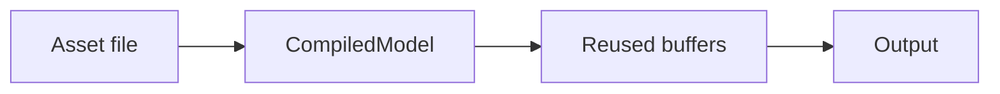

# LiteRT on CPU

## What this topic is

CompiledModel runs a .tflite file. Input and output TensorBuffers are allocated once and reused. The deprecated Interpreter API is not used.

## Why an Android AI engineer needs it

Your own model starts here, on one thread, on the CPU.

## Diagram

## What you will change

- A model file name
- An input shape

## Pass condition

One inference returns a buffer whose length matches the output shape.

## Sources

- [LiteRT on Android](https://ai.google.dev/edge/litert/android)
- [CompiledModel in Play services](https://developers.google.com/edge/litert/android/compiled_model_java)
