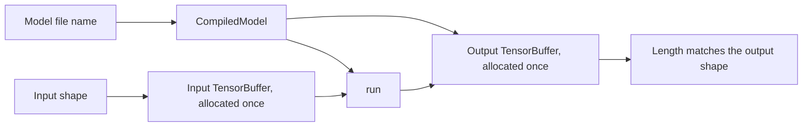

# LiteRT on CPU

LiteRT runs a `.tflite` model you ship yourself. On Android the current entry point is `CompiledModel`. You create it from the model file, allocate an input buffer and an output buffer once, write the input, run, and read the output. The next frame reuses those buffers. The deprecated `Interpreter` API stays out of this lab.

Suggested after [Summarize, rewrite, proofread, and describe an image](../lab-genai-tasks/README.md).

## The objects in the run

**The file.** A `.tflite` file holds the graph and the weights. The model card from the first lab still applies: task, input shape, dtype, output shape, size. The file name you type in this lab is how you point `CompiledModel` at that asset, pack, or path. Delivery of the file is the model-delivery lab. Here, the file is assumed readable.

**CompiledModel.** `CompiledModel.create` compiles the graph for the runtime you chose. The CPU path is the default that every later acceleration option falls back toward. Creation is expensive relative to a single `run`. Do it when the screen opens, on a background thread, and keep the compiled model for the lifetime of the screen.

**TensorBuffers.** The input buffer matches the input shape and dtype. The output buffer matches the output shape. Allocating them on every frame forces the allocator to churn and hides the real cost of inference. Allocate once, `clear` or overwrite, run again.

**One inference.** Write the preprocessed tensor into the input buffer, call `run`, then read the output buffer. The pass checks the output: its length matches the output shape. If the card says the output is 1000 scores of `float32`, the buffer you read has room for those 1000 values. A shorter buffer means you allocated the wrong shape. A longer one means you are reading past the result and calling the tail part of the answer.

## What you still do around the call

`CompiledModel` does not resize your camera frame or apply the 0–1 scale. The tensors lab is that work, and it happens before the write into the input buffer. The outputs lab is the work after the read: scores to a label, threshold applied. CPU inference is the middle: file, compiled model, reused buffers, one buffer whose length matches the shape.

Measure a warm run when you quote latency. The first `create` and the first `run` include work you will not pay on every frame. The GPU lab separates those times on purpose.

## Asset to a buffer you can read

## What you will change

- A model file name
- An input shape

## Pass condition

One inference returns a buffer whose length matches the output shape.

## Sources

- [LiteRT on Android](https://ai.google.dev/edge/litert/android)
- [CompiledModel in Play services](https://developers.google.com/edge/litert/android/compiled_model_java)
