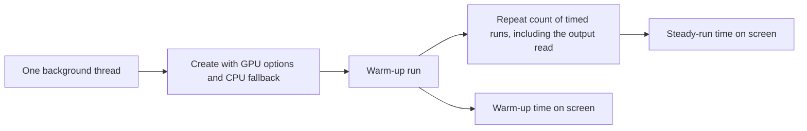

# GPU, one thread, warm-up, and latency

A GPU delegate can run the same `.tflite` graph faster than the CPU, and it can fail open on a phone whose GPU path does not support an op. You list CPU as the fallback so the run still happens. The GPU context, the compiled model, and the buffers belong to one background thread. You warm up once, then you time the steady runs. The number you show the user is the steady run, and the clock includes reading the output back.

Suggested after [LiteRT on CPU](../lab-litert-cpu/README.md).

## One thread owns the model

GPU resources are thread-affine. Create the `CompiledModel` with the GPU options on a single background thread, and call `run` on that same thread every time. A second thread that "just reads the output" can race the device context. Post the work to one handler or one executor, and post the result to the main thread only after the buffer has been copied into plain numbers the UI can hold.

CPU fallback belongs in the options you pass at creation. If the GPU rejects the model, the run uses the CPU on that same thread. You still have one owner. You log which path ran, because a silent fallback means your latency budget was a guess.

## Warm-up is not the user’s tap

The first GPU `run` compiles shaders and allocates device memory. That time is real and it is large. It is not the time the user will feel on the tenth frame. Run the model once with a dummy input of the right shape before you enable the shutter, or before you start the analyzer. Record that duration as the warm-up time.

Then run the repeat count you typed. Each sample times `run` together with the output read. Stopping the clock before the read reports a partial result: the GPU may still be finishing while you start the next frame, or the numbers may still be on the device. The steady-run time is the typical sample after warm-up, or the average of those samples, and the screen shows both the warm-up and the steady figure.

A repeat count of 1 can only show warm-up. Use enough repeats that a steady sample exists. The performance lab adds heat: a long repeat on a phone will throttle, and the last samples are a third number. This lab’s pass is the pair of times.

## Create, warm up, then time

## What you will change

- A repeat count

## Pass condition

The screen shows a warm-up time and a steady-run time.

## Sources

- [LiteRT on Android](https://ai.google.dev/edge/litert/android)
