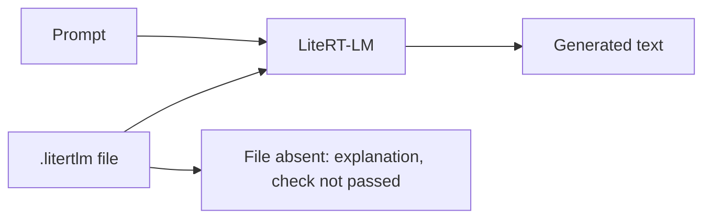

# LiteRT LM

LiteRT-LM runs an open language model you ship as a `.litertlm` file. It is a different stack from Gemini Nano. Nano arrives through the Prompt API when the device has it. LiteRT-LM runs the file you chose, through its own runtime, on devices where you can read that file. The screen shows generated text when the file is present. When the file is absent, the screen explains the absence, and the lab does not pass.

Suggested after [On-device embeddings and RAG](../lab-on-device-rag/README.md).

## What you are shipping

A `.litertlm` file is the model package LiteRT-LM knows how to load. You pick an open model whose license allows your app, whose size fits the delivery mode you chose, and whose context window you have read. The file reaches the phone through assets, a Play pack, or a download. `CompiledModel` and a raw `.tflite` vision graph are the CPU lab. This stack is for text generation with the LM runtime.

The prompt you type is the same kind of text as in the prompting lab: an instruction plus the user line. Tokens still fill a window. Quantization still decides whether the file is something you can ship. Those topics apply, with a different loader.

## Present, or explained

The pass has two honest outcomes.

**The file is there.** The runtime loads it, the prompt runs, and the screen shows generated text. You can judge that text with the evaluation lab’s golden set once you care about quality.

**The file is absent.** The path is missing, the pack is still null, or this build did not include the asset. The screen says so. Absence does not call the pass. A placeholder sentence you wrote in the UI is an explanation, and it must look like an explanation so a test can tell it from generated text.

That split is the same discipline as Gemini Nano’s missing model. The testing lab encodes it: unavailable and downloading fail the check with an explanation; a ready run passes only against a known output. Here the "unavailable" case is a missing `.litertlm` file rather than a `FeatureStatus`.

Close the engine when the screen goes away. A loaded language model is a large allocation to leave attached to a destroyed activity.

## File, runtime, text

## What you will change

- A prompt

## Pass condition

The screen shows generated text, or an explanation when the model file is absent, and absence does not mark the lab passed.

## Sources

- [LiteRT-LM on Android](https://developers.google.com/edge/litert-lm/android)
