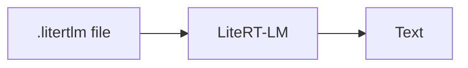

# LiteRT LM

## What this topic is

An open .litertlm model runs through LiteRT-LM, which is a different stack from Gemini Nano.

## Why an Android AI engineer needs it

Gemini Nano is a system model. LiteRT LM is a model you package.

## Diagram

## What you will change

- A prompt

## Pass condition

The screen shows generated text, or an explanation when the model file is absent, and absence does not mark the lab passed.

## Sources

- [LiteRT-LM on Android](https://developers.google.com/edge/litert-lm/android)
