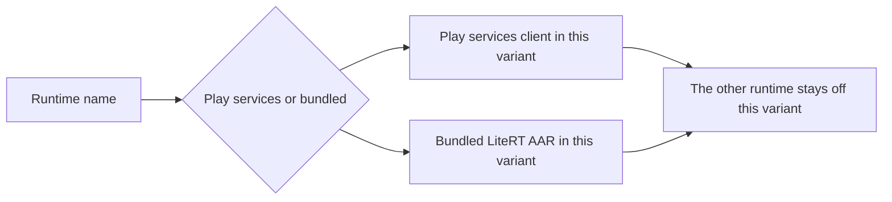

# Play services LiteRT and the bundled runtime

`CompiledModel` needs a LiteRT runtime in the process. You can take that runtime from Google Play services, or you can bundle it inside the app. Play services keeps the runtime out of the APK and updates it on devices that have Play services. The bundled runtime is the choice when you need the NPU, custom ops, or a device that has no Play services. One build variant contains one of those choices. Mixing them in a single variant is the case this lab forbids.

Suggested after [GPU, one thread, warm-up, and latency](../lab-litert-gpu/README.md) and [LiteRT on CPU](../lab-litert-cpu/README.md).

## What each choice adds

**Play services.** The app depends on the Play services LiteRT library. The heavy runtime is delivered through Play services on the device. Your APK stays smaller. `CompiledModel.create` uses that shared runtime. Phones without a usable Play services install cannot take this path, and your feature has to explain that the same way a missing Gemini Nano model explains itself.

**Bundled runtime.** The app packages a LiteRT AAR. The runtime is in the APK, so install size goes up and you own the version. This is the artifact you add for an NPU delegate, for a model with custom ops the Play services build does not include, or for a device that will never have Play services. The code that calls `CompiledModel` can look the same. The Gradle dependency and the variant are what changed.

The lab asks for a runtime name. The screen states which artifact that name adds — the Play services client, or the bundled AAR — and states the case that forbids mixing them: one variant, one runtime. A debug build that "also" bundles the AAR while depending on Play services is the mix. Pick the variant in Gradle and keep the other dependency off that variant.

## How you choose

Start with Play services when the model is a normal `.tflite` graph, the device is a Play device, and APK size matters. Move that product flavor to the bundled runtime when you have measured a need for the NPU or for an op the Play services runtime will not run. Keep a second flavor if you truly ship both populations, and give each flavor one runtime. Sharing a single `implementation` line that pulls both is the mix the check is looking for.

The CPU and GPU labs assume a runtime is already present. This lab is the choice that makes `CompiledModel.create` resolve.

## One variant, one artifact

## What you will change

- A runtime name

## Pass condition

The screen states which artifact that choice adds and which case forbids mixing them.

## Sources

- [CompiledModel in Play services](https://developers.google.com/edge/litert/android/compiled_model_java)
- [LiteRT on Android](https://ai.google.dev/edge/litert/android)
