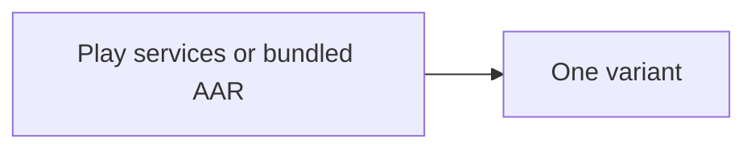

# Play services LiteRT and the bundled runtime

## What this topic is

Play services keeps the runtime out of the APK. The bundled runtime is for NPU, custom ops, or devices without Play services. One build variant contains one of them.

## Why an Android AI engineer needs it

Shipping both runtimes in one variant is the mistake this lab exists to prevent.

## Diagram

## What you will change

- A runtime name

## Pass condition

The screen states which artifact that choice adds and which case forbids mixing them.

## Sources

- [CompiledModel in Play services](https://developers.google.com/edge/litert/android/compiled_model_java)
- [LiteRT on Android](https://ai.google.dev/edge/litert/android)
