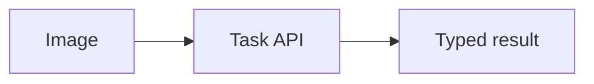

# ML Kit task APIs

## What this topic is

Text recognition, barcode, face, and pose are ready-made models with a task API.

## Why an Android AI engineer needs it

Most camera features do not need a model you convert yourself.

## Diagram

## What you will change

- A task name

## Pass condition

The screen lists what that task returns (text, a code, faces, or landmarks).

## Sources

- [ML Kit vision](https://developers.google.com/ml-kit/vision)
