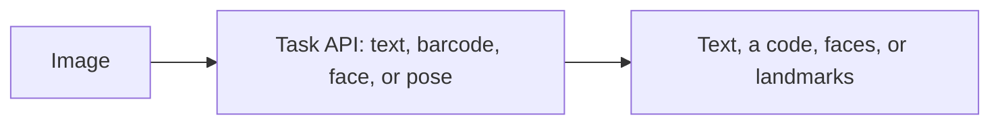

# ML Kit task APIs

Some vision jobs already have a model and a client. Text recognition, barcode scanning, face detection, and pose detection are that kind of job. ML Kit wraps each one as a task API: you pass an image, you get a typed result. Reach for a task API before you train or ship a custom model for the same job.

Suggested after [Privacy, safety, on-device and cloud](../lab-privacy/README.md).

## What each task returns

The lab asks for a task name. The screen has to list the result that task actually produces.

**Text recognition** returns text. You get blocks, lines, and elements, with the string and where it sat in the image. The result is characters the user can copy, not a class score.

**Barcode scanning** returns a code. The value is the payload of the barcode or QR, plus the format. The result is the string or structured data encoded in the symbol.

**Face detection** returns faces. Each face has a bounding box and, when you ask for them, landmarks and classifications such as smiling. The result is a list of faces in the image.

**Pose detection** returns landmarks. A pose is a set of body points, and each point has a position. The result is those landmarks, which you can draw or pass to your own logic.

If you name "barcode" and describe a face box, the check fails. The return type is the whole point of a task API: your code receives text, a code, faces, or landmarks, and the model stays inside the task.

## When a task API is the wrong tool

The task covers a general job. A model that must recognize your factory’s 40 part numbers, or a custom gesture that is not a body pose, is outside these four results. That is when a later lab’s `.tflite` file and `CompiledModel` are the path. Starting there for barcodes means you will own preprocessing, a score threshold, and updates that the task API would have shipped for you.

The CameraX lab is where a live preview meets one of these tasks, or a custom model. The analyzer still has to respect the result type. A barcode client yields a code. Drawing a class label from it is a misuse of the result.

## Image to a typed result

## What you will change

- A task name

## Pass condition

The screen lists what that task returns (text, a code, faces, or landmarks).

## Sources

- [ML Kit vision](https://developers.google.com/ml-kit/vision)
