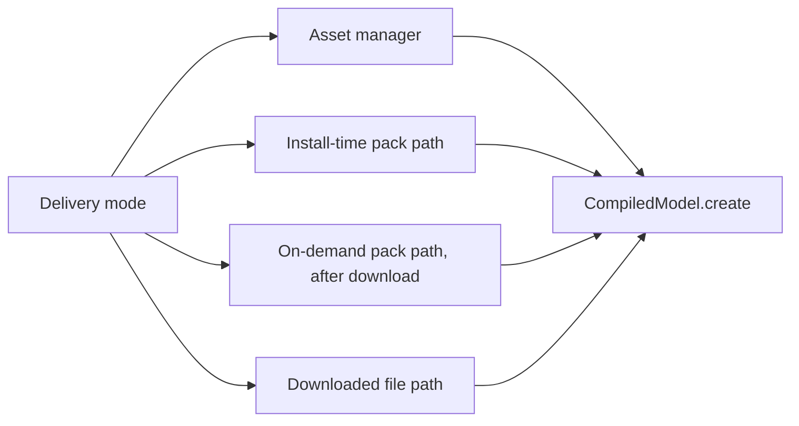

# Assets, AI packs, and downloads

`CompiledModel.create` needs a readable model file. The file has an address, and the app has to wait until that address exists. Four addresses cover the cases you will ship: assets inside the APK, an install-time Play AI pack, an on-demand Play AI pack, and a file you download into app storage. The lab asks for the mode. The screen names where `create` reads for that mode.

Suggested after [Play services LiteRT and the bundled runtime](../lab-litert-runtime/README.md) and [LiteRT on CPU](../lab-litert-cpu/README.md).

## Four addresses

**Assets.** The `.tflite` file lives under `assets/` and is inside the APK. `create` reads it through the asset manager as soon as the process starts. There is nothing to wait for. The cost is install size and an update cycle tied to the app. A small model, or a model you need on the first offline launch, belongs here.

**Install-time pack.** Play delivers the pack as part of install. After install, the pack’s path is available without a separate download step in your UI. `create` reads that pack path. The APK itself stays thinner than an assets file of the same bytes, and the user still cannot open the feature before the install included the pack.

**On-demand pack.** The pack is absent until you request it. The location you would pass to `create` is null until the download finishes. Calling `create` on that null path fails. The screen should be a progress state, then `create` on the pack path Play gives you. This is the right mode for a large model most users will never open.

**Download.** You fetch the file yourself into app-specific storage and `create` reads that file path. You own the URL, the checksum, the resume, and the failure message. Use it when the file is not a Play pack: a model you host, a file the user imported, a version you swap without a Play release. The wait is yours to show.

The quantization lab tells you whether the file is 40 MB or 10 MB. That number picks the mode. A 10 MB file can be an asset. A multi-hundred-megabyte file should be an on-demand pack or a download, with a UI that waits.

## Wait, then create

## What you will change

- A delivery mode (assets, install-time pack, on-demand pack, or download)

## Pass condition

The screen names where CompiledModel.create reads for that mode.

## Sources

- [Play for On-device AI](https://developer.android.com/google/play/on-device-ai)
