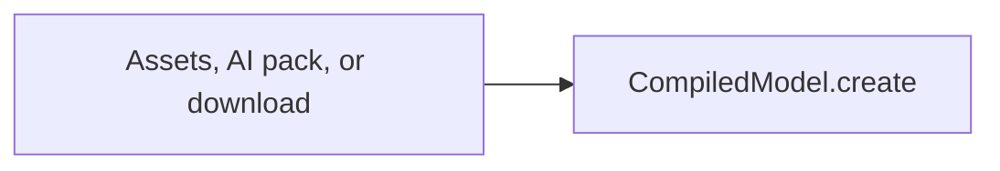

# Assets, AI packs, and downloads

## What this topic is

Small models ship in assets. Larger ones ship as a Play AI pack or a file in app storage. An on-demand pack is null until it has downloaded.

## Why an Android AI engineer needs it

CompiledModel.create cannot run until the file has a path.

## Diagram

## What you will change

- A delivery mode (assets, install-time pack, on-demand pack, or download)

## Pass condition

The screen names where CompiledModel.create reads for that mode.

## Sources

- [Play for On-device AI](https://developer.android.com/google/play/on-device-ai)
