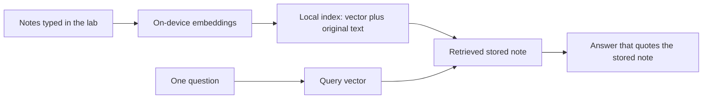

# On-device embeddings and RAG

This is the RAG loop from the literacy lab, with the vectors kept on the phone. The user types notes. The app embeds them with an on-device embedding model, stores each vector in a small local index beside the original text, and answers a question by retrieving from that index. The answer has to quote a note that was actually stored. The notes do not need to leave the device for the search to work.

Suggested after [Assets, AI packs, and downloads](../lab-model-delivery/README.md), [Embeddings and similarity](../lab-embeddings/README.md), and [RAG](../lab-rag/README.md).

## What changed from the earlier RAG lab

The shape is the same: chunk, embed, retrieve, answer, quote. Two things are now concrete.

**The embedder runs on the phone.** Gemini Nano, a small embedding `.tflite`, or another on-device model turns a note into a vector. There is no request that uploads the note to build the index. The privacy lab’s on-device label applies to the text the user typed. You still follow that model’s status rules: if the embedding model is missing or still downloading, you explain and you do not pretend the index was built.

**The index is local and small.** Each entry is the vector plus the original note, or an id that points at the note in your database. A few dozen notes can live in a list you scan with cosine similarity. A few thousand notes want a real nearest-neighbor structure, and that structure is still a file in app storage. This lab’s index is the small one: you can point at every stored note.

Retrieval embeds the question with the same model, ranks the stored vectors, and passes the winning note into the answer prompt. The pass is a quote check. If the answer quotes a sentence you never stored, the model invented a source. If it quotes a stored note, the index did its job and the answer used it.

## A walk-through

You type two notes: "Stand is in hall B." and "The on-device file is 40 MB." You ask "Where is the file size written?" The second note is in the index. The answer quotes "40 MB" from that stored note. An answer that quotes a size you did not type fails, even when the number is plausible.

Chunk the notes when they grow past the embedding model’s input. Overlap the edges so a sentence split across chunks can still be found. Store the chunk text, not only the vector, because the quote has to come from somewhere you can show.

## Typed notes stay on the device

## What you will change

- Notes typed in the lab
- One question

## Pass condition

The answer quotes a note that was stored in the index.

## Sources

- [Embeddings crash course](https://developers.google.com/machine-learning/crash-course/embeddings/video-lecture)
- [Retrieval-augmented generation](https://cloud.google.com/vertex-ai/generative-ai/docs/rag-overview)
