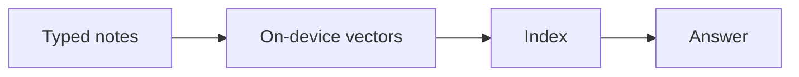

# On-device embeddings and RAG

## What this topic is

Embed notes on the phone, store the vectors in a small index, and answer from the retrieved note.

## Why an Android AI engineer needs it

This is the phone version of the literacy RAG lab.

## Diagram

## What you will change

- Notes typed in the lab
- One question

## Pass condition

The answer quotes a note that was stored in the index.

## Sources

- [Embeddings crash course](https://developers.google.com/machine-learning/crash-course/embeddings/video-lecture)
- [Retrieval-augmented generation](https://cloud.google.com/vertex-ai/generative-ai/docs/rag-overview)
