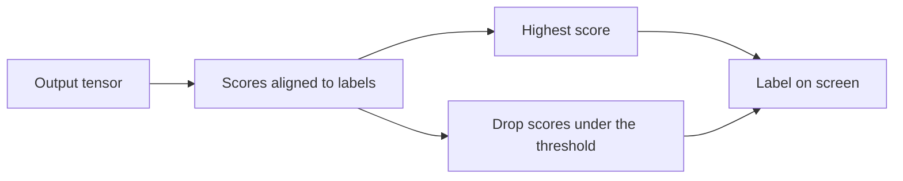

# Reading a model output

The model run returns a buffer of numbers. Your screen needs a decision: a label, a box, a line of text. Reading the output is the code between those two. A high score is only a label after you know which index it occupies and which scores you promised to hide.

Suggested after [Embeddings and similarity](../lab-embeddings/README.md).

## Classifiers: scores, then a cutoff

A classifier’s output for one image is a list of scores, one per class. Sometimes the card calls them logits, which are raw scores before they are turned into probabilities. Sometimes they already sum to 1. Either way, the top label is the index of the highest score.

Take the scores `[0.05, 0.62, 0.21, 0.12]` and the labels `[background, cat, dog, car]`. The highest score is 0.62 at index 1, so the top label is cat.

A threshold then drops the rest. If the screen’s threshold is 0.5, dog at 0.21 and car at 0.12 are discarded. Cat stays. If every score is under the threshold, the honest result is "no label," not the least-bad class. Showing the argmax anyway is how a dark frame becomes a confident "cat."

The lab gives you a score list. The check is both parts: the top label is the max, and anything under the stated threshold is gone.

## Detectors: boxes are a second decoder

A detector does not return one score list. Each candidate is a box plus a class plus a score. The box is a set of numbers in a coordinate system the card must define: corner and size, or two corners, in pixels or in 0–1 relative to the image. You drop boxes under the score threshold, and you often merge boxes that cover the same object. Until you do that decode, the output tensor is still a raw buffer. Do not draw it.

Text models are the other shape. Their output buffer is token ids. You decode ids with the same tokenizer that built the prompt. Showing the integers, or showing a string sliced out of the raw bytes, is a different bug with the same cause: the buffer was treated as the answer.

## From buffer to labels

## What you will change

- A score list

## Pass condition

The top label is the highest score, and scores below a stated threshold are dropped.

## Sources

- [Machine Learning Glossary](https://developers.google.com/machine-learning/glossary)
- [ML Kit vision](https://developers.google.com/ml-kit/vision)
