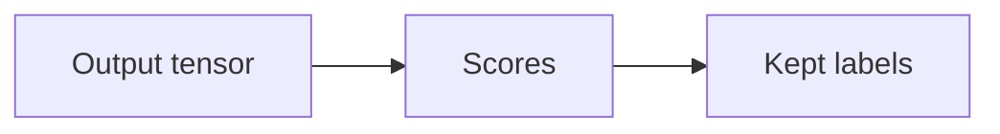

# Reading a model output

## What this topic is

Classifiers return scores, detectors return boxes and labels, and a raw buffer is neither a decision.

## Why an Android AI engineer needs it

The UI should show a decision, and the buffer is not yet a decision.

## Diagram

## What you will change

- A score list

## Pass condition

The top label is the highest score, and scores below a stated threshold are dropped.

## Sources

- [Machine Learning Glossary](https://developers.google.com/machine-learning/glossary)
- [ML Kit vision](https://developers.google.com/ml-kit/vision)
