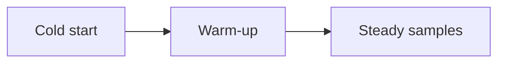

# First run, heat, and the profiler

## What this topic is

The first inference includes compile and load. Later inferences show the steady cost.

## Why an Android AI engineer needs it

A demo that quotes the first run as the product latency is wrong.

## Diagram

## What you will change

- A repeat count

## Pass condition

The screen shows both times and names the profiler trace to capture.

## Sources

- [LiteRT on Android](https://ai.google.dev/edge/litert/android)
- [Android Studio profiler](https://developer.android.com/studio/profile)
