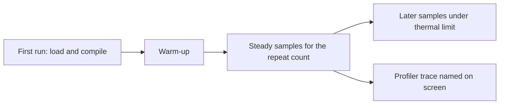

# First run, heat, and the profiler

The first inference is a different event from the tenth. The first one loads the file, compiles the graph, and may compile GPU shaders. Later ones show the cost the user actually pays. Record those times separately. A long repeat also heats the phone, and the chip will slow down. The Android Studio profiler is how you see which of those stories you measured.

Suggested after [CameraX into a vision model](../lab-camerax/README.md) and [GPU, one thread, warm-up, and latency](../lab-litert-gpu/README.md).

## Three numbers, one repeat count

You type a repeat count. The screen has to show two times, and it has to name the profiler trace that captured them.

**First run.** Time from the moment you ask for the model until the first output is in memory you can read. That includes file read, `CompiledModel.create`, buffer allocation, and the warm-up `run` from the GPU lab. Quote this number as startup, or as time-to-first-result. Quoting it as "inference latency" makes a 40 ms model look like a 900 ms model.

**Steady run.** Time for a run after warm-up, including the output read, averaged over the repeats that are past the first. This is the number to compare when you change bit width, thread count, or GPU versus CPU. The GPU lab’s steady-run time is this figure for a single configuration.

**Heat.** A repeat count of 200 on a phone in a case will climb in temperature. The scheduler then drops frequency. The last samples are slower than the middle samples, and the cause is thermal, not your graph. If the steady average includes the throttled tail, you will "optimize" a number that was the phone protecting itself. Watch the per-repeat series. When it steps up and stays up, mark the later samples as throttled and keep them out of the steady average, or report them as their own line.

## The trace you name

Android Studio’s profiler can record a system trace while those repeats run. The screen names the trace you are supposed to capture so the check is specific: a CPU trace, a system trace that shows the analyzer thread, or the trace that includes the GPU work. A screenshot of a single millisecond reading is weaker than a trace you can reopen and see the thread that blocked.

What to look for in the trace:

- The background thread from the GPU lab, and whether a second thread touched the model.
- The gap between `run` returning and the output becoming visible on the main thread.
- Camera analyzer frames that piled up because you forgot to drop work.
- A long first block that is `create`, sitting in front of a row of short `run` calls.

Run the repeat on a device that resembles the one you ship to, plugged in and then on battery. A bench powered by USB hides thermal behavior you will see in a pocket.

## Cold, warm, steady

## What you will change

- A repeat count

## Pass condition

The screen shows both times and names the profiler trace to capture.

## Sources

- [LiteRT on Android](https://ai.google.dev/edge/litert/android)
- [Android Studio profiler](https://developer.android.com/studio/profile)
