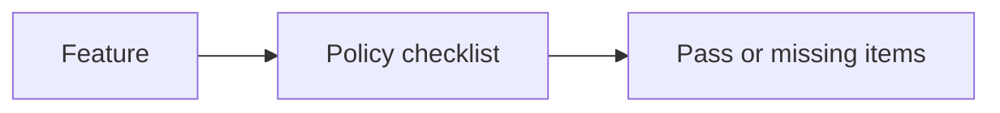

# Play policy for AI features

## What this topic is

Generative features need a block on restricted content, a way to report output, and testing against hostile prompts.

## Why an Android AI engineer needs it

A lab that generates text still has to meet the Play policy before it ships.

## Diagram

## What you will change

- A feature description

## Pass condition

The checklist items the feature still lacks are listed, and an empty list is the pass.

## Sources

- [AI-Generated Content policy](https://support.google.com/googleplay/android-developer/answer/14094294)
