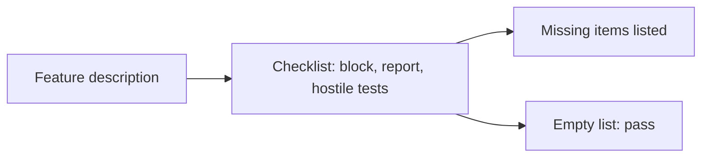

# Play policy for AI features

A generative feature on Google Play has a checklist, not only a model. People can get output they did not expect, including output that breaks Play’s rules on restricted content. Your feature needs a way to block that content, a way for people to report what the model said, and tests that throw hostile prompts at it before review does. The lab takes a feature description and lists the checklist items that description still lacks. An empty list is the pass.

Suggested after [Testing a missing or known model](../lab-testing/README.md).

## The checklist

Read the feature description and ask three questions. Each "no" is a missing item on the list.

**Can the feature block restricted content?** Generative output includes text the model writes, text it rewrites, captions, and replies spoken aloud. If the description has no filter, no safety setting, and no refusal path, the item is missing. A prompt that says "be nice" is not a block. A block is a check you can point at: the client’s safety option, a classifier in front of the UI, or a refusal you show instead of the raw text.

**Can a person report the output?** The description needs a visible way to flag a specific reply. A general "contact us" address with no tie to the output is a weaker story than a report action on the message that was just generated. The policy expects users to be able to report or flag the content the feature produced.

**Have you tested hostile prompts?** Someone will ask the model to ignore the instruction, reveal the prompt, produce disallowed content, or drag private context into the answer. The evaluation lab’s golden set should include those cases, with expected refusals. If the description never mentions that testing, the item is missing. The testing lab is where those cases become automated: a ready model, a hostile fixture, a golden refusal.

The screen lists every item still missing. When you have described all three, the list is empty and the check passes. Shipping with a non-empty list means you know the gap and have not closed it.

## Where it meets the rest of the course

The privacy lab decided where the bytes go. Policy still applies on-device. A Gemini Nano reply, a LiteRT-LM paragraph, and a cloud caption are all generative output if the user sees generated content. Speech out speaks that content, so a blocked string must be blocked before `TextToSpeech` says it. AppFunctions return values an agent will read; a function that generates text needs the same checklist.

Write the description the way a reviewer will read the store listing and the UI. "Chat with your notes" plus "we run a model" leaves all three items missing. "Chat with your notes, on device, with a report button on each reply, safety blocks on the client, and a hostile-prompt suite in CI" can clear the list. The suite has to exist, which is the testing topic, not a sentence in the listing alone.

## Feature to a list

## What you will change

- A feature description

## Pass condition

The checklist items the feature still lacks are listed, and an empty list is the pass.

## Sources

- [AI-Generated Content policy](https://support.google.com/googleplay/android-developer/answer/14094294)
