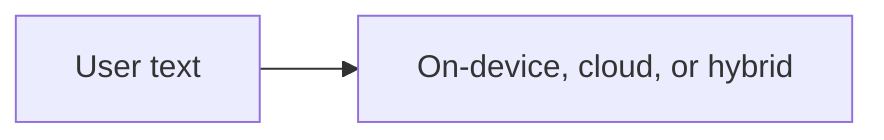

# Privacy, safety, on-device and cloud

## What this topic is

On-device keeps the input on the phone. Cloud sends it away. A hybrid path sends only what the on-device model cannot do.

## Why an Android AI engineer needs it

The Android labs choose Gemini Nano, LiteRT, or a cloud call from this rule.

## Diagram

## What you will change

- A feature description

## Pass condition

The lab's label is on-device, cloud, or hybrid and matches the rule on screen.

## Sources

- [ML Kit GenAI overview](https://developers.google.com/ml-kit/genai)
- [AppFunctions overview](https://developer.android.com/ai/appfunctions)
