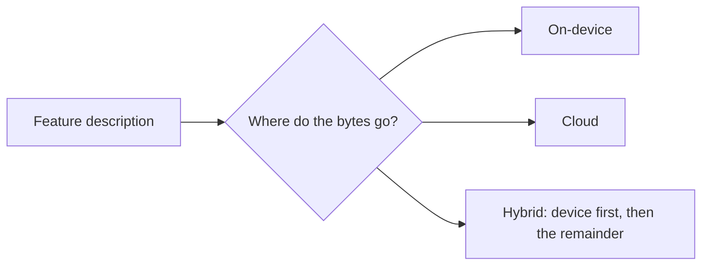

# Privacy, safety, on-device and cloud

Every AI feature sends bytes somewhere. The first design choice is where. On-device means the input stays on the phone and the model runs there. Cloud means the input leaves the phone for a server. Hybrid means the phone handles what it can, and only the remainder is sent. Pick that path from the feature description, before you pick a model, because the path decides the model you are allowed to use.

Suggested after [Quantization, latency, memory, and battery](../lab-quantization/README.md).

## Three labels

**On-device.** The camera frame, the note, or the audio buffer is processed in the app process or in an on-device system model such as Gemini Nano. The bytes of that input are not uploaded for the inference. You still have a model file to deliver, a latency budget, and phones where the model is missing. Privacy is stronger. Capability is limited to what fits on the device.

**Cloud.** The app sends the input to an API and waits for the result. The server can run a larger model. The input now exists in your request, in transit, and in whatever the provider logs. A feature that reads private notes, messages, or a microphone needs a reason that survives a review, and a disclosure the user can understand. "The model is better" is a product argument. It is also a transfer of data.

**Hybrid.** The on-device model does the frequent, sensitive, or offline part. The cloud does the part the device cannot do. A photo app might label objects on device, and send a short caption the user approved when they ask for a long description. The rule is to send the smallest text that the remote step requires, after the on-device step has already reduced it. Sending the original image because the caption call was easier is a cloud feature wearing a hybrid name.

The lab shows a rule for which description gets which label. Your label has to match that rule.

## Safety sits beside the path

Path is where the bytes go. Safety is what the model is allowed to say or do once they arrive. A cloud model can be asked to reveal the prompt, including other users’ text if you concatenated it. An on-device model can still be driven by a hostile prompt into a harmful reply that your UI then shows. The Play policy lab is the checklist for a generative feature: block restricted content, give people a way to report output, and test hostile prompts. This lab is the earlier question: did the bytes need to leave the phone at all?

AppFunctions, later, let the system call a function you published. That call is another path for data. A function that returns a private note to any agent is a privacy decision even when no cloud model is involved.

## One input, three destinations

## What you will change

- A feature description

## Pass condition

The lab's label is on-device, cloud, or hybrid and matches the rule on screen.

## Sources

- [ML Kit GenAI overview](https://developers.google.com/ml-kit/genai)
- [AppFunctions overview](https://developer.android.com/ai/appfunctions)
