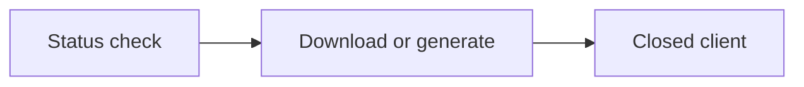

# Gemini Nano Prompt API

## What this topic is

Check FeatureStatus, download when the model is downloadable, stream or wait, and close() the client. The model is unavailable on some phones, including unlocked bootloaders.

## Why an Android AI engineer needs it

This is the on-device Gemini path, and it is absent on many devices.

## Diagram

## What you will change

- One prompt

## Pass condition

The status is shown, and a missing model stays on an explanation screen without a passed check.

## Sources

- [Get started with the Prompt API](https://developers.google.com/ml-kit/genai/prompt/android/get-started)
- [Prompt API overview](https://developers.google.com/ml-kit/genai/prompt/android)
