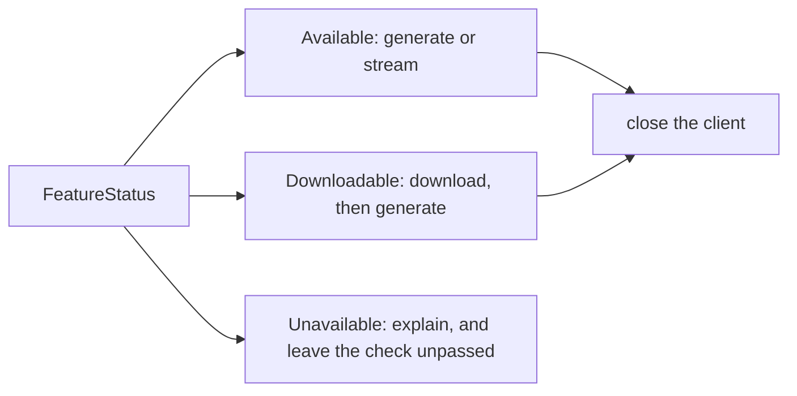

# Gemini Nano Prompt API

Gemini Nano is a model that lives on the device and is reached through ML Kit’s Prompt API. Your app does not ship the weights. The platform does, on phones where the feature exists. The first call is therefore a status check. You generate only after the feature is available, and you close the client when the work is done. A missing model stays on an explanation screen. That screen does not count as a passed check.

Suggested after [ML Kit task APIs](../lab-mlkit-tasks/README.md).

## Status, then download, then generate

`FeatureStatus` is the gate. Read it before you show a prompt box that implies the model is ready.

- **Available.** You can create the client and send the prompt.
- **Downloadable.** The model can be fetched. Start the download, show progress, and wait until the status becomes available. Generating during the download has no model to run.
- **Unavailable.** This phone will not run Gemini Nano. Unlocked bootloaders are one case the platform calls out. The UI explains that, and the lab’s check stays unpassed. Pretending the prompt ran is a broken bench.

After a real generation you can wait for the full reply or collect a stream of partial text. Streaming is how a long answer appears before the last token. Either way, the client holds native resources. Call `close()` when the screen is done, including when the user leaves mid-generation. A client leaked across configuration changes is a stuck model and a stuck status the next time you enter the screen.

## The prompt is still your text

The API sends the string you provide. The prompting lab’s habits apply: an instruction, a field name when you need a shape, and a token budget that fits the window. This lab’s input is one prompt. The pass is about the status path around it. The status is visible. If the model is missing, the explanation is what the user sees, and `markPassed` stays uncalled.

The testing lab builds on this. Unavailable, still downloading, and a known output are three cases your tests should hit so a phone in a lab drawer does not become a fake failure of the prompt itself.

## Status decides the next step

## What you will change

- One prompt

## Pass condition

The status is shown, and a missing model stays on an explanation screen without a passed check.

## Sources

- [Get started with the Prompt API](https://developers.google.com/ml-kit/genai/prompt/android/get-started)
- [Prompt API overview](https://developers.google.com/ml-kit/genai/prompt/android)
