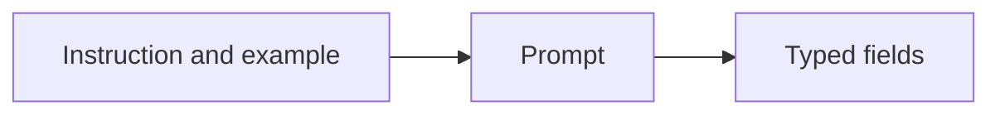

# Prompting and structured output

## What this topic is

An instruction, a few examples, and a requested shape change the answer. A typed shape is a contract the app can store.

## Why an Android AI engineer needs it

An Android app stores fields. A paragraph has to be parsed before it can be stored.

## Diagram

## What you will change

- One instruction
- A field name the answer must contain

## Pass condition

The drafted prompt contains the instruction and the field name.

## Sources

- [Prompt API](https://developers.google.com/ml-kit/genai/prompt/android)
- [Structured output](https://developers.google.com/ml-kit/genai/prompt/android/structured-output)
