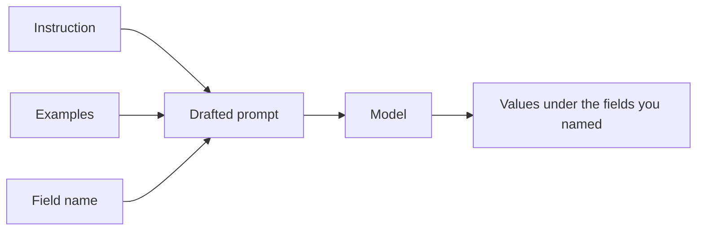

# Prompting and structured output

A prompt is the text you send, and small changes in that text change the answer. An instruction tells the model the job. A few examples show the shape of a good answer. A requested field name tells your app what it must be able to store. The lab checks the draft you build: the instruction and the field name are both in it.

Suggested after [Transformers, intuition](../lab-transformers/README.md).

## Three pieces you can point at

**Instruction.** One sentence that assigns the job and the boundaries. "Extract the city from the user message. Return only that city." is an instruction. "Help the user" is a mood. Models follow the first more often because it can be checked.

**Examples.** One or two pairs of input and the answer you wanted. This is few-shot prompting. If every example puts the city in a field called `city`, the next answer tends to do the same. Examples cost tokens. They share the context window with the instruction and the new user text, so a long example block can push the real question out of the window.

**A field name.** The app has to parse the reply. If you need a city, name the field `city` in the prompt and ask for that field. A paragraph that mentions a city somewhere is harder to store than a value sitting under a known name. The structured-output lab turns that request into a Kotlin type. This lab stops at the draft: the text of the prompt contains the instruction you typed and the field name you require.

Put them in an order you can re-read later:

1. The instruction.
2. The examples, if you need them.
3. The new user text.
4. The reminder of the field name.

The check is inclusion. If the field name only exists in your head, the draft fails.

## What a typed shape buys you

Free text comes back with extra words, apologies, and markdown. A typed shape is a contract: these fields, these types. Your database, your UI, and your tests can depend on `city` being present. When the model omits it, you have a failed parse, which is a result you can handle. When you never asked for the field, you have a paragraph and a guessing parser.

On Android, the Prompt API and its structured-output support are the platform version of this idea. You still write the instruction. The API helps bind the reply to a schema. This lab builds the habit before that API: the prompt itself names the field.

## From instruction to fields

## What you will change

- One instruction
- A field name the answer must contain

## Pass condition

The drafted prompt contains the instruction and the field name.

## Sources

- [Prompt API](https://developers.google.com/ml-kit/genai/prompt/android)
- [Structured output](https://developers.google.com/ml-kit/genai/prompt/android/structured-output)
