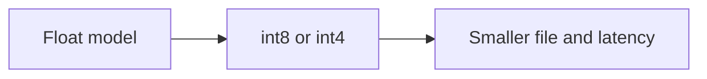

# Quantization, latency, memory, and battery

## What this topic is

Lower precision makes a model smaller and usually faster, and it can change answers.

## Why an Android AI engineer needs it

Phones ship int8 or int4 models because a float model often does not fit.

## Diagram

## What you will change

- A size in megabytes
- A bit width (32, 8, or 4)

## Pass condition

The estimated smaller size follows the bit-width ratio the screen states.

## Sources

- [LiteRT on Android](https://ai.google.dev/edge/litert/android)
