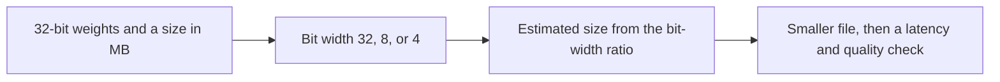

# Quantization, latency, memory, and battery

A model’s weights are numbers. Full precision stores each weight in 32 bits, four bytes. Quantization stores each weight in fewer bits, commonly 8 or 4. The file shrinks, the phone moves fewer bytes, and the run is often faster. The answers can change, because the weights are no longer the original values. You estimate the new size from the bit-width ratio, then you measure quality on the golden set before you ship the smaller file.

Suggested after [Evaluation](../lab-evaluation/README.md).

## The ratio

Bit width is the storage of one weight.

| Width | Bytes per weight | Size compared with 32-bit |
| --- | --- | --- |
| 32 | 4 | the original file |
| 8 | 1 | 8/32 of the 32-bit file, one quarter |
| 4 | 0.5 | 4/32 of the 32-bit file, one eighth |

If the screen states that the smaller size follows the bit-width ratio, apply that ratio to the size you typed. A 40 MB float file at 8 bits is 40 × (8/32) = 10 MB. The same file at 4 bits is 40 × (4/32) = 5 MB. The lab’s pass is that your estimate matches the ratio the screen states. Read the ratio on the screen and use that one, including the direction it names (smaller size from the original, or the factor itself).

The ratio is about weight storage. It does not include the runtime, the tokenizer, or the peak memory of the activation tensors. A 10 MB file can still want more than 10 MB of RAM while it runs. The estimate is the first filter, before you profile.

## What else moves

**Latency.** Less memory traffic often means a shorter run, especially when the phone is waiting on RAM rather than on arithmetic. The GPU and CPU labs measure that. Quantization is one reason those times change.

**Battery.** Moving and computing fewer bytes usually costs less energy per inference. A model you run on every camera frame cares about this more than a model you run once when the user taps Summarize.

**Answer quality.** Rounding weights moves the output. A classifier’s top label can flip. A generated sentence can drift. The evaluation lab is how you see the damage: same golden questions, score before and after the bit width changes. A smaller file that fails the golden set is the wrong trade.

Choose the width with those three in view. 32-bit is the reference. 8-bit is the common on-device default. 4-bit is a further cut that needs a closer look at quality.

## Float file to a smaller file

## What you will change

- A size in megabytes
- A bit width (32, 8, or 4)

## Pass condition

The estimated smaller size follows the bit-width ratio the screen states.

## Sources

- [LiteRT on Android](https://ai.google.dev/edge/litert/android)
