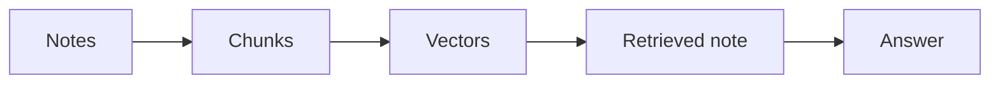

# RAG

## What this topic is

Split notes into chunks, embed the chunks, retrieve the closest ones, and answer from those chunks.

## Why an Android AI engineer needs it

This is the pattern the on-device RAG lab runs on the phone.

## Diagram

## What you will change

- Note 1
- Note 2
- Note 3
- Question

## Pass condition

The retrieved note is the one that shares the question's terms, and the answer quotes it.

## Sources

- [Retrieval-augmented generation](https://cloud.google.com/vertex-ai/generative-ai/docs/rag-overview)
