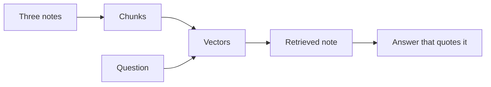

# RAG

A language model answers from its weights and from the text you put in the window. Your user’s notes are in neither, until you put them there. Retrieval-augmented generation does that on purpose. Split the notes into chunks, embed the chunks, retrieve the chunks that match the question, and write the answer from those chunks. The answer has to point at the text you retrieved. A fluent sentence that never touches the notes is a miss.

Suggested after [Prompting and structured output](../lab-prompting/README.md) and [Embeddings and similarity](../lab-embeddings/README.md).

## The five steps

**Notes.** Three short notes are enough to see the mechanism. One of them shares terms with the question. The others do not.

**Chunks.** A long note is cut into pieces that fit in the embedding model and leave room in the context window. A chunk can be a paragraph, a heading plus the paragraph under it, or a fixed number of tokens with a small overlap so a sentence on the boundary is not lost. This lab’s notes are already short, so each note can be one chunk. The idea is the same: the unit you embed is the unit you can quote.

**Vectors.** Each chunk goes through the embedding model from the embeddings topic. You store the vector next to the original text. The vector is for search. The text is for the answer.

**Retrieval.** The question is embedded with the same model, and you rank chunks by similarity. This lab’s check uses a visible stand-in for that ranking: the retrieved note is the one that shares the question’s terms. If the question says "battery" and only note 2 contains "battery," note 2 is the retrieved note. A production index uses cosine or another score from the embeddings lab. Term overlap is how you can see the choice with your eyes.

**Answer.** The prompt now contains the question and the retrieved note, and the instruction to answer from that note. The pass requires the answer to quote the retrieved note. Quoting is the audit. If the quote is missing, the model may have ignored the retrieval and answered from habit.

## A tiny example

- Note 1: "The stand is in hall B."
- Note 2: "The model file is 40 MB."
- Note 3: "Doors open at 9."
- Question: "How large is the model file?"

Note 2 shares the terms that matter. The answer has to quote "40 MB" or the sentence that contains it. "Models are usually small enough to download" fails the check, even if it sounds helpful.

## Where people skip a step

They embed the question and forget to embed with the same model used for the notes. They retrieve three chunks and never put them in the prompt. They put them in the prompt and accept an answer that cites none of them. Each of those still produces text. RAG is the discipline of tying that text to a chunk you can open and read.

The on-device RAG lab runs this same loop on the phone and keeps the vectors in a local index.

## Notes to an answer that quotes one of them

## What you will change

- Note 1
- Note 2
- Note 3
- Question

## Pass condition

The retrieved note is the one that shares the question's terms, and the answer quotes it.

## Sources

- [Retrieval-augmented generation](https://cloud.google.com/vertex-ai/generative-ai/docs/rag-overview)
