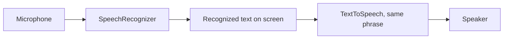

# Speech in and speech out

Speech in turns a microphone buffer into text. Speech out turns text into audio the speaker can play. Together they let a prompt start as something the user said and an answer end as something they hear. The lab uses one phrase. The recognized text is shown, and that same phrase is the one handed to speech output.

Suggested after [LiteRT LM](../lab-litert-lm/README.md).

## Speech in

`SpeechRecognizer` listens and returns a list of hypotheses, each a string with a confidence. You show the text you will actually send onward. The recognizer needs the record-audio permission, and on many devices it needs a network path to the recognizer service. A phone with the permission denied, or a recognizer that is unavailable, is an explanation screen. Silence and a fake transcript would poison every later step.

Partial results arrive while the user is still talking. Commit a final result when the recognizer ends the utterance, and send that final string. Sending every partial into a model call burns battery and answers a sentence the user had not finished.

## Speech out

`TextToSpeech` takes a string and speaks it. You initialize the engine, wait until it is ready, set the language, and call speak on the phrase. The phrase this lab speaks is the same phrase you recognized, so you can hear whether the round trip preserved the words. Queue mode matters: a second speak should either flush the first or wait behind it, and you should pick one and keep it. Shut the engine down when the screen is destroyed.

The text you speak can be the model’s answer rather than the echo. The pipeline is then microphone, recognized text, model, spoken answer. This lab checks the echo, because if the words already changed between recognizer and `TextToSpeech`, the model is not the component that lost them.

## Where a generative model fits

The recognized text is a normal prompt. It can go to Gemini Nano, to LiteRT-LM, or to a cloud model if the privacy label for that feature is cloud. The spoken reply is the model’s text passed to `TextToSpeech`. Token limits and the context window apply to the recognized string, which is often longer than the user thinks, because hesitations become words too.

## Microphone, text, speaker

## What you will change

- A phrase

## Pass condition

The recognized text is shown and the same phrase is the one sent to speech output.

## Sources

- [SpeechRecognizer](https://developer.android.com/reference/android/speech/SpeechRecognizer)
- [TextToSpeech](https://developer.android.com/reference/android/speech/tts/TextToSpeech)
- [ML Kit GenAI overview](https://developers.google.com/ml-kit/genai)
