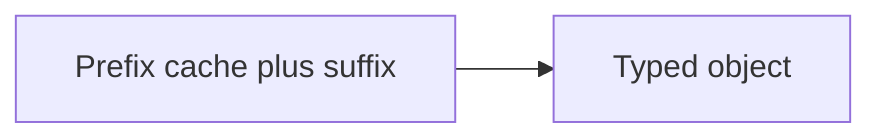

# Structured output and prefix caching

## What this topic is

A Kotlin type is the response contract. A repeated prefix can be cached apart from the changing suffix.

## Why an Android AI engineer needs it

Typed output is what you can save, and a cached prefix cuts the repeated cost.

## Diagram

## What you will change

- A prefix
- A suffix

## Pass condition

The screen shows a typed object, and the prefix is marked as the cached part.

## Sources

- [Structured output](https://developers.google.com/ml-kit/genai/prompt/android/structured-output)
- [Prefix caching](https://developer.android.com/agents/skills/device-ai/ml-kit-genai-prompt-api/references/prefix-caching)
