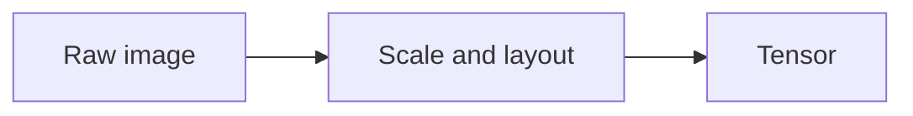

# Tensors, shapes, and preprocessing

## What this topic is

A tensor is an array with a shape and a dtype. A vision model also needs a known scale and channel order before the first inference.

## Why an Android AI engineer needs it

A wrong shape is the usual reason a first on-device inference fails.

## Diagram

## What you will change

- A shape such as 1x224x224x3
- A dtype name

## Pass condition

The shape's rank and element count match the text.

## Sources

- [Machine Learning Glossary](https://developers.google.com/machine-learning/glossary)
- [LiteRT on Android](https://ai.google.dev/edge/litert/android)
