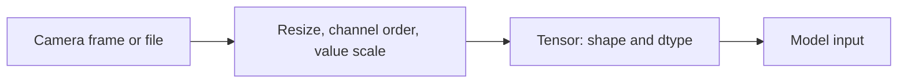

# Tensors, shapes, and preprocessing

A model does not see "a photo of a cat." It sees a block of numbers with a shape and a number type. That block is a tensor. If the shape or the type disagrees with the model card, the run fails immediately or, worse, succeeds and returns nonsense. Preprocessing is the work that turns a camera frame into the block the card asked for.

Suggested after [Inference and a model card](../lab-inference/README.md).

## Shape is a list of lengths

A shape is the size of each axis, written in order. `1x224x224x3` means four axes:

| Axis | Length | Meaning in a common vision layout |
| --- | --- | --- |
| 1 | 1 | One image in the batch |
| 2 | 224 | Height in pixels |
| 3 | 224 | Width in pixels |
| 4 | 3 | Red, green, and blue |

**Rank** is how many axes there are. `1x224x224x3` has rank 4. **Element count** is the product of the lengths: 1 × 224 × 224 × 3 = 150528 numbers. The lab checks those two facts against the text you type. A shape of `224x224` is a different tensor: rank 2, and 50176 elements. Same picture, wrong object.

Layouts differ. NHWC orders the axes as batch, height, width, channels. NCHW puts channels before the spatial axes. A model trained in one layout will read the other layout as a scrambled image. The card, or the model's input spec, says which layout you must produce.

## Dtype is the type of each number

The dtype is how each element is stored.

- `float32` uses 4 bytes. 150528 elements are about 0.6 MB for that one input.
- `float16` uses 2 bytes.
- `uint8` and `int8` use 1 byte. The same shape is four times smaller in memory than `float32`.

The model’s input tensor has one dtype. Feeding `float32` values into a tensor allocated as `uint8` is a different buffer than the model will read. Name the dtype from the card, then allocate that type.

## Preprocessing is part of the model

The weights were trained on pixels prepared a certain way. You have to repeat that preparation.

1. Decode the camera frame or file into pixels.
2. Resize or crop to the height and width on the card. A 4000×3000 photo is not a 224×224 tensor until you scale it.
3. Reorder channels if the card wants RGB and the camera gave you a different order.
4. Scale the values. A common pair of choices is 0–255 kept as bytes, or divided into 0–1, or mapped into −1–1. The model learned one of those. The others shift every activation.
5. Pack the numbers into the shape and dtype, including the batch axis of 1 when you run a single image.

Skip the scale step and the model still returns 1000 scores. They will not match the labels you tested on the desktop.

## How a frame becomes an input

## What you will change

- A shape such as 1x224x224x3
- A dtype name

## Pass condition

The shape's rank and element count match the text.

## Sources

- [Machine Learning Glossary](https://developers.google.com/machine-learning/glossary)
- [LiteRT on Android](https://ai.google.dev/edge/litert/android)
