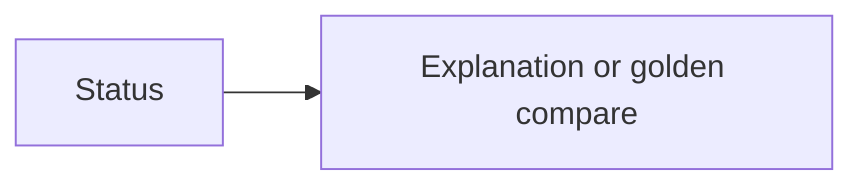

# Testing a missing or known model

## What this topic is

Tests cover feature unavailable, still downloading, and a golden output.

## Why an Android AI engineer needs it

Gemini Nano and a bundled model are often absent. The screen still has to explain that.

## Diagram

## What you will change

- A status (unavailable, downloading, or ready)
- A golden output

## Pass condition

Unavailable and downloading fail the check with an explanation, and ready passes only when the output matches the golden value.

## Sources

- [Android app testing](https://developer.android.com/training/testing)
