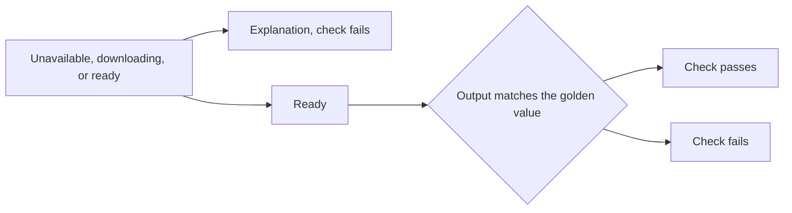

# Testing a missing or known model

An AI feature has a result when the model is missing. The result is an explanation, and the check does not pass. The same feature, once the model is ready, passes only when the output matches a value you wrote down in advance. Tests are how those branches stay true after you refactor the screen.

Suggested after [AppFunctions](../lab-appfunctions/README.md), [Gemini Nano Prompt API](../lab-prompt-api/README.md), and [LiteRT on CPU](../lab-litert-cpu/README.md).

## Three statuses

You type a status and a golden output.

**Unavailable.** The Prompt API reports that Gemini Nano will not run on this phone, or the `.litertlm` / `.tflite` file is absent and cannot be fetched. The test asserts an explanation is what the UI would show, and that the check fails. A test that only asserts "no crash" will stay green when you accidentally mark the lab passed.

**Downloading.** The model is downloadable and the bytes are still arriving. The test asserts the same kind of explanation, or a progress state, and again a failed check. Generating against a half-downloaded file is the bug this status exists to catch.

**Ready.** The model can run. The test feeds a known input and compares the output to the golden value you typed. Ready passes only on that match. A ready status with the wrong text, the wrong label, or a buffer whose length disagrees with the output shape fails. Golden output is the evaluation lab’s expected answer, pinned to one input so a unit test can run it every time.

The pass condition is that whole table: unavailable and downloading fail with an explanation, and ready passes only when the output matches the golden value.

## What to pin

Pin the input as well as the output, even though this lab’s fields are the status and the golden string. For a classifier, the golden value might be the label `cat` for a fixture image. For a prompt, it might be the field `city = "Amman"` for a fixture sentence. For LiteRT, it might be the length of the output buffer for a fixture shape. Exact match is the comparison unless you have written down a different one. A test that accepts any non-empty string goes green the day the model starts returning an error message.

Use a fake client in the unit test. The fake returns the status you asked for and, when ready, the golden output or a wrong output. You do not need a device farm to prove the explanation branch. You need a device run, later, to prove the real client’s status matches what the fake taught the UI to do.

Keep the golden fixtures small and in the test source. When you change the instruction or the model file, update the fixture in the same change. A stale golden value fails the test, which is the point.

## Status branches

## What you will change

- A status (unavailable, downloading, or ready)
- A golden output

## Pass condition

Unavailable and downloading fail the check with an explanation, and ready passes only when the output matches the golden value.

## Sources

- [Android app testing](https://developer.android.com/training/testing)
