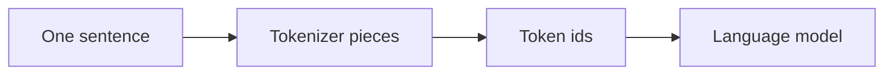

# Tokens

A language model does not read letters. It reads a list of integers called token ids. A tokenizer is the function that turns your sentence into that list, and turns the model's output ids back into text. Two tokenizers can split the same sentence into different counts. The count is the one that fills the context window and the bill, so you measure it with the tokenizer you will actually ship.

Suggested after [Tensors, shapes, and preprocessing](../lab-tensors/README.md).

## From characters to ids

Take the sentence "Don't ship the model yet."

A character count is 26, including spaces. A word count is 5. A tokenizer might emit something closer to:

`Don` · `'t` · `ship` · `the` · `model` · `yet` · `.`

or a tighter split, or a single id for "Don't" if that string was common in its training data. Each piece has an integer id in a fixed vocabulary. The model’s input tensor is those ids, usually with a batch axis, and sometimes with a length axis that you pad to a maximum.

The pieces are not a stable property of English. They are a property of the vocabulary file that was built with the model. Swap the tokenizer and the ids change. The model then attends to a sequence it was never trained to see.

## Why the count matters on a phone

Three practical limits are counted in tokens, not in characters.

**The context window.** The transformer lab treats this directly: a window of 1024 tokens cannot hold a 1024-token prompt plus a long answer. If you budget in words, you will overflow and the model will never see the end of the prompt, or the start of it, depending on what you truncate.

**Latency and battery.** More input tokens means more work per generated token. A prompt you thought was "one sentence" can be 80 tokens once you paste a stack trace into it.

**The Gemini Nano path.** The Prompt API accepts text from you, and the platform tokenizes it. You still need the idea, because a prompt that looks short in the editor can be long in tokens, and structured output spends tokens on the schema as well as the user text.

Special tokens also take slots: beginning of sequence, end of sequence, padding, and sometimes a separator between the instruction and the user text. A sentence-piece or byte-pair vocabulary decides those rules. The lab’s splitter is the authority for the check. The count on screen has to equal that splitter, not a hand count of words.

## How a sentence enters the model

## What you will change

- One sentence

## Pass condition

The shown token count equals the splitter used by the lab.

## Sources

- [Machine Learning Glossary](https://developers.google.com/machine-learning/glossary)
- [Prompt API](https://developers.google.com/ml-kit/genai/prompt/android)
